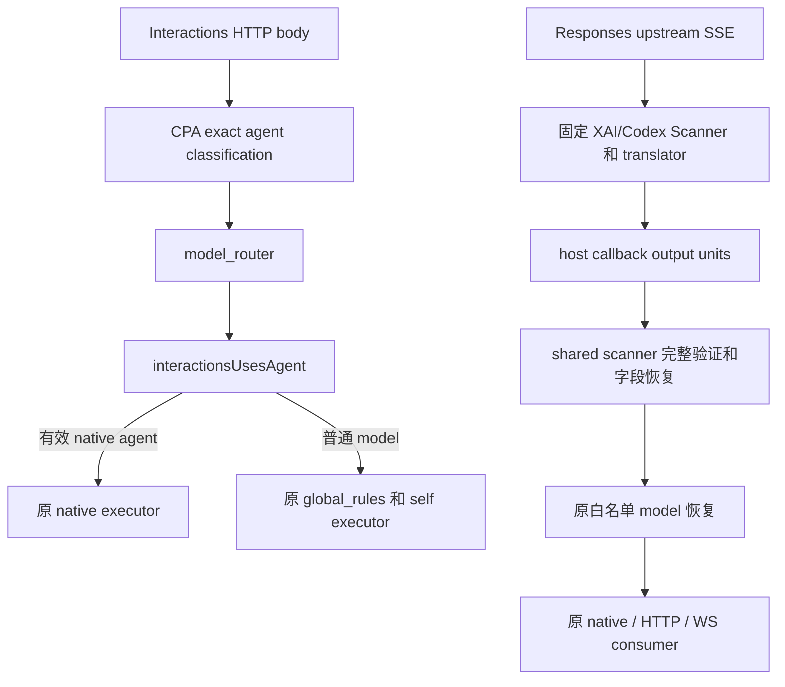
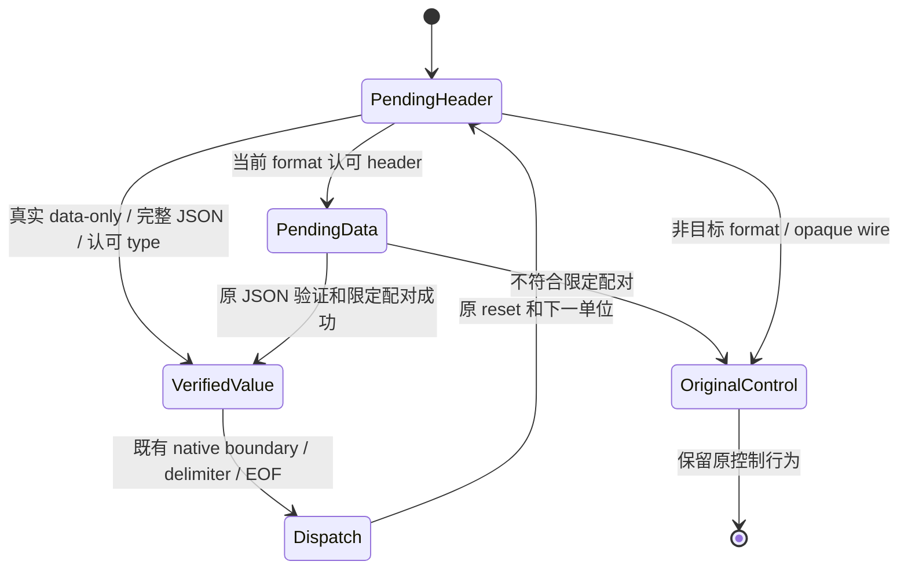
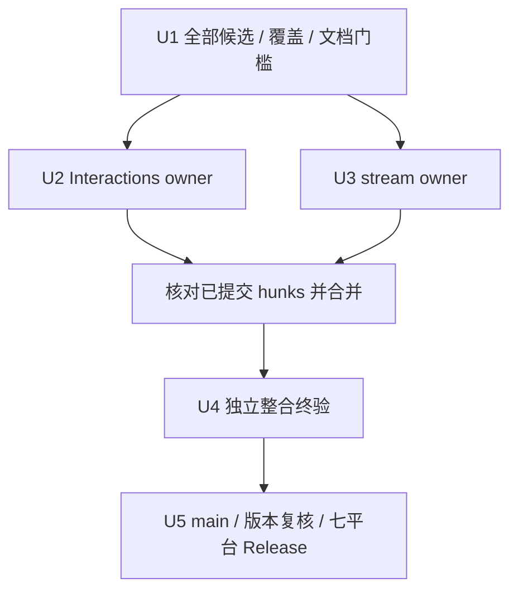

# 功能审查修复实施计划 - Plan

## Goal Capsule

- **Objective：**使用 Model Mapper 的客户端收到完整 Responses 错误／完成数据，普通 Interactions model 正确映射，真实 native agent 正常执行。
- **Means：**在当前 shared scanner 和唯一 agent helper 修复 F1-F3，分别由两个互不修改相同位置的 owner 完成（KTD1-KTD4）。
- **Authority：**产品行为由 `docs/superpowers/specs/2026-10-11-functional-audit-fixes-design.md` 的 R1-R14 约束；本计划安排实施和核验。发布动作由协调者核对真实用户授权，不以 workflow 文本、完成通知或旧文档替代。
- **Execution profile：**每个 coding owner 使用独立 Git worktree，连续完成正式 TDD、最小实现、测试、规格／质量审查、修正、复审与提交。协调者只合并完成任务，终验 owner 负责整合验证，协调者负责最终 main 和发布。
- **Stop conditions：**二次覆盖审查、全部候选判定或 spec/plan 审查尚未完成时不开始产品编码。同一真实入口出现可靠相反要求、关键 producer 对照不成立、修改需要扩大到 CPA 或共享位置发生冲突时，保留证据并交协调者更新范围和依赖。

---

## Product Contract

### Summary

完成 F1 的 Responses 非 `response.*` 逻辑事件（error、keepalive）边界识别、F2 的单向 done/completed alias 和 F3 的 CPA-compatible agent 分类。永久测试复现基线失败，并用真实 producer、native DLL、HTTP/WS 对照和完整旧 integration 验收修复。

### Problem Frame

当前映射流丢失 XAI 原始错误，非 Grok Codex 的 keepalive 与后续 completion 被合并，正常 done/completed alias 被当作 mismatch。Interactions guard 与固定 CPA parser 对同一 body 作不同判定，造成普通 model 漏映射和真实 agent HTTP 400。独立诊断已复现这些失败；当前产品尚未实施本次修复。

### Requirements

完整需求保留在 origin spec，编号和范围不变。本计划不另定义协议、配置或 Google API 功能。

| 需求 | 实施单元 | 直接验收 |
| --- | --- | --- |
| R1，非 `response.*` error／keepalive 边界 | U3 | AE1、AE7；pair 和连续 data-only 的 exact bytes；XAI error native/HTTP，非 Grok Codex keepalive/completion HTTP/WS；error-only WS 既存边界单独报告。 |
| R2，done/completed 单向 alias | U3 | AE2；完整 output/model/header/type；Codex HTTP/WS 正常完成。 |
| R3-R4，mismatch／generic wire／派发与内容保护 | U3、U4 | AE3；原 discriminator、metadata、mixed、wire 分片、data-only 和 format isolation 控制。 |
| R5-R7，agent 分类与 native bypass | U2 | AE4-AE6；root helper/route；真实 model/native HTTP；invalid 和非 string 分类边界。 |
| R8-R10，JSON、错误、接口、依赖与现有行为 | U2、U3、U4 | 全量 root、headers、opaque/ownership、原 lifecycle、ABI/register/schema 和三个 scripts。 |
| R11，独立 worktree／完整 owner 交付 | U1-U4 | 固定 BASE..最终 HEAD、无位置冲突、真实 RED/GREEN、审查修正复审、任务提交。 |
| R12，完整终验与旧集合 | U4 | 24 原 functional、2 bridge、四份 captures 精确 key，加独立新 terminal test。 |
| R13，版本与占用核查 | U4、U5 | 注入候选版本前及发版前两次核对，registration/package 和最终资产。 |
| R14，main／CI／Release 及保护边界 | U5 | 最终 SHA、七平台 CI、ZIP/checksum/根 LICENSE/Version；不创建 PR。 |

### Scope Boundaries

只修复 origin spec 的三根因，沿用原产品结构。无需新增配置、mode、provider-specific 产品分支、parser、Error/Done 转换、retry 或 executor guard。fixed CPA 的 error-only WS 行为按 R1/AE1 保持，不把该既存限制变成新功能。

不修改 CPA/cache、ABI、CI、Makefile、其他 worktree、`.claude` 或用户配置，不处理本机既有删除故障。外部真实模型账号请求、跨平台 runtime 与当前 Windows 本地诊断不同，报告按实际执行层区分。

---

## Planning Contract

### Key Technical Decisions

- KTD1. F1/F2 由同一 stream owner 修改 shared scanner 的两个 header 谓词和 type/matched 判定。F1 同时覆盖 pair 和连续 data-only，新增无 header type 许可只用于真实 data-only 位置（R1、R3）；复用原完整 JSON 验证、增量游标、`rewritePendingEvent` 和模型恢复器。两个问题修改同一识别位置，分成并行产品任务会产生冲突。Governs R1-R4、R8-R10。
- KTD2. F3 只修改 `interactionsUsesAgent`，直接使用 `github.com/tidwall/gjson v1.18.0` 的 validity／exact-key lookup／`String()`，复用 `strings.TrimSpace`。固定 CPA 使用同版本，Go struct 不能保留已核验的 first-wins/exact-key 语义；不开发自制 first-wins parser。Governs R5-R7、R10。
- KTD3. Interactions owner 负责 `main.go` imports/helper、旧 Agent root 用例、新独立 regression、module 文件及唯一 fixture 的 Agent 函数和必需 GJSON import。stream owner 不改这些位置，fixture 只新增独立 terminal test。Governs R11。
- KTD4. terminal fixture 使用已有 `gCPANewLocalProducer` 的 custom `p.wire`，不改 public helpers 或 imports。每 case 在请求开始前加锁设置 fixture/wire/records；`setFixture` 不清空 wire，因此每 case 显式设置或清空，custom wire 的实际 model 由 case 自己生成。Governs R1-R4、R11。
- KTD5. 新 native 测试保留唯一 smoke/overlay 入口和 parent-lifetime canonical library，沿用顺序 Host 初始化和真实 cleanup。不新增子测试 DSO copy、共享 `t.Parallel`、cached Host 或第二入口。Governs R9、R12。
- KTD6. 两个编码任务达到全部 owner 完成条件后合并，终验由新的独立 owner 完成；对外发布由协调者执行现有 tag workflow。新增检查不降低旧测试规模、内部 timeout、allocation 门槛或内容断言。Governs R11-R14。

### High-Level Technical Design

两条请求路径复用现有系统边界；产品变化只有分类和字段识别，消费者与 ABI 保持。



scanner 的完整值、dispatch 和错误保留分属现有状态；本次只调整哪些已验证 header/type 配对可进入原路径。



任务依赖以实际修改位置为依据。U2/U3 的写入位置已分开；新共享位置须先重新分配。



### Assumptions and Execution-Time Facts

- 本计划采用已确认的固定 CPA v7.2.152 行为；将来升级 CPA 时需以新 producer/parser 重新核对，本次不升级。
- owner 的 worktree 名称、BASE 后的整合 SHA、正式测试源码、DLL hashes、最终版本和 CI/Release IDs 由实际执行产生，不预填。
- `v0.5.14` 是待核实占用的候选，不能在核对前写成最终发布版本。
- 完成报告中的原诊断 worktree 已有清理；新的 owner 重新取得正式 RED/GREEN。保留结果与原日志缺失分别说明，原诊断不充当实现完成证据。

### Exact Ownership

| owner／单元 | 可修改文件和位置 | 保持不改／交接条件 |
| --- | --- | --- |
| U1，协调者和文档审查 | 当前 spec/plan；审查结果 | 不改产品/tests；全部候选终态、二次覆盖和五位独立文档审查完成，阻塞问题修正并复审通过后才分派编码。 |
| U2，Interactions | `main.go` imports（3-24）及 `interactionsUsesAgent`（1716-1721）；`main_test.go` 的 `TestHandleModelRouteLeavesInteractionsAgentsNative`（1820-1853）；新 `interactions_agent_regression_test.go`；`go.mod`／`go.sum`；fixture imports 和 `TestModelMapperFunctionalInteractionsAgent`（1932-2027）。 | 不改 `handleModelRoute` caller、executor、scanner、stream regression、公共 CPA helpers。 |
| U3，stream | `main.go` 的 `sseRewriter.Write`（198-269）和 `findDelimiterlessResponsesEventEnd`（583-778）的必要识别；`stream_native_fields_regression_test.go` 的独立新增用例；fixture 新 `TestModelMapperFunctionalResponsesTerminalFields` 及本测试专用局部代码。 | 不改 imports、Agent 函数、module、`main_test.go`、公共 producer/loader/helper、生命周期、batching 和恢复器。 |
| U4，终验 | 新整合 worktree 的实际证据、必要验收操作 | 产品回归交对应 owner 在其 worktree 修正、复审、提交；主会话不补半成品代码。公共入口确需改变时先更新单 owner 所有权。 |
| U5，协调者 | 经授权的 local main、remote main、tag、Release 验收 | 不创建 PR、force push、移动既有 tag、改 CPA 或删除其他已有工作区。 |

行号只标识 BASE 的核查位置，实施以符号与实际 hunks 为准。两个 owner 可以在同一文件不同已分配位置并行；合并前比较完整 BASE..HEAD。fixture imports 只归 U2，U3 使用现有 imports。出现公共 helper 或同一函数共同修改需求时，先交协调者按依赖或单 owner 更新所有权，再继续。

---

## Implementation Units

### U1. 完成候选、覆盖和规划门槛

**Goal：**编码起点只包含已复现、独立反证确认、可在插件内安全修复的 F1-F3。

**Requirements：**R11，Goal Capsule 的停止条件。

**Dependencies：**完成全部审查候选判定和二次源码覆盖结果；收到后台完成通知。

**Files：**本 spec/plan；现有全量审查的 scope/coverage 证据只读。

**Approach：**

1. 将全部检查域、源码与 CPA 必要路径逐项对应到已完成结果，补查缺失范围。候选均有明确终态，不能用抽样代替全面覆盖。
2. keepalive 诊断安全回归以 origin spec 所记 a2 完成 ZIP 的实际 source／exit 为依据，协调者已确认该门槛和二次扫描覆盖满足。F1 仍限定 error／keepalive 的 pair、连续 data-only 和 actual Grok comments 对照；原诊断不替代 owner 的正式 TDD。
3. 文档 owner 完成 inline spec／计划自审、修正、复审与本次文档提交，核对 R/AE/U 对应、所有 callers 和精确所有权。提交后由协调者收集五位独立规格／计划 reviewer 的结果；全部完成且阻塞问题修正、复审通过后才允许 U2/U3 开始编码。当前独立文档审查尚未执行。
4. 向 U2/U3 同时交付同一含最终文档的已审查整合 HEAD、原始 BASE、完成条件和限定修改位置。二者各自独立 worktree，保护既有 worktree 和用户改动。

**Test expectation：**本单元不修改或运行产品 tests；核验文档 frontmatter、真实 paths/symbols/test names、diff 和证据完整性。

**Verification：**全部检查范围和候选终态可核查，文档无阻塞问题且已提交；U2/U3 只能在满足本单元后开始编码。

### U2. 统一 Interactions agent 分类并保存真实 native 回归

**Goal：**普通 model 正常映射，有效 native agent 保持原执行路径。

**Requirements：**R5-R11，AE4-AE6，KTD2/KTD3/KTD5。

**Dependencies：**U1；与 U3 并行，使用同一已审查起点。

**Files：**Exact Ownership 的 U2 文件。相关现存 tests 包括 `TestHandleModelRouteLeavesInteractionsAgentsNative`、`TestHandleModelRouteIgnoresUnusedBody`、`TestHandleModelRouteSkipsClaudeCountTokens` 和 fixture 的同名 Agent 函数。

**Execution note：**先在当前未修复产品上写正式失败测试并运行。修正 whitespace 的旧 expected 本身属于 RED 阶段；private overlay 的成功结果不代替正式 TDD。

**Approach：**

1. 核对初始 HEAD、Git clean、fixed CPA module/version，并重新检查 helper 唯一 caller 和 route -> executor 流程。保留完整 BASE 和起点，不使用 `HEAD~1` 作为累计审查范围。
2. 在新独立 root regression 定义 `TestFunctionalInteractionsAgentClassification` 和 `TestFunctionalInteractionsAgentRoute`；同时只将旧 `whitespace agent` expected 改为 true。分类预期来自 R5-R7，不使用当前产品函数生成 expected。
3. 扩展唯一 fixture 的 Agent 函数，保留旧唯一 lowercase agent 流／非流。fake upstream 改用 case 的 raw byte 断言和同版 GJSON 分类，修正其 struct last-wins test oracle；fixture 新增 import 归本 owner。
4. 用新 root 和真实 native Agent fixture 在 BASE 产品取得目标 RED，保存日志、overlay、源和 DLL 身份。环境 setup failure、CPA 入口400控制和目标 selfroute400分别记录。
5. 只替换 shared helper，直接 require/import GJSON v1.18.0，以正常 module 流程生成 sum；核对新增条目，不升级 CPA 或无关依赖。helper 不改 body、不新增 executor guard。
6. 同样命令取得 root 与 native GREEN；运行关联和全量 root/vet/race、三个 scripts、注册及本 owner 关联 integration。检查 R5-R10 的旧行为和全部新 Agent 对照。
7. 完成规格／质量审查，修正、重测和复审，在自己的 worktree 正常提交本任务文件，主动回报 commit、完整 diff、实际 RED/GREEN、命令/exit/identity 和限制。

**Test Scenarios：**

1. Covers AE4。missing／empty／纯空白／null + model：helper false，匹配规则时 self route，实际 upstream model 被映射，下游 model 恢复。空白分别覆盖 ASCII space、Tab、换行、NBSP、Em Space 和 Ideographic Space。
2. 只有 `Agent`／`AGENT` 或 escaped uppercase key + model：未知 key 不触发 native guard。
3. escaped decoded lowercase `agent`：与 lowercase 相同，trim 后非空仍 native。
4. 首 lowercase agent empty 后非空、首 null 后非空、首空白后非空：按照第一个值选择 model 路径。
5. Covers AE5。首 lowercase agent 非空后 empty／null／其他值：native guard 保持；后续 `Agent`／`AGENT` 空、null、bool、number、object、array 不覆盖 lowercase agent。
6. 唯一正常 agent、trim 后正常 agent，以及普通 model／有效 string agent 的各重复和大小写 case：stream/nonstream，direct／disabled／enabled-unmapped／mapped 配置。逐项按 R5 判定 model mapping 或 native bypass，核查完整 response/SSE 和原 body/calls/URI/header。
7. Covers AE6。invalid JSON 返回 false；null+model 正常；nonstring+model 的固定入口 400 保持。agent-only nonstring 只检查同 CPA 分类，不宣称 Google API 接受。
8. 未匹配／identity／`count_tokens`／其他formats不受 guard修改影响，普通 Interactions 仍只选择 global rules。

**Verification：**目标 root/native RED 来源明确，固定 helper 后全部对照GREEN；module只有必要GJSON变更，无重复helper，全部owner步骤和提交完成。

### U3. 恢复 Responses 非 response.* 事件和完成别名

**Goal：**F1 error 保留原错误数据，keepalive 后的 completion 正常到达；F2 完整 completed 可由 HTTP/WS 识别。

**Requirements：**R1-R4、R8-R11，AE1-AE3、AE7，KTD1/KTD4/KTD5。

**Dependencies：**U1；与 U2 并行。F1/F2 在本 owner 内连续完成，不能并行修改同一 scanner。

**Files：**Exact Ownership 的 U3 文件；相关现存 controls 为 `TestFunctionalNativeSSEFieldDiscriminator/mismatch-control`、`TestFunctionalNativeSSEFieldDataOnlyTypeControl`、`TestFunctionalNativeSSEFieldFormatIsolation`、`TestFunctionalNativeSSEFieldWireControls`、ordinary/mixed metadata、limit/continuation/dispatch，以及 forwarder/error 回归。

**Execution note：**正式新 tests 在 BASE 产品证明 exact-byte/native/HTTP 目标失败后才改 scanner；重新保留证据，不依赖已清理 worktree 的日志。

**Approach：**

1. 新增 root `TestFunctionalNativeSSEFieldError`、`TestFunctionalNativeSSEFieldKeepalive`、`TestFunctionalNativeSSEFieldDoneAlias`、`TestFunctionalNativeSSEFieldTerminalDispatch`、`TestFunctionalNativeSSEFieldTerminalForwarder`。复用 `gNativeParts` 和既有 helpers，不更改旧 mismatch expected。
2. 唯一 CPA fixture 新增独立 `TestModelMapperFunctionalResponsesTerminalFields`，复用真实 XAI/Codex producer、custom wire、canonical loader、native drain 和 HTTP/WS helpers。每 case 在请求前加锁设置或清空 wire、records 和 fixture，wire 的 model 随 case 生成，不依赖 disabled 路由改写。
3. BASE DLL 与新 root/fixture 取得正式 RED，证明 keepalive pair 和连续 data-only 均失败。核对真正非 Grok producer 原始单位、validator、direct／disabled／unmapped、actual Grok comments、no-keepalive 和 data-only 普通 completion 对照。记录每条路径的实际状态和错误，不统一指定 RED 状态码。
4. 按 R1/R3 修改两个 header 谓词与 data-only type 谓词，只为精确 error／keepalive 增加逻辑单位许可；新增无 header 许可仅用于真实 data-only 位置，保留 opaque header 控制。在原完整 JSON 的 matched 判定加入 R2 单向例外，复用原恢复／派发；无 model marker 的 error／keepalive 同样正确处理。
5. 新 tests 取得 GREEN 后，核查所有现存 scanner 分支、reset、EOF、错误与派发；运行关联 unit、性能／allocations、三个 scripts、全量 root／vet／race 和本 owner 的真实 terminal integration。
6. 规格／质量审查核对三处谓词、真正 mismatch、原 header/data.type、opaque 字节、generic wire、其他 formats 及所有 chunks+error 上层调用。修正后重测、复审和提交，主动回报证据与精确修改位置。

**Test Scenarios：**

1. Covers AE1。独立 error/error pair 与 data-only，单 terminal、created 后 error、Flush／Finish；code/message/param 原字节保持，无 model marker 也有效。
2. Covers AE2。done/completed 单 terminal 与 created 后 completion；原 header 保留，type 为 completed，所有允许 model 恢复，完整 output／opaque 数字表示保持。
3. Covers AE7。keepalive pair、连续 data-only 和两者合法交替后接完整 completion；native 两个 data 单位有效，HTTP/WS 获得完整 completion，keepalive 原文保持。不能只添加 pair 测试。
4. 每次 Write 后检查累计有效 data、顺序和完整内容，metadata 不增加 data 帧，data-only 时点沿用原策略；迟到 LF/CRLF 不重复派发。
5. Covers AE3。原 `Discriminator/mismatch-control`、reverse alias、unknown/missing/null/nonstring type；error／keepalive header 配其他 type 仍为 mismatch，opaque header 被清空的 discriminator 不获得新增许可，闲置 `event_type=17/false` 保持 opaque。
6. LF/CR/CRLF 标准 wire，whole／全部双分片／bytewise、BOM、前置及 in-event/between-event metadata 和 opaque comment；generic callback read 不变成新增字段边界。
7. callback/in-band 错误、Payload+Done、完整前缀+incomplete tail、16MiB 限额、完整大单位、ownership、增量游标与 batching；原错误和关闭策略不变。
8. 真正 XAI error、非 Grok Codex keepalive、done alias 与普通 completed，field-pair/data-only、terminal-only/after-created、whole/bytewise 网络写入，direct／mapped／unmapped／disabled 两个实际 model。检查原始 callback 单位、HTTP 状态与错误、type/event/model、完整 output 和 upstream 请求；actual Grok comments 与无 keepalive 控制保持。
9. error-only WS 保持 fixed direct 的 1006 边界；keepalive+completion 和 F2 mapped WS 必须收到完整 completion，与正常 direct／disabled／unmapped 对照。不得将所有路径的预期统一为 `wsErr=nil`。

**Verification：**新 error／keepalive／alias root 与真实 producer/native/HTTP GREEN，keepalive 和 F2 WS 正常完成，error-only WS 边界准确；全部原控制与性能门槛保持，审查、修正、复审和提交完成。

### U4. 合并完成任务并执行独立整合终验

**Goal：**最终整合源码、永久tests和候选版本产物满足所有R/AE。

**Requirements：**R8-R13，KTD5/KTD6。

**Dependencies：**U2、U3最终审查提交；协调者核对完整hunks无冲突后合并。

**Files：**最终整合源码；既有 `.github/scripts/smoke-local_test.go`、唯一CPA fixture、Makefile/package/compatibility、ABI/register tests只验收。证据保存在owner的专用ignored `dist/functional-audit-fixes-20261011/`，诊断Go文件使用独立module，不能污染原`./...`包集合。

**Approach：**

1. 在新独立worktree核对最终整合HEAD，记录原BASE、两个owner commits、完整diff；不接收未完成源码。源码问题由对应owner连续修正、复审、提交后重新合并。
2. 执行Verification Contract全部本地命令，完整race使用30分钟总timeout；不降低内部timeout或删除旧断言。
3. 运行原`make integration`，保留fixed CPA clean/revision guard。overlay只指向自有可写副本，不能replace或改写module cache。完整验证原24/2、6456精确keys、新terminal顶层test和Agent子测试。
4. 验证真实 ABI init/register/schema/config/default Version 及 Windows c-shared，记录 source/artifact/shadow DLL 身份。native 与 race 分层；保留 canonical lifecycle、reconfigure 和 bridge 控制，以及 backpressure 分支首次 unload 后按顺序读尽已接收的 17 帧并保留 terminal error 的断言。
5. 在候选VERSION注入前核对v0.5.14的local/remote tag和Release未占用。用核实后的实际版本build/package，校验注册Version、ZIP根目录、LICENSE、checksum与兼容性。
6. 全量规格/质量和累计BASE..最终HEAD审查，修正后重跑受影响检查并复审；确认各R/AE的证据、未知/缺失和真实限制。完成后向协调者交付终验结果，不自行推送或tag。

**Test Scenarios：**原完整native/HTTP/WS/binary captures、新F1-F3、registration/schema/version injection、Windows loader、package与compatibility；全部均使用当前整合源码和正式永久tests。

**Verification：**全部命令真实exit0，精确集合无unknown/duplicate/missing，新旧内容断言全部通过；版本化package与默认build分别有真实注册证据，累计审查无未解决阻塞项。

### U5. 完成本地 main、七平台 CI 和 Release 验收

**Goal：**发布包含已验证F1-F3修复的可安装Plugin Release Package。

**Requirements：**R13-R14；R12终验作为前置。

**Dependencies：**U4，最终分支审查，真实用户的push/tag/Release授权。

**Files：**现有Git refs、`.github/workflows/build.yml`生成资产；不修改CI或产品。

**Approach：**

1. 核对授权、local/remote main和所有既有修改；按用户指示退出协调worktree并保留已有内容，将最终已验证提交合并到本地main。无需创建PR。
2. 发布前再次查询local/remote tag和Release占用；候选被占用时重新核对未占用patch，并重做相应VERSION注入build/package验收，不覆盖旧tag。
3. push main和新tag，记录最终SHA与workflow run身份，核验main/tag指向已验收源码。等待实际完成通知；不通过sleep或反复读取后台输出检查本会话任务。
4. 确认最终SHA的test/integration及七平台build成功，tagRelease成功。七平台逐项核对，不以单个Windows或Linuxbuild代替其余平台。
5. 下载所有ReleaseZIP及checksums到本任务新空目录，使用可靠ZIP/parser和SHA256核查完整资产集合、archive basename、根库/根LICENSE、版本metadata和适用compatibility结果。可实际加载的平台验证注册Version；不能实际加载的平台明确说明所用元数据证据和runtime限制。
6. 汇报实际main/tag/Release SHA、版本、CI/Release URL、资产校验和运行限制。失败保留真实状态，不force push、移动既有tag、删除用户文件或处理无关本机删除故障。

**Verification：**localmain、remotemain、tag和Release最终SHA一致，七平台CI成功，全部ZIP/checksum/LICENSE/Version验收完成；任何未执行的runtime或资产检查明确列出，不把发布按钮成功当完整验收。

---

## Verification Contract

命令从执行者自己的worktree根运行，Go/cgo/CC使用现有可用环境。每条保存真实argv、cwd、时间、数字exit和输出；工具拒绝或尚未启动的exit为未知，不能写成0。本次规划不执行这些命令。

### Focused TDD and Controls

以下测试名称中的新名称是计划新增，U2/U3实际实现时不得与既有符号重复；既有名称已在BASE核查。

| 单元 | 命令或入口 | 必需结果 |
| --- | --- | --- |
| U2新root和旧expected修正 | `go test . -run '^TestFunctionalInteractionsAgent(Classification|Route)$|^TestHandleModelRouteLeavesInteractionsAgentsNative$' -count=1 -v` | BASE目标RED，fixed全部GREEN，未因无关setup失败停止。 |
| U2真实native | fixed CPA自有overlay的 `^TestModelMapperFunctionalInteractionsAgent$`，至少重复两次 | stream/nonstream model/native路径、原body、controls全部GREEN。 |
| U3新root | `go test . -run '^TestFunctionalNativeSSEField(Error|Keepalive|DoneAlias|TerminalDispatch|TerminalForwarder)$' -count=1 -v` | BASE error、keepalive pair/连续 data-only、alias 目标 RED；修复后 exact-byte/dispatch/error 全部 GREEN。 |
| U3原native controls | `go test . -run '^TestFunctionalNativeSSEField|^TestFunctionalLogicalEventFormatIsolation$' -count=1 -v` | discriminator/mismatch、data-only、formats、metadata/mixed/limit等原控制保持。 |
| U3真实producer/native/HTTP/WS | fixed CPA 自有 overlay 的 `^TestModelMapperFunctionalResponsesTerminalFields$`，至少重复两次 | error native/HTTP 原错误保持，keepalive pair/连续 data-only 和 F2 完整 completion；direct／disabled／unmapped、actual Grok comments 与 no-keepalive 对照正常。 |
| U3性能 | 全部现存allocation tests和 `BenchmarkStreamChunkRewriterNativeFieldContinuation`／完整benchmark preflight | 原门槛、byte-exact、ownership、增量游标保持；不以allocationGREEN宣称新性能提升。 |

### Full Integrated Checks

```bash
go test -count=1 ./...
go vet ./...
go test -race -count=1 -timeout=30m ./...
go test -count=1 .github/scripts/package-release.go .github/scripts/package-release_test.go
go test -count=1 .github/scripts/check-release-compatibility.go .github/scripts/check-release-compatibility_test.go
go test -count=1 .github/scripts/smoke-local.go .github/scripts/smoke-local_test.go
go test . -run '^TestPluginRegistrationMetadataAndConfigFields$|^TestPluginRegisterKeepsSchemaOneForNewerHost$' -count=1 -v
go test . -run '^$' -bench . -benchtime=1x -count=1 -benchmem
make build-windows-amd64
make integration
```

不得运行 `go test ./.github/scripts`。关联cgo tests随完整root运行；构建默认Version与候选Version分开检查。`make integration`的固定CPA checkout必须保持clean；测试overlay使用现有临时可写副本机制。新test由现有 `^TestModelMapperFunctional` regex发现并执行，不增加第二入口。

VERSION检查通过后，用实际核实版本执行现有单平台package和适用compatibility检查。`make package VERSION=<verified-patch> GOOS=windows GOARCH=amd64`必须实际注入Version，并验证真实注册输出与package内容。Linux GLIBC上限2.17、macOS deployment target12.0和七平台Release继续使用现有workflow；本计划不自行编写binary/parser替代现有脚本。

### Exact Legacy Coverage

原 24 个顶层 functional 的 expected 集合固定为下列 BASE 名称，实施后不能用已修改的 fixture 自动生成 expected 来掩盖删除。另两项 bridge 为 `TestStreamBridgeCloseUnblocksPendingEmit`、`TestStreamBridgeClosePreservesTerminalErrorWhenBufferIsFull`。逐项核对 RUN/PASS、重复和遗漏；U3 新增 terminal 顶层名称独立加入 expected，U2 扩展 Agent 子测试保留原唯一 agent 控制。

1. `TestModelMapperFunctionalNativeProducerFields`
2. `TestModelMapperFunctionalNativeSSEFields`
3. `TestModelMapperFunctionalNativeFieldsHTTP`
4. `TestModelMapperFunctionalNativeFieldsHTTPUnmappedControl`
5. `TestModelMapperFunctionalNativeUnload`
6. `TestModelMapperFunctionalNativeRequestDuplicates`
7. `TestModelMapperFunctionalNativeFormatsAndHeaders`
8. `TestModelMapperFunctionalNativeProtocolAndErrors`
9. `TestModelMapperFunctionalResponsesWS`
10. `TestModelMapperFunctionalMetadataBuiltin`
11. `TestModelMapperFunctionalValidatorAndConsumers`
12. `TestModelMapperFunctionalProtocolHTTP`
13. `TestModelMapperFunctionalReconfigureReload`
14. `TestModelMapperFunctionalCompatLifecycle`
15. `TestModelMapperFunctionalCodexTruncatedPrefix`
16. `TestModelMapperFunctionalBinaryCaptures`
17. `TestModelMapperFunctionalInteractionsAgent`
18. `TestModelMapperFunctionalValidatorPrefixLimit`
19. `TestModelMapperFunctionalOrdinaryMetadata`
20. `TestModelMapperFunctionalOrdinaryMetadataDisabledWS`
21. `TestModelMapperFunctionalOrdinaryMetadataConsumerControls`
22. `TestModelMapperFunctionalMixedMetadata`
23. `TestModelMapperFunctionalMixedBinaryCaptures`
24. `TestModelMapperFunctionalMixedShapeControls`

| capture | 原精确数量 | 核查内容 |
| --- | ---: | --- |
| `native-binary-captures.json` | 1536 | 完整expectedkeys、原body/headers/model/upstream identity。 |
| `mixed-native-captures.json` | 1800 | 同上，mixed/metadata/consumer预期不降低。 |
| `mixed-binary-captures.json` | 1440 | 同上，HTTP/WS正常和既存限制分开记录。 |
| `mixed-shape-controls.json` | 1680 | 同上，reverse/alternating/raw controls不删除。 |

总计6456，unknown/duplicate/missing为空。原reconfigure、canonical lifetime、explicit unload/reload、17帧backpressure、terminal error、zero bridge state、16MiB incomplete和16,842,937-byte完整translator unit保持。新F1/F2/Agent证据另行核对，不把新case计入旧capture数量冒称完整覆盖。

### Review and Evidence

每个owner审查固定BASE..全部最终HEAD，不用HEAD~1；核对只含分配位置，失败修正后重验并复审。正式证据清单包括源/overlay/artifact/CPA身份、RED/GREEN日志、各R/AE对应、完整test/capture集合、环境失败与限制。无需保留的本任务临时文件仅清理自己创建部分，保留正式可复查证据；不删除用户已有文件。

---

## Definition of Done

- U1的完整覆盖、候选终态与文档审查门槛已满足，F1-F3范围及所有权明确。
- U2/U3各自在自己的worktree完成正式TDD、最小GREEN、关联和全量验证、规格／质量审查、修正、复审和正常commit；没有留给主会话补写的半成品。
- 两个任务的完整diff符合Exact Ownership，公共fixture/import/helper冲突已按依赖解决，协调者只合并已完成提交。
- U4用最终整合源码完成Verification Contract、R12/R13；所有新旧R/AE有实际证据，private诊断和已缺失原日志不替代正式验收。
- U5经真实授权完成localmain/remote main/tag、七平台CI和Release全部资产验收，实际版本与最终SHA相符。
- 本次新增的无用代码、重复helper、实验fallback和废弃尝试已经移除；原无关代码、配置、worktree和用户文件保持。
- 最终报告给出真实 commit、路径、命令、exit、CI 与 Release 证据，明确未运行的外部账号、非本机 runtime 和其他限制；error-only WS 保持固定 CPA 的既存边界，keepalive+completion 和 F2 WS 满足正常完成验收。
