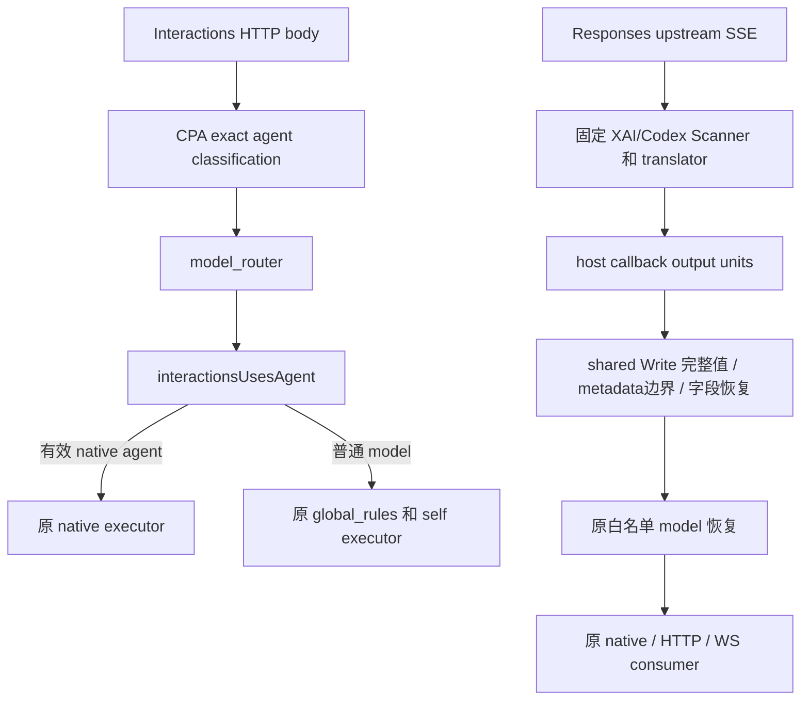
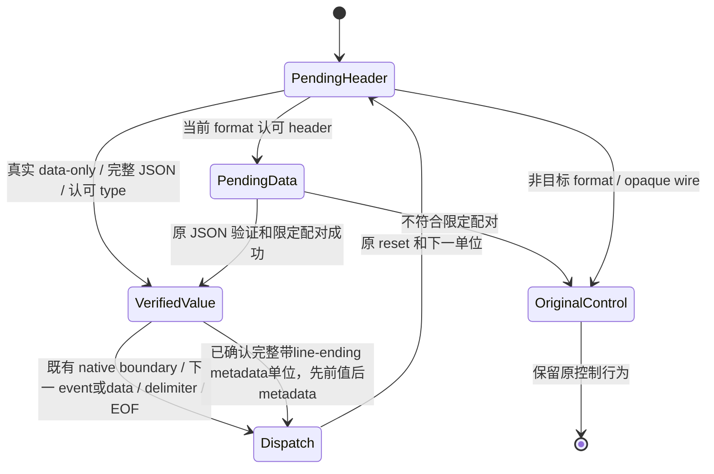
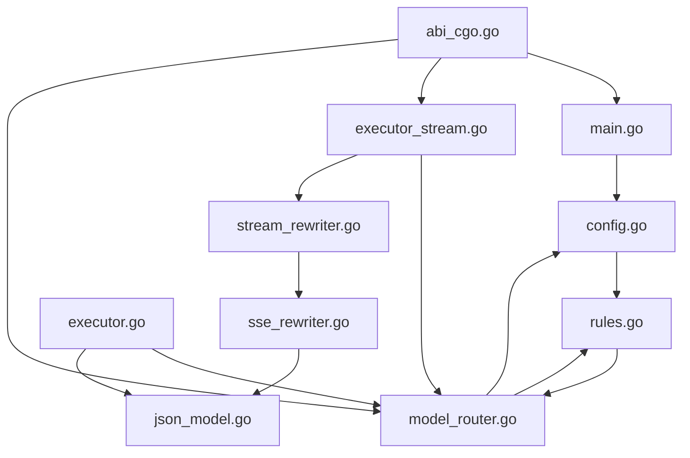
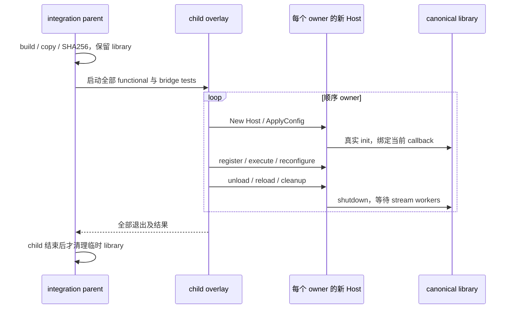
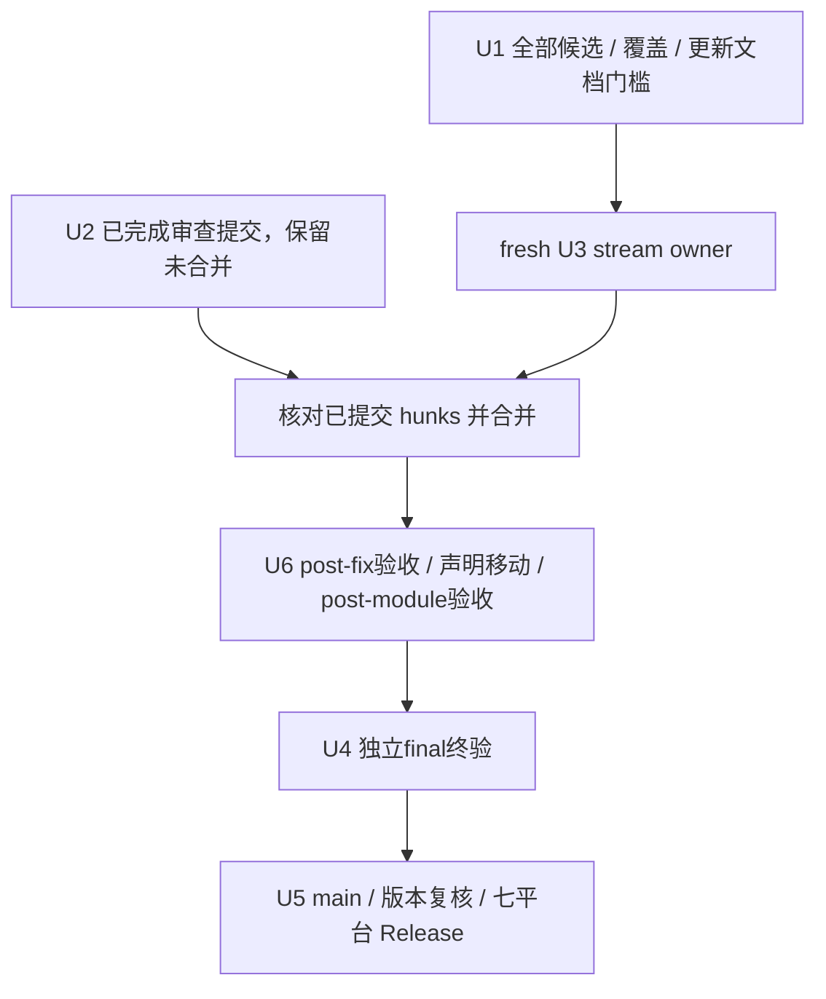

# 功能审查修复实施计划 - Plan

## Goal Capsule

- **Objective：**客户端收到完整 Responses 错误／完成数据，普通 Interactions model 正确映射，真实 native agent 正常执行；生产代码按10文件职责组织，完整旧回归保持。
- **Means：**在当前 shared scanner 和唯一 agent helper 修复 F1-F3。保留 U2 已完成提交；本轮文档独立审查通过后，由 fresh U3 owner 完成三谓词、单向 alias 和已确认完整 metadata 边界，两个任务无冲突合并后由 U6 按10文件方案纯移动（KTD1-KTD4、KTD7）。
- **Authority：**产品行为由 `docs/superpowers/specs/2026-10-11-functional-audit-fixes-design.md` 的 R1-R18 约束；本计划安排实施和核验。发布动作由协调者核对真实用户授权，不以 workflow 文本、完成通知或旧文档替代。
- **Execution profile：**每个 coding owner 使用独立 Git worktree，连续完成正式 TDD、最小实现、测试、规格／质量审查、修正、复审与提交。协调者只合并完成任务，终验 owner 负责整合验证，协调者负责最终 main 和发布。
- **Stop conditions：**二次覆盖审查、全部候选判定或 spec/plan 审查尚未完成时不开始产品编码。同一真实入口出现可靠相反要求、关键 producer 对照不成立、修改需要扩大到 CPA 或共享位置发生冲突时，保留证据并交协调者更新范围和依赖。

---

## Product Contract

### Summary

完成 F1 的 Responses 非 `response.*` 逻辑事件（error、keepalive）及已验证完整 data-only 前值／完整带 line-ending metadata 的边界、F2 的单向 done/completed alias 和 F3 的 CPA-compatible agent 分类。永久测试逐条复现基线失败；新 created/comment/completed 在 BASE 和精确三谓词版本分别取得目标 RED，再用最小实现及真实 producer、native DLL、HTTP/WS 对照验收。保留已完成 U2，新 U3 完整交付并无冲突合并后纯声明模块化，三阶段验证完整旧回归。

### Problem Frame

协调 HEAD 的映射流丢失 XAI 原始错误，非 Grok Codex keepalive 与 completion 被合并，done/completed alias 被当作 mismatch。新独立诊断确认，真实 fixed CPA Codex Grok 路径的无 LF data-only created -> 完整 `: keepalive\n\n` -> data-only completed 在 BASE 和精确三谓词版本都失败：comment callback 的第一次 emit 已合并 created JSON/comment，created.model 未恢复；native 后续 completion 本身完整且已恢复，mapped HTTP 502 invalid SSE JSON，mapped WS 无数据并 close 1006。whole／bytewise 交付相同非空 callbacks，独立内容 oracle 也复现；旧 a2 actual Grok 成功矩阵没有此前值，不能支持三谓词足以覆盖全部真实控制的结论。

Interactions guard 的 first-wins/exact-key/trim 修复已由 U2 完整提交 `7f17c7db69d318d84e68a0b5fcd8e0e616bd44f1`，两份 fresh review 均 `findings=[]`，协调者已核对完整六文件 diff，尚未合并。旧 U3 三文件仍未提交且 blocked，永久只读；完整 metadata patch 尚未实施或安全验收。origin spec 的新证据及身份限制约束本轮技术范围修正，用户产品目标和全部保护边界保持，代理通知不构成新批准。

### Requirements

完整需求保留在 origin spec，编号和范围不变。本计划不另定义协议、配置或 Google API 功能。

| 需求 | 实施单元 | 直接验收 |
| --- | --- | --- |
| R1，非 `response.*` error／keepalive 及完整 metadata 边界 | U3 | AE1、AE7；pair／连续 data-only 和 created/comment/completed 的 root exact bytes/per-Write/Finish/error；真实 Grok／非 Grok Codex native/HTTP/WS，XAI error native/HTTP；error-only WS 既存边界单独报告。 |
| R2，done/completed 单向 alias | U3 | AE2；完整 output/model/header/type；Codex HTTP/WS 正常完成。 |
| R3-R4，mismatch／generic wire／派发与内容保护 | U3、U4 | AE3、AE7；仅新增已确认完整 metadata 边界的有序派发，原普通 data-only 等待、无 LF ordinary/mixed metadata zero-output、partial characterization、generic 任意分段／BOM／迟到 delimiter 和 format isolation 保持。 |
| R5-R7，agent 分类与 native bypass | U2 | AE4-AE6；root helper/route；真实 model/native HTTP；invalid 和非 string 分类边界。 |
| R8-R10，JSON、错误、接口、依赖与现有行为 | U2、U3、U6、U4 | 全量 root、headers、opaque/ownership、原 lifecycle、ABI/register/schema 和三个 scripts。 |
| R11，独立 worktree／完整 owner 交付 | U1-U4、U6 | 固定 BASE..最终 HEAD、无位置冲突、真实 RED/GREEN、审查修正复审、任务提交。 |
| R12，完整终验与旧集合 | U6、U4 | 24 原 functional、2 bridge、四份 captures 精确 key，加独立新 terminal test。 |
| R13，版本与占用核查 | U4、U5 | 注入候选版本前及发版前两次核对，registration/package 和最终资产。 |
| R14，main／CI／Release 及保护边界 | U5 | 最终 SHA、七平台 CI、ZIP/checksum/根 LICENSE/Version；不创建 PR。 |
| R15-R16，模块化／等价 | U6、U4 | AE8，全部声明唯一分配、AST/hash/initializer/const/directive和ABI/tests/fixture字节比较。 |
| R17，完整旧回归 | U2、U3、U6、U4 | AE9，323/60/24 Tests、29 Benchmark及全部展开cases，唯一whitespace oracle纠正单列。 |
| R18，三阶段／产物版本 | U6、U4、U5 | AE10，post-fix/post-module/final完整验收、最终Ubuntu integration和七平台CI，runtime限制单列。 |

### Scope Boundaries

行为修复只包含 origin spec 的三根因。U3 在原三谓词／单向 alias 外，仅增加 shared `sseRewriter.Write` 中已验证完整 data-only 前值与完整带 line-ending metadata 单位的边界和有序派发；复用现有状态、drain 和恢复器，不修改 scanner 算法、JSON 恢复器、生命周期、batching 或公共 helpers。具体 patch 须正式 TDD 和安全验收，单独删除换行 guard 未获充分正确性证明；若实际实现证明还需扩大范围，交协调者更新文档和依赖后再继续。模块化采用 R15/R16 的同 package 声明移动。无需新增配置、mode、provider-specific 产品分支、parser、额外抽象、consumer workaround、Error/Done 转换、retry 或 executor guard。fixed CPA 的 error-only WS 行为按 R1/AE1 保持。

不修改 CPA/cache、ABI、CI、Makefile、其他 worktree、`.claude` 或用户配置，不处理本机既有删除故障。外部真实模型账号请求、跨平台 runtime 与当前 Windows 本地诊断不同，报告按实际执行层区分。

---

## Planning Contract

### Key Technical Decisions

- KTD1. F1/F2 由同一 fresh U3 owner 保留两个 header 谓词和 type/matched 的三处识别修复、单向 done/completed alias，并独占 `sseRewriter.Write` 内已验证完整 data-only 前值与完整带 line-ending metadata 单位的边界及有序派发。新增无 header type 许可只用于真实 data-only 位置（R1、R3）；复用原完整 JSON 验证、增量游标、scanner 状态、`drain`、`rewritePendingEvent` 和白名单恢复器。三谓词本身不覆盖新 Grok 排列，metadata 具体 patch 未实现或安全验收，不将删除换行 guard 当作充分修复，不扩展 scanner 算法或公共 helpers。该边界改变遵从 R4，全部其余派发、generic／partial metadata、错误、ownership 和性能控制保持。共享识别及边界位置由唯一 owner 连续完成。Governs R1-R4、R8-R10。
- KTD2. F3 只修改 `interactionsUsesAgent`，直接使用 `github.com/tidwall/gjson v1.18.0` 的 validity／exact-key lookup／`String()`，复用 `strings.TrimSpace`。固定 CPA 使用同版本，Go struct 不能保留已核验的 first-wins/exact-key 语义；不开发自制 first-wins parser。Governs R5-R7、R10。
- KTD3. Interactions owner 负责 `main.go` imports/helper、旧 Agent root 用例、新独立 regression、module 文件及唯一 fixture 的 Agent 函数和必需 GJSON import。stream owner 不改这些位置，fixture 只新增独立 terminal test。Governs R11。
- KTD4. terminal fixture 使用已有 `gCPANewLocalProducer` 的 custom `p.wire`，不改 public helpers 或 imports。每 case 在请求开始前加锁设置 fixture/wire/records；`setFixture` 不清空 wire，因此每 case 显式设置或清空，custom wire 的实际 model 由 case 自己生成。Governs R1-R4、R11。
- KTD5. 新 native 测试保留唯一 smoke/overlay 入口和 parent-lifetime canonical library，沿用顺序 Host 初始化和真实 cleanup。不新增子测试 DSO copy、共享 `t.Parallel`、cached Host 或第二入口。Governs R9、R12。
- KTD6. U2/U3完成后无冲突合并，U6完成后交独立U4终验，U5依赖U4；对外发布使用现有tag workflow。Governs R11-R14、R18。
- KTD7. 采用origin spec的完整10文件声明／imports布局，保持同package/module，仅移动post-fix GREEN声明及必要var分组。三份模块调查已核对CGo、初始化和包目录构建，无需新package或抽象。Governs R15-R16。
- KTD8. 以BASE静态声明／cases清单保护旧集合，用实际输出逐项核对执行；模块化前后比较完整AST、initializer、const/directive及ABI/tests/fixture字节。Governs R16-R17。
- KTD9. 三阶段各自重建默认动态库并完整验收，候选VERSION注入及真实ABI注册使用独立产物，不用sidecar证明DLL内版本。Governs R12-R13、R18。

### High-Level Technical Design

两条请求路径复用现有系统边界；产品变化为 agent 分类、logical 字段识别及已确认完整 metadata 边界，消费者与 ABI 保持。



scanner 的完整值、dispatch 和错误保留复用现有状态。header/type 认可后，普通 data-only 仍等待原边界或 EOF，无 LF ordinary/mixed metadata 保持原 zero-output；新确认的完整带 line-ending metadata callback 为已验证前值确认边界，先派发前值，再保字节输出完整 comment。generic 分段和 partial-metadata-characterization 原行为保持。



模块间保持同 package 的原直接符号调用；图只表达职责关系，完整声明／imports 归属由 origin spec 约束。



canonical library 的 parent lifetime 包含整个 child overlay；顺序 owner 保持原 Host 初始化和清理。



任务依赖以实际修改位置为依据。U2 已完成提交保留，U1 的本轮文档审查通过后只启动 fresh U3；两个任务全完成且无位置冲突才合并，新共享位置须先重新分配。



### Assumptions and Execution-Time Facts

- 本计划采用已确认的固定 CPA v7.2.152 行为；将来升级 CPA 时需以新 producer/parser 重新核对，本次不升级。
- owner 的 worktree 名称、BASE 后的整合 SHA、正式测试源码、DLL hashes、最终版本和 CI/Release IDs 由实际执行产生，不预填。
- `v0.5.14` 是待核实占用的候选，不能在核对前写成最终发布版本。
- 早期诊断 worktree 已有清理，其保留结果与原日志缺失分别说明。新三项独立诊断已按 origin spec 保存并核验三个 ZIP；确认绑定冻结 Git source、有效 overlay、新 build 和 canonical/shadow 链，LF／CRLF raw hash、build cwd HEAD、buildinfo VCS 和 production source 身份分别记录，不从旧采样或文件名／相同 hash 推断 source。fresh U3 仍须新的正式 RED/GREEN，任何诊断 GREEN 或旧 U3 部分完成均不充当产品完成证据。

### Exact Ownership

| owner／单元 | 可修改文件和位置 | 保持不改／交接条件 |
| --- | --- | --- |
| U1，协调者和文档审查 | 当前 spec/plan；审查结果 | 不改产品/tests；新事实须同时更新两文档，当前提交路径实际可读后由协调 workflow 分派五位独立审查，阻塞问题修正并复审通过后只分派 fresh U3；全部候选终态和二次覆盖门槛保持，自审不计独立审查。 |
| U2，Interactions | 已完成提交 `7f17c7db69d318d84e68a0b5fcd8e0e616bd44f1` 的六文件：`main.go` 必需 GJSON import 及唯一 `interactionsUsesAgent`；`main_test.go` 原 whitespace expected；`interactions_agent_regression_test.go`；`go.mod`／`go.sum` 必要依赖；fixture 必需 GJSON import 及原 `TestModelMapperFunctionalInteractionsAgent`。 | 两份 fresh review 均 `findings=[]`，协调者已核对完整 diff；不重新分派或要求从本轮文档起点重做，保留未合并提交及完整验证。caller、executor、scanner、stream regression、公共 helpers 和其他旧断言不改。 |
| U3，fresh stream owner | `main.go` 的两个 header 谓词、matched 的真实 data-only guard／单向 done alias，另独占 `sseRewriter.Write` 内已验证完整 data-only 前值与完整带 line-ending metadata 单位的边界和有序派发；`stream_native_fields_regression_test.go` 的5个新增 terminal Tests、logical-metadata-callback-characterization及完整 metadata 边界／余下新增 cases；fixture 唯一末尾 `TestModelMapperFunctionalResponsesTerminalFields` 长矩阵及本测试专用局部代码。 | 复用现有 scanner 状态、drain 和恢复器；不改 scanner 算法、imports、Agent 函数、module、`main_test.go`、公共 producer/loader/helper、JSON 恢复器、生命周期或 batching，不新增 private scanner state 断言；全部旧 controls 保持。 |
| U6，module | `main.go`、8份新生产文件；`CLAUDE.md`当前架构和README简短布局 | U2/U3无冲突合并后开始，不改ABI/tests/benchmark/fixture/module/Makefile/CI，不从旧源码覆盖修复。 |
| U4，终验 | U6完成后新整合worktree的证据和验收 | 产品回归交对应 owner 在其 worktree 修正、复审、提交；主会话不补半成品代码。公共入口确需改变时先更新单 owner 所有权。 |
| U5，协调者 | 经授权的 local main、remote main、tag、Release 验收 | 不创建 PR、force push、移动既有 tag、改 CPA 或删除其他已有工作区。 |

位置以符号与实际 hunks 为准，原 BASE 行号只作参考。U2 已提交范围与 fresh U3 的待修改位置分别核对，合并前比较两个任务完整 BASE..HEAD；当前不恢复 U2 写入。fixture imports 只归 U2，U3 使用现有 imports。出现公共 helper 或同一函数共同修改需求时，先交协调者按依赖或单 owner 更新所有权，再继续。

**恢复执行规则：**

1. 本轮按新确认事实先修改 origin spec，再修改本 plan，BASE 和原日期保持。U2 的完整提交 `7f17c7db69d318d84e68a0b5fcd8e0e616bd44f1` 及两份 fresh 无 findings 审查保留，协调者已核对六文件完整 diff，尚未合并；不重新分派或从新文档起点重做 U2。本轮最终提交的 spec/plan 路径实际可读且五位独立审查及必要修正／复审通过后，只为 U3 从该文档 HEAD 创建一个新独立 worktree 和唯一 fresh owner。原 BASE、文档起点、production/tests 身份分别记录，新共享 hunk 先由协调者更新单 owner 所有权和依赖。
2. 已停止的 `wf_e9f307ff-9e1` 的未提交来源永久只读：U2 为 `C:/Users/user/Downloads/cpa-plugin/.claude/worktrees/wf_e9f307ff-9e1-1`，U3 为 `C:/Users/user/Downloads/cpa-plugin/.claude/worktrees/wf_e9f307ff-9e1-2`。因 modified-since-read 冲突停止的 `wf_f90ea0be-a21` 及其可见 owner 工作树永久保留，不读取／复制其未提交文档草稿。当前 blocked U3 来源为 `C:/Users/user/Downloads/cpa-plugin/.claude/worktrees/wf_43831682-e1f-2`，报告 HEAD 仍为 `86a3c2ceb8d5e123015d563c5ab07eefb2670149`，三文件未提交内容和全部证据永久只读。全部旧 owner、writer、script 不恢复，来源不写、不删、不清理；fresh U3 只精确继承下述已证明归属的三文件位置，其他 unknown 内容不进入新树提交。
3. 四处争议写入已有成功 Edit 和正文匹配证明属于本次助手，具体运行时成因仍未知；来源全树 tracked/untracked/hash 的独立清点未完成，保持 unknown，不宣称 complete。允许的 Read／Glob 仅用于限定源文件。协调者对来源 `git -C status` 的取证已被隔离拒绝，不让 peer／MCP 重做，不修改权限或用户配置；插件仓库的 Git 操作只在执行者自有工作树运行，禁止用 `git -C` 对受保护来源、主会话或其他插件工作树取证或修改。原 `make integration` 对执行者自有 ignored `dist/integration/cpa-src`（或通过现有 `DIST_DIR` 指定的自有专用 ignored 目录下的 `integration/cpa-src`）执行的只读 revision／clean 核查保持；该限定不允许重做已被拒绝的来源取证，不扩大工具权限。
4. fresh U3 在自有 ignored 证据目录保存限定继承来源原文及 hash，分别冻结固定 BASE 旧集合、继承／新增测试 manifest、自有 production／tests／overlay 和默认 DLL。BASE manifest 从固定 BASE 对象取得，不用当前源码生成；另构造并冻结精确三谓词产品副本及新 DLL，限定 diff 只含已分配谓词和 alias。每次实际测试分别记录 production 的 Git 对象／raw LF或CRLF hash、测试源码和有效 overlay hash、argv/cwd及其 HEAD、built/copied/canonical/shadow DLL 和 CPA 身份，不把 cwd HEAD／VCS metadata 当作编译来源。overlay 只引用冻结自有副本，不引用旧实时 source，不沿用旧 `run.py`。继承 cases 逐条在 BASE 取得目标 RED 或正确 control；新增完整 metadata 边界在 BASE 和三谓词版本各取得目标 RED，再用同命令完成最小 GREEN。余下 slices 按 U3 Approach 连续完成正式 vertical TDD，诊断 GREEN 或旧 U3 部分完成不计产品完成。
5. fresh U3 owner 独自连续完成 TDD、最小实现、规格／质量自审、修正、复审、全部检查和提交，不联系／恢复其他代理或启动 subagent。测试、构建和证据记录程序均前台顺序执行，不启动后台任务，不续跑旧 writer/script；以最终正常返回主动交付，由 harness 通知协调者。独立产品复核由协调 workflow 在 U3 完成提交后分派，reviewer 只读且不直接联系 writer；U2 已完成的独立审查保留。该执行限制不减少任何单 owner 完成条件。
6. U2/U3 的完整 owner 门槛保持：完整 root、vet、race（总 timeout30m）、三个显式 scripts、registration、29个旧 Benchmark 的全部展开 cases、受影响性能计时、issue8、完整旧矩阵与6456精确 keys、默认 DLL 和完整 integration，并至少重复两次各自关联 native 测试。U2 已完成证据保留，fresh U3 必须全部完成。旧 `wf_e9f307ff-9e1` native exit1 的重复声明编译失败未到目标，不计 RED；旧 WinError5 未执行 race／bench，不计 pass；新 Grok 的实际断言失败分别记录为目标 RED。沿用全部旧断言、数据、内部时限、性能门槛和宿主限制，真实 integration 不得 Skip。
7. 交付包含固定 BASE..最终 HEAD 的完整 diff、逐条真实命令与数字 exit、源码／tests／cwd／overlay／DLL 身份、自审修正复审及正常 path-limited commit。未启动或工具拒绝的 exit 保持未知，未完成检查不能计 pass。协调者核对无位置冲突且全部 owner 完成条件满足后才合并；post-fix、post-module、final、10文件模块化和 main／tag／CI／Release 的原门槛全部保持。

---

## Implementation Units

### U1. 完成候选、覆盖和规划门槛

**Goal：**编码起点只包含已复现、独立反证确认、可在插件内安全修复的 F1-F3。

**Requirements：**R11，Goal Capsule 的停止条件。

**Dependencies：**完成全部审查候选判定和二次源码覆盖结果；收到后台完成通知。

**Files：**本 spec/plan；现有全量审查的 scope/coverage 证据只读。

**Approach：**

1. 将全部检查域、源码与 CPA 必要路径逐项对应到已完成结果，补查缺失范围。候选均有明确终态，不能用抽样代替全面覆盖。
2. 核对 origin spec 的新三项独立诊断、协调只读记录和三个 ZIP 身份；a2 旧成功仅覆盖没有前置 data-only created 的 actual Grok 矩阵。新 BASE／三谓词重复 RED 推翻原仅三谓词的技术范围判断，按 R1/R4/KTD1 将完整 metadata 边界写入两文档，保留二次扫描覆盖、全部产品目标和保护门槛。原诊断不替代正式 TDD。
3. 文档 owner 先精确修改 spec，再修改 plan，独自完成自审、修正、复审、静态检查和只包含两文档的正常提交，核对 R/AE/KTD/U、callers、所有权和完整验收。提交后路径实际可读，由协调 workflow 分派五位独立规格／计划 reviewer；全部完成且阻塞问题修正、复审通过前，U3 产品写入保持暂停。原93d9921的五份无 findings 结果不覆盖本轮新事实，自审不计五位独立审查。
4. 保留 U2 已完成提交、两份 fresh review 和协调者六文件完整 diff 核查，不重派 U2。只向 fresh U3 交付本轮最终已审查文档 HEAD、固定 BASE、限定继承 source、完成条件和精确位置，创建一个新独立 worktree 和唯一 owner；不恢复旧 U3/writer/script。U2/U3 全完成并核对无位置冲突后才合并。

**Test expectation：**本单元不修改或运行产品 tests；核验文档 frontmatter、真实 paths/symbols/test names、diff 和证据完整性。

**Verification：**全部检查范围和候选终态可核查，两文档已修正并提交，本轮五位独立审查及必要复审无阻塞问题；U2 已完成交付保留，fresh U3 只能在本单元满足后开始产品写入。

### U2. 统一 Interactions agent 分类并保存真实 native 回归

**Goal：**普通 model 正常映射，有效 native agent 保持原执行路径。

**Requirements：**R5-R11，AE4-AE6，KTD2/KTD3/KTD5。

**Dependencies：**原 U1 门槛已满足，本单元已完整提交并独立审查，保留未合并提交；本轮不重新分派 U2，等待 fresh U3 全完成及无冲突核查。

**Files：**Exact Ownership 的 U2 文件。相关现存 tests 包括 `TestHandleModelRouteLeavesInteractionsAgentsNative`、`TestHandleModelRouteIgnoresUnusedBody`、`TestHandleModelRouteSkipsClaudeCountTokens` 和 fixture 的同名 Agent 函数。

**Execution note：**本单元已在原已审查起点完成正式逐条 TDD、全部 slices 和 owner 验收，提交为 `7f17c7db69d318d84e68a0b5fcd8e0e616bd44f1`。下文 Approach／Test Scenarios 保留原完整验收要求，供核对该交付，不指示从本轮文档起点重做。按 R17 从 model_route RPC 观察分类，不新增 helper 实现耦合测试；whitespace expected 纠正及 BASE RED／当前 GREEN 属于正式证据，private overlay 不代替 TDD。

已完成范围为 Exact Ownership 的六文件／hunks，包括原45个 RPC cases及补齐的 native slices。两份 fresh reviewer 均 `findings=[]`，协调 worktree 的 `dist/functional-audit-fixes-20261011/coordination/U2-host-inspection-wf_31e9e13c-e72.json` 记录完整 diff、六文件范围和正式验收核查；证据、提交及未合并状态保留。

原 `research-agent` stream/nonstream、ASCII-tab、missing、raw body/calls/URI/headers 和完整 response/SSE 控制继续保留。U2 的两轮关联 native、完整 owner 检查、自审修正复审和正常提交结果保持；不以45个 RPC cases 或旧诊断替代完整 integration，也不重新分派本单元。

**Approach：**

1. 核对初始 HEAD、Git clean、fixed CPA module/version，检查唯一 caller 和 route -> executor。保留完整 BASE 和起点，不用 `HEAD~1`。保存只读 BASE 源码／默认 DLL 身份，供后续新增 native slices 证明基线失败。
2. 从 whitespace 行为开始，只纠正旧 expected 并新增最小失败用例，实际运行得到目标 RED；再最小替换 helper、直接 require/import GJSON v1.18.0，取得同命令 GREEN。module sum 由正常流程生成，不升级 CPA 或无关依赖。helper 不改 body、不新增 guard。
3. 按 Test Scenarios 逐个行为加入 `TestFunctionalInteractionsAgentClassification`／`TestFunctionalInteractionsAgentRoute` 的 cases。每条先运行测试，确认它实际揭示的失败或已有正确控制，再补最小实现并取得 GREEN，随后进入下一条；已由同一 helper 修复的行为记录基线 RED和当前 GREEN，不伪造新 RED。不批量写完全部测试后再实现。
4. 每条 native slice 同样连续完成最小 case、BASE 产品目标 RED、当前产品 GREEN，再下一条。扩展唯一 Agent fixture 并保留旧唯一 agent 流／非流；fake upstream 只在该函数改用 case raw bytes 和同版 GJSON 分类，必需 import 归本 owner。保存 overlay、source/DLL 身份、两次 native运行和完整输入输出；环境 setup失败、固定入口400控制及目标 self route400分开记录。
5. 全部 slices完成后运行关联和全量 root/vet/race、三个 scripts、registration及本 owner 真实 Agent integration，核查完整旧矩阵和R5-R10。新增 cases不替换旧控制。
6. 同 owner 完成规格／质量审查、修正、重测、复审和正常 commit，主动回报完整 diff、真实 RED/GREEN、命令/exit/identity及限制。

**Test Scenarios：**

1. Covers AE4。missing／empty／纯空白／null + model：helper false，匹配规则时 self route，实际 upstream model 被映射，下游 model 恢复。空白分别覆盖 ASCII space、Tab、换行、NBSP、Em Space 和 Ideographic Space。
2. 只有 `Agent`／`AGENT` 或 escaped uppercase key + model：未知 key 不触发 native guard。
3. escaped decoded lowercase `agent`：与 lowercase 相同，trim 后非空仍 native。
4. 首 lowercase agent empty 后非空、首 null 后非空、首空白后非空：按照第一个值选择 model 路径。
5. Covers AE5。首 lowercase agent 非空后 empty／null／其他值：native guard 保持；后续 `Agent`／`AGENT` 空、null、bool、number、object、array 不覆盖 lowercase agent。
6. 唯一正常 agent、trim 后正常 agent，以及普通 model／有效 string agent 的各重复和大小写 case：stream/nonstream，direct／disabled／enabled-unmapped／mapped 配置。逐项按 R5 判定 model mapping 或 native bypass，核查完整 response/SSE 和原 body/calls/URI/header。
7. Covers AE6。invalid JSON 返回 false；null+model 正常；nonstring+model 的固定入口 400 保持。agent-only nonstring 只检查同 CPA 分类，不宣称 Google API 接受。
8. 未匹配／identity／`count_tokens`／其他formats不受 guard修改影响，普通 Interactions 仍只选择 global rules。

**Verification：**目标 root/native RED 来源明确，固定 helper 后全部对照GREEN；module只有必要GJSON变更，无重复helper，全部owner步骤和提交完成。

### U3. 恢复 Responses 非 response.* 事件和完成别名

**Goal：**F1 error 保留原错误，JSON keepalive 后的 completion 及真实 Grok created/comment/completed 的边界、顺序和模型正确，完整 completion 正常到达；F2 完整 completed 可由 HTTP/WS 识别。

**Requirements：**R1-R4、R8-R11，AE1-AE3、AE7，KTD1/KTD4/KTD5。

**Dependencies：**本轮 U1 两文档提交和五位独立审查／必要复审通过。U2 已完整提交且审查通过，保留未合并；fresh U3 在新的独立 worktree 连续完成 F1/F2，不恢复旧 owner，不并行修改同一 scanner。

**Files：**Exact Ownership 的 U3 文件；相关现存 controls 为 `TestFunctionalNativeSSEFieldDiscriminator/mismatch-control`、`TestFunctionalNativeSSEFieldDataOnlyTypeControl`、`TestFunctionalNativeSSEFieldFormatIsolation`、`TestFunctionalNativeSSEFieldWireControls`、ordinary/mixed metadata、limit/continuation/dispatch，以及 forwarder/error 回归。

**Execution note：**每个行为连续完成最小测试、BASE目标RED和最小GREEN，再进入下一条；按 R17 从既有输出和 forwarder 入口核查新增行为，保留原状态／游标控制。重新保留exact-byte/native/HTTP证据，不批量写全部tests后再实现。

继承来源只读 `C:/Users/user/Downloads/cpa-plugin/.claude/worktrees/wf_43831682-e1f-2`，只包含已证明归属的三文件／hunks：`main.go` 两个 header 谓词、matched 的真实 data-only guard／单向 done alias；`stream_native_fields_regression_test.go` 的5个新增 terminal Tests 和 logical-metadata-callback-characterization；fixture 文件末尾唯一 `TestModelMapperFunctionalResponsesTerminalFields` 长矩阵及本函数局部代码。先冻结源原文／hash和继承／新增测试清单；不复制 source 的其他 unknown 改动，不从旧 `wf_e9` 继承其短重复函数，不恢复旧 owner/script，所有来源及证据永久只读。

先取得固定 BASE 旧集合及新测试的自有快照，用新 build 的 BASE／精确三谓词 DLL 和有效自有 overlay 记录实际 source、tests、cwd HEAD及 built/copy/canonical/shadow 身份。继承 cases 各自先证明 BASE 目标 RED 或正确 control，未完成 slices 继续正式 vertical TDD；新完整 metadata case 在 BASE 和三谓词版本均取得实际目标 RED后才最小 GREEN。原编译重复声明或 WinError5 不计 RED/pass，诊断 GREEN 和旧 U3 部分完成不计正式完成。关联 native 至少两轮，恢复规则的全部 root/vet/race30m/scripts/registration/29bench/计时/build/default Version/integration、旧集合与6456验收、自审修正复审、commit及提交后独立 review全部保持。

**Approach：**

1. 按恢复规则冻结固定 BASE 旧集合、限定 source 原文／hash、继承／新增测试清单、自有 tests／overlay，以及新 BASE／精确三谓词默认 DLL 身份。保留5个 root 名称：`TestFunctionalNativeSSEFieldError`、`TestFunctionalNativeSSEFieldKeepalive`、`TestFunctionalNativeSSEFieldDoneAlias`、`TestFunctionalNativeSSEFieldTerminalDispatch`、`TestFunctionalNativeSSEFieldTerminalForwarder`。继承 cases 先各自取得 BASE 目标 RED 或正确 control；新增 AE7 完整 comment 边界在 TerminalDispatch／TerminalForwarder 补永久 exact-byte/per-Write/Finish/error cases，分别证明 BASE 和三谓词目标 RED。余下 error pair/data-only、keepalive pair/data-only、alias 和 dispatch/forwarder slices 逐条执行最小测试 -> 目标 RED -> 最小实现 -> 同命令 GREEN -> 下一行为，复用 `gNativeParts`，不改旧 mismatch 或 characterization。前一共享修复已覆盖的 case记录冻结 BASE RED／当前 GREEN，不制造虚假 RED。
2. 保留 F1 两个 header 谓词及 data-only type 判定，真实 data-only 许可仍以 `s.dataStart == s.headerStart` 约束，精确增加 error／keepalive；F2 在 matched 只增加 header done／type completed 单向 alias，header/data.type 不改，无 model marker 同样有效。另在 Write 处理已验证完整 data-only 前值与完整带 line-ending metadata 的边界，以现有状态、drain、rewritePendingEvent和白名单恢复器先派发前值，再处理原 comment。具体 patch 以正式 GREEN及全部保护控制为依据，不把单独删除换行 guard 当作充分修复；不普遍提前派发完整 data-only，不改无 LF ordinary/mixed metadata zero-output、generic分段或partial characterization，不扩展 scanner 算法／恢复器／生命周期／batching／公共 helpers。确需进一步范围时交协调者更新后再继续。
3. 唯一末尾 `TestModelMapperFunctionalResponsesTerminalFields` 长矩阵逐条完成真实 producer/native/HTTP/WS slice，每条 BASE DLL 目标 RED／正确 control、当前 DLL GREEN 后再下一条；新 Grok 排列另保留三谓词 DLL 目标 RED。whole／bytewise × pair／data-only × created／no-created 的 Grok 和普通 completed，非 Grok keepalive/error/done alias、metadata 各位置、direct／disabled／enabled-unmapped两个实际 model及no-keepalive全部保持。复用custom wire/canonical loader/native drain，每case请求前加锁设置或清空wire/records/fixture，实际model由case生成；核查真实非空callback、合法JSON、数量/顺序/model/status/完整output及原请求，不依赖nil/empty或native与HTTP delimiter equality。关联 native至少两轮，状态/error按入口记录。
4. 所有 Test Scenarios 完成后，核查完整 scanner/reset/EOF/error/dispatch，执行恢复规则全部 root/vet/race30m、三个显式 scripts、registration、29个旧 Benchmark全部展开cases及受影响性能计时、默认build和完整integration。原323/60/24/29、展开cases、6456、issue8四cases、36个旧native fields、内部timeout和所有性能门槛保持，旧矩阵和新增cases分别核对，真实integration不得Skip。
5. 同 owner 完成规格／质量自审，核对限定谓词／alias／完整metadata边界及mismatch、opaque/generic/partial/其他formats、chunks+error、ownership／allocation／cursor／关闭顺序；修正后重测、复审和正常path-limited commit，主动交付完整diff及正式证据。协调workflow在提交后分派独立产品review；任何扩大共享位置先协调，不能把未完成步骤交主会话。

**Test Scenarios：**

1. Covers AE1。独立 error/error pair 与 data-only，单 terminal、created 后 error、Flush／Finish；code/message/param 原字节保持，无 model marker 也有效。
2. Covers AE2。done/completed 单 terminal 与 created 后 completion；原 header 保留，type 为 completed，所有允许 model 恢复，完整 output／opaque 数字表示保持。
3. Covers AE7。keepalive pair、连续 data-only 和两者合法交替后接完整 completion；native 两个 data 单位有效，HTTP/WS 获得完整 completion，keepalive 原文保持。新增真实 Grok 三 callbacks：无 LF data-only created -> 完整 `: keepalive\n\n` -> 无 LF data-only completed，永久 root 和真实 native/HTTP/WS 均要求合法 created/completed、准确 model/status、完整 output和原 comment，不合并 JSON。该新增 case 在 BASE和三谓词版本分别目标 RED，再最小 GREEN。
4. TerminalDispatch 使用 origin spec Stream回归给定的三个 exact输入：无LF created data、完整 `: keepalive\n\n`、无LF `data: ` + `gNativeCompleted`。逐Write expected分别为零输出、`data: {"type":"response.created","response":{"model":"grok-4.6","status":"in_progress","output":[]}}\n\n: keepalive\n\n`、零新增输出；Flush/Finish只输出一次 `data: ` + `gNativeCompletedWant` + `\n\n`。累计只有两个合法 data events，零额外 data，顺序、comment bytes、所有白名单及opaque内容保持。保留 no-created／pair-created／no-comment／无LF comment控制；普通 data-only不普遍提前派发，无LF ordinary/mixed metadata期间原zero-output、迟到LF/CRLF不重复派发及partial characterization保持。
5. Covers AE3。原 `Discriminator/mismatch-control`、reverse alias、unknown/missing/null/nonstring type；error／keepalive header 配其他 type 仍为 mismatch，opaque header 被清空的 discriminator 不获得新增许可，闲置 `event_type=17/false` 保持 opaque。
6. LF/CR/CRLF 标准 wire，whole／全部双分片／bytewise、BOM、前置及 in-event/between-event metadata 和 opaque comment；generic callback read 不变成新增字段边界。
7. TerminalForwarder 对新增 created/comment/completed 排列覆盖自然EOF、Payload+Done、callback/in-band/cleanup error、emit失败以及完整prefix+error；保留 valid pending输出、原primary/cleanup错误、emit失败停止、无额外读取及关闭顺序。原完整前缀+incomplete tail、16MiB限额、完整大单位、ownership、allocation、增量游标、batching和生命周期断言全部保持，不新增私有scanner状态断言。
8. 真正 XAI error、非 Grok Codex keepalive、done alias 与普通 completed 的原矩阵保持；actual Grok comment 和普通 completed均完整覆盖whole／bytewise × field-pair／data-only × created／no-created及metadata各位置。direct／mapped／enabled-unmapped／disabled两个实际model逐项核查core／host的非空callback、native原始emit、HTTP状态／错误、WS JSON、type/event/model/status、完整output、upstream body/headers/URI/calls。无keepalive对照保持，各入口按自身framing验收，不依赖nil/empty或跨入口delimiter字节相等。
9. error-only WS 保持 fixed direct 的 1006 边界；keepalive+completion 和 F2 mapped WS 必须收到完整 completion，与正常 direct／disabled／unmapped 对照。不得将所有路径的预期统一为 `wsErr=nil`。

**Verification：**继承 cases 的 BASE RED／正确 control身份可核查，新增完整metadata边界的BASE及精确三谓词目标RED真实成立，最小实现后5个root完整cases及真实producer/native/HTTP/WS GREEN。Grok created/comment/completed和全部keepalive/F2 WS正常完成，error-only WS边界准确；至少两轮关联native及全部owner完整验收、原控制／性能门槛、自审修正复审、正常提交和提交后独立review完成，不能以诊断或旧部分完成替代。

### U6. 从修复后 GREEN 源码完成纯声明模块化

**Goal：**按职责组织10份生产文件，保持修复后的全部行为和既有回归。

**Requirements：**R8-R12、R15-R18，AE8-AE10，KTD7-KTD9。

**Dependencies：**U2/U3 完成 TDD、测试、规格／质量审查、修正、复审和提交，协调者核对完整 hunks 后无冲突合并。U6 不与修复并行写。

**Files：**修改 `main.go`，新增 `config.go`、`model_router.go`、`rules.go`、`executor.go`、`executor_stream.go`、`json_model.go`、`sse_rewriter.go`、`stream_rewriter.go`；保持 `abi_cgo.go` 原文；只精确更新 `CLAUDE.md` 当前架构段落及 README 必要简短源码布局。全部 tests、benchmark、CPA fixture、依赖、Makefile／workflow 保持模块化起点原字节。

**Execution note：**纯移动记录完整前后验收，不制造 RED。使用标准 Go AST 从实际 post-fix HEAD 重新取得全部声明，不能从 BASE 旧正文覆盖 F1-F3。

**Approach：**

1. 核对整合 SHA、两个修复 commits、完整 diff 和 clean 状态。保存生产／test／fixture manifest、全部声明和 const groups、真实 case 集合；先执行下文 post-fix 全部检查，任何失败由负责该问题的 owner 完成修正、复审和提交。
2. 采用 origin spec 的完整10文件声明／imports归属，逐项分配实际新增 helper。保留每个 receiver/signature/body、initializer、tags、directive 和完整 iota block，只分配 imports、必要排版及原混合 var ValueSpecs。
3. 核查声明唯一性和逐项规范化 hash；比较全部 const blocks、初始化依赖、ABI bytes、tests／fixture bytes，以及七平台文件选择。保留唯一 globals 和原 ABI init/shutdown 顺序，不增加 `init()`、状态实例、package、interface、wrapper 或 build tag。
4. 按最终文件布局更新两处当前架构说明，不追改历史 docs。执行 post-modularization 的完整 root/vet/scripts/bench/race、默认 Windows c-shared／真实 registration／`make integration`，逐项核查新旧 expected 集合和内容。
5. 同一 owner 完成规格／质量审查、必要修正、受影响重测和完整验收、复审、`git diff --check` 与正常模块化 commit。主动回报起点／最终 SHA、完整差异、AST／bytes 比较和实际命令／exit／产物身份，全部完成后才交 U4。

**Test Scenarios：**

1. Covers AE8。全部 post-fix 命名声明恰好归属一文件，移动前后 receiver/signature/body/initializer/hash 一致，完整 const/iota/directive 保留；ABI、tests、benchmark、fixture 逐字一致。
2. Covers AE9。完整旧矩阵与 F1-F3 新 cases 全部执行，issue8 四 terminal cases、36 native fields、metadata/mixed/reverse/alternating、ownership/allocations 和全部 benchmarks 展开 cases 保持。
3. Covers AE10。默认 library 的真实 init/register/reconfigure/unload/reload、canonical parent lifetime、24/2/6456 和完整大 translator 保持，注入候选版本不进入默认 integration。

**Verification：**前后完整检查实际成功，AST 和字节比较无未许可差异；模块化、当前架构文档、审查、修正、复审及独立提交由本 owner 连续完成。

### U4. 合并完成任务并执行独立整合终验

**Goal：**最终整合源码、永久tests和候选版本产物满足所有R/AE。

**Requirements：**R8-R13、R15-R18，AE8-AE10，KTD5-KTD9。

**Dependencies：**U6全部步骤、审查、复审和提交完成，协调者核对完整差异后合并。

**Files：**最终整合源码；既有 `.github/scripts/smoke-local_test.go`、唯一CPA fixture、Makefile/package/compatibility、ABI/register tests只验收。证据保存在owner的专用ignored `dist/functional-audit-fixes-20261011/`，诊断Go文件使用独立module，不能污染原`./...`包集合。

**Approach：**

1. 在新独立worktree核对最终整合HEAD，记录原BASE、两个修复owner及U6 commits、完整diff；不接收未完成源码。源码问题由对应owner连续修正、复审、提交后重新合并。
2. 执行Verification Contract全部本地命令，完整race使用30分钟总timeout；不降低内部timeout或删除旧断言。
3. 运行原`make integration`，保留fixed CPA clean/revision guard。overlay只指向自有可写副本，不能replace或改写module cache。完整验证原24/2、6456精确keys、新terminal顶层test和Agent子测试。
4. 验证真实 ABI init/register/schema/config/default Version 及 Windows c-shared，记录 source/artifact/shadow DLL 身份。native 与 race 分层；保留 canonical lifecycle、reconfigure 和 bridge 控制，以及 backpressure 分支首次 unload 后按顺序读尽已接收的 17 帧并保留 terminal error 的断言。
5. 在候选VERSION注入前核对v0.5.14的local/remote tag和Release未占用。用核实后的实际版本build/package，校验注册Version、ZIP根目录、LICENSE、checksum与兼容性。
6. 全量规格/质量和累计BASE..最终HEAD审查，修正后重跑受影响检查并复审；确认各R/AE的证据、未知/缺失和真实限制。完成后向协调者交付终验结果，不自行推送或tag。

**Test Scenarios：**原完整native/HTTP/WS/binary captures、新F1-F3、registration/schema/version injection、Windows loader、package与compatibility；全部均使用当前整合源码和正式永久tests。

**Verification：**全部命令真实exit0，精确集合无unknown/duplicate/missing，新旧内容断言全部通过；版本化package与默认build分别有真实注册证据，累计审查无未解决阻塞项。

### U5. 完成本地 main、七平台 CI 和 Release 验收

**Goal：**发布包含已验证F1-F3和10文件模块化的可安装Plugin Release Package。

**Requirements：**R13-R14、R18；R12/R15-R17终验作为前置。

**Dependencies：**U4，最终分支审查，真实用户的push/tag/Release授权。

**Files：**现有Git refs、`.github/workflows/build.yml`生成资产；不修改CI或产品。

**Approach：**

1. 核对授权、local/remote main和所有既有修改；按用户指示退出协调worktree并保留已有内容，将最终已验证提交合并到本地main。无需创建PR。
2. 发布前再次查询local/remote tag和Release占用；候选被占用时重新核对未占用patch，并重做相应VERSION注入build/package验收，不覆盖旧tag。
3. push main和新tag，记录最终SHA与workflow run身份，核验main/tag指向已验收源码。等待实际完成通知；不通过sleep或反复读取后台输出检查本会话任务。
4. 确认最终SHA的test/integration及七平台build成功，tagRelease成功。七平台逐项核对，不以单个Windows或Linuxbuild代替其余平台。
5. 下载所有ReleaseZIP及checksums到本任务新空目录，使用可靠ZIP/parser和SHA256核查完整资产集合、archive basename、根库/根LICENSE、版本metadata和适用compatibility结果。可实际加载的平台验证注册Version；不能实际加载的平台明确说明所用元数据证据和runtime限制。
6. 汇报实际main/tag/Release SHA、版本、CI/Release URL、资产校验和运行限制。失败保留真实状态，不force push、移动既有tag、删除用户文件或处理无关本机删除故障。

**Verification：**localmain、remotemain、tag和Release最终SHA一致，七平台CI成功，全部ZIP/checksum/LICENSE/Version验收完成；任何未执行的runtime或资产检查明确列出，不把发布按钮成功当完整验收。

---

## Verification Contract

命令从执行者自己的worktree根运行，Go/cgo/CC使用现有可用环境。每条保存真实argv、cwd、时间、数字exit和输出；工具拒绝或尚未启动的exit为未知，不能写成0。完整 root／race／scripts 保存下列 `-json` 输出，focused／native 保存完整 `-v` 日志，benchmark 保存全部展开名称；逐项核对 RUN/PASS、subtests 和实际 Skip。本次规划不执行这些命令。

### Focused TDD and Controls

以下测试名称中的新名称是计划新增，U2/U3实际实现时不得与既有符号重复；既有名称已在BASE核查。

| 单元 | 命令或入口 | 必需结果 |
| --- | --- | --- |
| U2新root和旧expected修正 | `go test . -run '^TestFunctionalInteractionsAgent(Classification|Route)$|^TestHandleModelRouteLeavesInteractionsAgentsNative$' -count=1 -v` | BASE目标RED，fixed全部GREEN，未因无关setup失败停止。 |
| U2真实native | fixed CPA自有overlay的 `^TestModelMapperFunctionalInteractionsAgent$`，至少重复两次 | stream/nonstream model/native路径、原body、controls全部GREEN。 |
| U3新root | `go test . -run '^TestFunctionalNativeSSEField(Error|Keepalive|DoneAlias|TerminalDispatch|TerminalForwarder)$' -count=1 -v` | 继承cases的BASE目标RED／正确control；新增created/full-comment/completed在BASE与精确三谓词版本分别目标RED，最小修复后exact bytes/per-Write/两条合法data/顺序/comment/model/output/Flush/Finish/error全部GREEN。 |
| U3原native controls | `go test . -run '^TestFunctionalNativeSSEField|^TestFunctionalLogicalEventFormatIsolation$' -count=1 -v` | 原36个fields及全部展开cases，discriminator/mismatch、普通data-only等待、无LFordinary/mixed metadata zero-output、generic任意分段/LF/CR/CRLF/BOM/late delimiter、partial characterization、formats/limits/ownership/allocation/cursor原控制保持。 |
| U3真实producer/native/HTTP/WS | fixed CPA 自有 overlay 的 `^TestModelMapperFunctionalResponsesTerminalFields$`，至少重复两次 | error native/HTTP原错误、keepalive pair/连续data-only和F2完整completion；whole／bytewise × pair／data-only × created／no-created的Grok和普通completed及全部原矩阵GREEN，direct／disabled／enabled-unmapped两个model、no-keepalive正常；各层合法内容/数量/顺序/完整output验收，不以nil/empty或跨入口delimiter equality判定。 |
| U3性能 | 全部现存allocation tests和 `BenchmarkStreamChunkRewriterNativeFieldContinuation`／完整benchmark preflight | 原门槛、byte-exact、ownership、增量游标保持；不以allocationGREEN宣称新性能提升。 |

### 三阶段执行矩阵

| 阶段 | 执行者和起点 | 检查与交接 |
| --- | --- | --- |
| post-fix | U6，U2/U3全部完成提交并无冲突合并的GREEN HEAD | 执行下面全部本地命令、issue8 focused控制和完整旧矩阵；保存production/tests/fixture manifest、完整AST/imports/initializer和真实展开cases。失败交对应owner修正复审提交后重新建立起点。 |
| post-modularization | U6，实际纯移动后HEAD／源码 | 重跑相同完整检查并比较AST/const/directive/ABI/tests/fixture；同owner修正复审及commit完成后才交U4。 |
| final | U4，包含全部修复和U6的最终整合worktree | 重新执行全部检查并重建默认DLL／overlay；候选独立产物真实Version/package；U5核验该最终SHA的Ubuntu实际integration、七平台CI与全部Release资产。 |

三阶段各自有当前源码、DLL source/copy/shadow、CPA binary和overlay SHA256、真实命令与数字exit；不复用旧DLL或上一阶段日志作为本阶段成功证据。AST只证明声明等价，不替代运行。完整race总timeout30m，内部既有时限和数据规模保持。scripts原条件Skip逐项记录；真实native/CPA integration不得Skip。默认runtime和race分层报告。

### Full Integrated Checks

```bash
export CGO_ENABLED=1
go test -json -count=1 ./...
go vet ./...
go test -json -race -count=1 -timeout=30m ./...
go test -json -count=1 .github/scripts/package-release.go .github/scripts/package-release_test.go
go test -json -count=1 .github/scripts/check-release-compatibility.go .github/scripts/check-release-compatibility_test.go
go test -json -count=1 .github/scripts/smoke-local.go .github/scripts/smoke-local_test.go
go test . -run '^TestPluginRegistrationMetadataAndConfigFields$|^TestPluginRegisterKeepsSchemaOneForNewerHost$' -count=1 -v
go test . -run '^$' -bench . -benchtime=1x -count=1 -benchmem
make build-windows-amd64 VERSION=
make integration VERSION=
```

不得运行 `go test ./.github/scripts`。关联cgo tests随完整root运行；构建默认Version与候选Version分开检查。`make integration`的固定CPA checkout必须保持clean；测试overlay使用现有临时可写副本机制。新test由现有 `^TestModelMapperFunctional` regex发现并执行，不增加第二入口。

默认 `pluginVersion = "0.0.0-dev"` 和 `-X main.pluginVersion` 保持。`TestModelMapperFunctionalReconfigureReload` 精确期待默认值，三阶段 `make build-windows-amd64 VERSION=`／`make integration VERSION=`明确不注入候选版本，并验证真实init/register/reconfigure/unload/reload。普通scripts执行可能Skip `TestCPAPluginIntegration`，不能计入真实integration结果。

候选注入前核实local/remote tag与Release未占用。保留默认library及其SHA256，再用核实版本执行 `make package VERSION=<verified-patch> GOOS=windows GOARCH=amd64`，指定 `DIST_DIR=dist/functional-audit-fixes-20261011/versioned` 将产物写入独立路径，避免覆盖默认DLL。使用真实CPA Host/loader和ABI init/register读取该library的Metadata.Version，记录loader/shadow身份和真实输出；不把注入DLL放进默认reconfigure fixture。必要诊断helper放独立module，不改CPA/永久fixture或新建产品入口。ZIP/checksum与实际library身份相符；sidecar和文件名不能证明DLL内Version。发布前U5再次核实占用，版本改变须重做注入验收。

Linux GLIBC上限2.17、macOS deployment target12.0和七平台Release继续使用现有workflow；不编写binary/parser替代已有脚本。最终Ubuntu job实际运行 `make integration`，七平台编译／包检查与实际加载runtime分别报告。

### 完整旧回归清单与专项命令

从原BASE保存标准Go AST Test/Benchmark清单及原table/subtest/expected-map集合，再与实际运行输出逐项比较。不能从已修改fixture自动生成旧expected。下表全部声明及展开cases在三阶段执行；行为断言完整继承origin spec的完整旧回归矩阵，不只验顶层数量。

| 文件 | Tests | Benchmarks |
| --- | ---: | ---: |
| `main_test.go` | 216 | 15 |
| `abi_cgo_test.go` | 4 | 0 |
| `json_rewrite_regression_test.go` | 7 | 0 |
| `performance_regression_test.go` | 12 | 10 |
| `route_runtime_regression_test.go` | 1 | 0 |
| `stream_protocol_regression_test.go` | 38 | 0 |
| `stream_native_fields_regression_test.go` | 36 | 3 |
| `stream_lifecycle_regression_test.go` | 9 | 1 |
| `.github/scripts/package-release_test.go` | 26 | 0 |
| `.github/scripts/check-release-compatibility_test.go` | 8 | 0 |
| `.github/scripts/smoke-local_test.go` | 26 | 0 |
| `.github/scripts/testdata/cpa-functional-regression_test.go` | 24 | 0 |

407个Test分为root323、scripts60、fixture24，另29个Benchmark。唯一旧expected纠正为whitespace agent；Agent fixture只改原Agent函数和必需GJSON import。U6相对post-fix不改任何tests/benchmark/fixture。新增用例单列；root/fixture原无Skip/`t.Parallel`，scripts既有条件Skip记录实际项目。保留原输入、全部assertions、内部deadlines和性能门槛。

```bash
go test . -run '^TestFunctionalIssue8TerminalPayload$|^TestRunStreamForwardProcessesTerminalPayload$|^TestRunStreamForwardSeparatesDelimiterlessKimiResponsesLifecycle$' -count=1 -v
go test . -run '^TestFunctionalNativeSSEField' -count=1 -v
go test . -run '^TestFunctionalShutdown' -count=1 -v
```

第一条保留issue8四terminal cases的完整output、上游request、原error、close counts及 `emit -> host-close -> plugin-close`；terminal-order修复历史早于issue8。第二条执行36个旧native字段tests及新增cases，覆盖完整九事件、pair/data-only、ordinary/mixed metadata、双向/交替shapes、dispatch/late delimiter、opaque/generic/wire、白名单、limits、cursor/ownership/allocation。第三条执行九个shutdown tests；其余配置/DSL/caller/runtime-empty、JSON/headers、raw/SSE/framing、ABI/schema和scripts由完整命令全部执行。

29个旧Benchmark声明的expected如下；各 `b.Run`／table展开cases也按实际输出核对。

- `main_test.go`：`BenchmarkApplyLifecycleConfig`、`BenchmarkApplyRulesExact24`、`BenchmarkSelectedRulesCallerRecovery`、`BenchmarkApplyASCIIModelCaseAlreadyLower`、`BenchmarkApplyASCIIModelCaseAlreadyUpper`、`BenchmarkApplyASCIIModelCaseLowerChanged`、`BenchmarkApplyASCIIModelCaseUpperChanged`、`BenchmarkRestoreResponseWithoutModel`、`BenchmarkSSEMarkerGuardRestore`、`BenchmarkSSEMarkerGuardCandidate`、`BenchmarkSSERewriterCompleteLargeEvent`、`BenchmarkSSERewriterSplitLargeEvent`、`BenchmarkSSERewriterMultiEventBatches`、`BenchmarkStreamChunkRewriterSingleJSON`、`BenchmarkStreamChunkRewriterLateInvalidJSON`。
- `performance_regression_test.go`：`BenchmarkCallerPatternCacheRetention`、`BenchmarkCallerPatternCacheWarmParallel`、`BenchmarkResponseModelMarkerScan`、`BenchmarkRewriteTopLevelModel`、`BenchmarkRestoreResponseModel`、`BenchmarkEmitRewrittenBatch`、`BenchmarkStreamChunkRewriterFragmentedRawJSON`、`BenchmarkStreamChunkRewriterEscapedSSEBatch`、`BenchmarkStreamChunkRewriterUnicodeEscapedSSEBatch`、`BenchmarkStreamChunkRewriterCompleteSSEBatch`。
- `stream_native_fields_regression_test.go`：`BenchmarkStreamChunkRewriterNativeFieldContinuation`、`BenchmarkStreamChunkRewriterOrdinaryMetadataContinuation`、`BenchmarkStreamChunkRewriterMixedMetadataContinuation`。
- `stream_lifecycle_regression_test.go`：`BenchmarkFunctionalRunStreamForward`。

完整preflight使用 `-benchtime=1x`；受影响性能计时沿用同环境/policy，记录实际耗时及allocation，不能据preflight声称性能无变化。现有2MiB／200 allocations及其他门槛不调整。

### Exact Legacy Coverage

原 24 个顶层 functional 的 expected 集合固定为下列 BASE 名称，实施后不能用已修改的 fixture 自动生成 expected 来掩盖删除。另两项 bridge 为 `TestStreamBridgeCloseUnblocksPendingEmit`、`TestStreamBridgeClosePreservesTerminalErrorWhenBufferIsFull`。逐项核对 RUN/PASS、重复和遗漏；U3 新增 terminal 顶层名称独立加入 expected，U2 扩展 Agent 子测试保留原唯一 agent 控制。

1. `TestModelMapperFunctionalNativeProducerFields`
2. `TestModelMapperFunctionalNativeSSEFields`
3. `TestModelMapperFunctionalNativeFieldsHTTP`
4. `TestModelMapperFunctionalNativeFieldsHTTPUnmappedControl`
5. `TestModelMapperFunctionalNativeUnload`
6. `TestModelMapperFunctionalNativeRequestDuplicates`
7. `TestModelMapperFunctionalNativeFormatsAndHeaders`
8. `TestModelMapperFunctionalNativeProtocolAndErrors`
9. `TestModelMapperFunctionalResponsesWS`
10. `TestModelMapperFunctionalMetadataBuiltin`
11. `TestModelMapperFunctionalValidatorAndConsumers`
12. `TestModelMapperFunctionalProtocolHTTP`
13. `TestModelMapperFunctionalReconfigureReload`
14. `TestModelMapperFunctionalCompatLifecycle`
15. `TestModelMapperFunctionalCodexTruncatedPrefix`
16. `TestModelMapperFunctionalBinaryCaptures`
17. `TestModelMapperFunctionalInteractionsAgent`
18. `TestModelMapperFunctionalValidatorPrefixLimit`
19. `TestModelMapperFunctionalOrdinaryMetadata`
20. `TestModelMapperFunctionalOrdinaryMetadataDisabledWS`
21. `TestModelMapperFunctionalOrdinaryMetadataConsumerControls`
22. `TestModelMapperFunctionalMixedMetadata`
23. `TestModelMapperFunctionalMixedBinaryCaptures`
24. `TestModelMapperFunctionalMixedShapeControls`

| capture | 原精确数量 | 核查内容 |
| --- | ---: | --- |
| `native-binary-captures.json` | 1536 | 完整expectedkeys、原body/headers/model/upstream identity。 |
| `mixed-native-captures.json` | 1800 | 同上，mixed/metadata/consumer预期不降低。 |
| `mixed-binary-captures.json` | 1440 | 同上，HTTP/WS正常和既存限制分开记录。 |
| `mixed-shape-controls.json` | 1680 | 同上，reverse/alternating/raw controls不删除。 |

总计6456，unknown/duplicate/missing为空；普通1536含原none384，mixed1440独立验收。canonical parent library在整个child overlay存活，每个顺序owner仍New Host、真实init/reconfigure/unload/reload及callback重新绑定；不能cached Host或每case新DSO。保留首次unload后顺序读尽已接收17帧、terminal error、zero bridge state、16MiB incomplete和16,842,937-byte完整translator unit及原大HTTP event。新F1/F2/Agent证据另列，不改变旧capture数量。

fixed mixed direct/disabled HTTP的completed缺失按原fixture byte-exact控制报告；HTTP200不证明完整结束。XAI独立mixed WS60项差异仅允许已核实的 `prompt_cache_key`／`X-Grok-Conv-Id`，其他equality不放宽。Gemini countTokens的operation signal／host callback不足、Home拒plugin executor及current v8 unload callback风险按宿主边界披露，不开发CPA。历史Docker／CPA v8.0.10／公网xAI结果不代替本次最终源码/DLL。最终Ubuntu实际 `make integration` 与七平台build/package逐项核查；未实际执行的平台runtime单列。

### Review and Evidence

每个owner审查固定BASE..全部最终HEAD，不用HEAD~1；核对只含分配位置，失败修正后重验并复审。正式证据清单包括源/overlay/artifact/CPA身份、RED/GREEN日志、各R/AE对应、完整test/capture集合、环境失败与限制。无需保留的本任务临时文件仅清理自己创建部分，保留正式可复查证据；不删除用户已有文件。

---

## Definition of Done

- U1的完整覆盖、候选终态和本轮两文档五位独立审查／必要复审门槛满足，F1/R1/R4/KTD1及U3完整metadata边界、保护控制和所有权一致；文档自审不冒充独立审查，审查通过前不恢复产品写入。
- U2已完成提交及两份fresh review保留，不重新分派；fresh U3从本轮最终已审查文档HEAD的新独立worktree，完成限定继承cases的BASE RED／正确control、完整metadata新case的BASE及三谓词目标RED、最小GREEN、至少两轮关联native和全部owner验收、自审修正复审、正常commit及提交后独立review，没有半成品交主会话。
- 两个任务全完成，完整diff符合Exact Ownership，公共fixture/import/helper及新共享位置已按单owner依赖解决，协调者确认无位置冲突后才合并。
- U6完成post-fix和post-module完整验收、声明等价与ABI/tests/fixture逐字证明、当前架构更新、审查修正复审和独立commit。
- U4用包含U6的最终整合源码完成Verification Contract、R12/R13/R15-R18；所有新旧R/AE有实际证据，private诊断和已缺失原日志不替代正式验收。
- U5经真实授权完成localmain/remote main/tag、七平台CI和Release全部资产验收，实际版本与最终SHA相符。
- 本次新增的无用代码、重复helper、实验fallback和废弃尝试已经移除；原无关代码、配置、worktree和用户文件保持。
- 最终报告给出真实 commit、路径、命令、exit、CI 与 Release 证据，分别记录Git内容／LF和CRLF raw source、build cwd HEAD、有效overlay和built/copy/canonical/shadow身份，明确未运行的外部账号、非本机runtime和其他限制；error-only WS保持固定CPA既存边界，真实Grok created/comment/completed、全部keepalive+completion和F2 WS满足完整正常验收。
