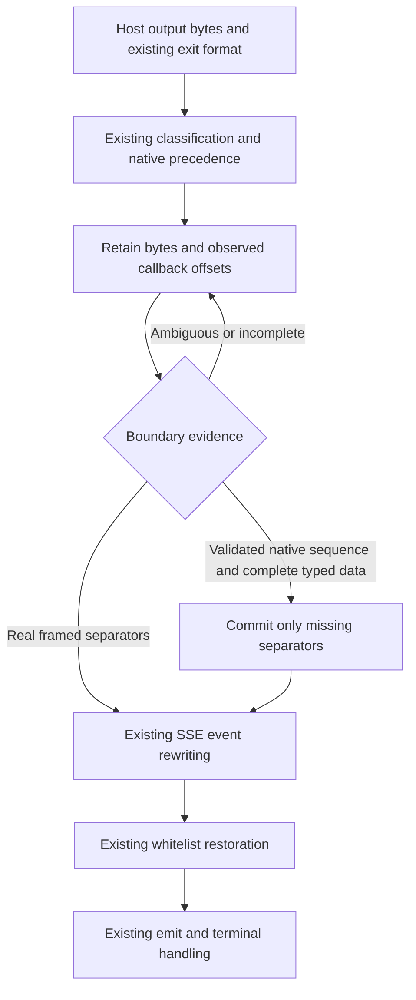

# Native Responses SSE Field Boundaries - Plan

## Goal Capsule

- **Objective:** Mapped Responses clients receive valid, complete terminal data with the Client-Requested Model when native SSE metadata or empty fields precede it.
- **Means:** Confirm field boundaries in the shared incremental rewriter, preserving unresolved bytes and reusing current restoration and lifecycle code (KTD1-KTD3).
- **Authority:** The [design spec](../specs/2026-10-22-native-sse-field-boundaries-design.md) owns R1-R13 and AE1-AE6. This plan defines implementation and verification without changing that scope.
- **Execution:** One coding owner completes TDD, minimal implementation, tests, specification/quality review, corrections, re-review, and commit in one independent worktree. The coordinator merges only completed, reviewed work after checking conflicts.
- **Start state:** The twelve-scope audit and focused verification are complete. F-SSE-001 is the sole implementation scope; review the corrected documents, freeze their existing evidence and controls, then begin U2. Do not reopen the audit or source-signal investigation.
- **Escalation conditions:** Report a newly demonstrated failure of an established supported input, a failed healthy-direct control, a required CPA/ABI change, or an overlapping writer with concrete evidence. The documented custom raw/native same-sequence ambiguity is an existing limit handled by native precedence, not an unresolved start gate. Push, tag, and release require the user's actual authorization; this plan grants none.

---

## Product Contract

### Summary

Implement F-SSE-001 for all confirmed native fields, with exact existing framed/partition controls at their actual formats, focused new-field continuations, and real CPA producer/native/HTTP/WS verification. Preserve the current plugin's model, protocol, limit/ownership, dispatch, and error behavior. Responses keeps its established native-output-unit precedence; an identical unmarked callback sequence cannot also be guaranteed a conflicting raw-wire interpretation.

### Problem Frame

The retained audit shows bare `id`/`retry`, extension metadata, bare `data`/`event`, empty `event:`, and Codex empty `data: ` concatenated with later native fields. Independent baseline native-DLL/real-HTTP verification confirms six metadata regressions and 98 healthy-direct empty-field regressions in the complete 222-case matrix. Event names, JSON type/status/model, output text, and opaque content establish health; HTTP status alone does not. Codex empty-data acceptance uses its confirmed data-only positions. The spec identifies the exact evidence and the custom raw/native interpretation limit. Rebuilt-DLL GREEN acceptance is still required.

### Requirements

Product Contract preserved from the origin spec. The trace below locates verification, rather than restating its protocol rules.

| Requirements | Implementation | Acceptance |
| --- | --- | --- |
| R1-R2, confirmed fields and empty-field semantics | U2, rounds S1-S4 | AE1-AE2; exact root bytes and actual producer/native/HTTP cases |
| R3-R4, complete lifecycle and dispatch | U2, rounds S1-S5 | AE1-AE2; per-Write output, single/two/nine events, mixed shapes, late delimiters |
| R5-R6, existing partitions and native precedence | U2, rounds S1-S5 | AE3; new-field continuations, unchanged old oracles, opaque/resegmented/native and generic-format split/BOM/ending controls |
| R7-R8, discriminator and whitelist preservation | U2-U3 | AE3-AE4; existing error/keepalive/alias, Interactions and JSON controls |
| R9-R11, limits/ownership/raw formats/lifecycle/errors | U2, rounds S5-S6; U3 | AE4-AE5; existing bounds/ownership/allocation, raw/Gemini, terminal/error/shutdown suites |
| R12, unchanged public surfaces and real seams | U2-U3 | AE6; actual RPC envelopes, cgo/native loader, registration and full integration |
| R13, owner completion and patch delivery | U1-U4 | Baseline RED/current GREEN, completed owner commit, independent review, final-SHA CI and authorized release |

### Scope Boundaries

Production edits are confined to `sse_rewriter.go` and necessary boundary classification/retention changes in `stream_rewriter.go`. Tests use the files and callers in the origin's Change reach table. All ten production files remain in the same package; dependencies, configuration, exports, schema, routing, and five formats remain unchanged.

Work is limited to F-SSE-001 and ordinary regression. Do not perform cybersecurity scanning or repair, authentication/credential or digest-integrity investigations, vulnerability or resource-exhaustion investigations, unrelated fixes, or CPA changes. Run existing limit/ownership/performance regressions without adding stress or benchmark campaigns. This task adds no parser, provider branch, mode, retry, migration, dependency, or public interface. README, `CONCEPTS.md`, historical planning documents, CI/Makefile, packaging scripts, and global/project instructions need no edits.

---

## Planning Contract

### Key Technical Decisions

- KTD1. Record tentative offsets only at observed callback boundaries for new fields, retaining their bytes until real framing or a complete validated native sequence confirms missing separators. Widening `isResponsesMetadataField` and immediately appending LF fails `id` + `: cursor` and `retry` + `: 100`. Preserve existing recognized-metadata behavior and old oracles. Governs R1-R2, R5-R6, R9.
- KTD2. Reuse the current incremental scanner, `encoding/json`, `drain`, model restorer, and reset paths. Apply existing type/event/alias checks before confirming new boundaries; preserve repeated/empty event and empty-data semantics. Responses native-shaped units keep native precedence, while whole opaque units and generic-format partitions keep their existing interpretation. No interior-text search, source-marker guess, provider branch, or new mode. Governs R3-R8, R10.
- KTD3. Keep `executor_stream.go`, `main.go`, and `abi_cgo.go` production callers unchanged. Verify complete chunks plus errors and lifecycle effects through their existing interfaces. Governs R9-R12.
- KTD4. Add behavioral root cases in `stream_native_fields_regression_test.go` and one new matrix in the sole CPA fixture, `.github/scripts/testdata/cpa-functional-regression_test.go`. Reuse existing helpers; add no second permanent fixture or smoke entry point. Governs R12-R13.
- KTD5. Keep one parent-lifetime canonical library and sequential enabled Hosts. Record source/build/canonical/actual-loaded identities, including the actual overlay child's Windows shadow DLL PID/path/hash; canonical-only records are incomplete native identity evidence. Governs R12-R13.
- KTD6. Keep default-version integration separate from patch-version registration/packaging. Local tags include `v0.5.14`; `0.5.15` is a candidate to recheck before injection and publication, not a reserved version. Governs R13.

### Boundary flow



### Assumptions and execution-time facts

The pinned CPA is the compatibility target; local controlled upstreams isolate external model services while actual producers, translators, validator, host callbacks, loader, and HTTP/WS consumers run. Stock XAI/Codex whole and bytewise upstream writes yield the same native output units, and complete opaque lines stay whole. The existing ABI has no trusted source marker; custom raw callbacks that collide with native shapes receive the established native interpretation. Do not promise both interpretations or repeat the completed feasibility investigation.

Keep every baseline case, assertion, oracle, size, allocation threshold, and internal timeout, including the partial-metadata characterization and NativeDelimiter. Existing literal-event/all-split generic tables retain their current formats. New continuation tests target bare `id`/`retry`, extensions, and empty-field prefixes without introducing an unconditional Responses wire-partition requirement. Record the eventual implementation commit, existing benchmark results, patch version, CI run, and release identity when they occur.

---

## Implementation Units

### U1. Freeze the reviewed F-SSE-001 inputs

**Goal:** Give the coding owner the corrected scope, fixed acceptance cases, and unchanged compatibility oracles. The audit and focused verification are already complete.

**Requirements:** R1-R13; completed start state.

**Dependencies:** Existing local evidence named in the spec; no new audit or feasibility work.

**Files:** The origin spec and this plan; retained evidence is read-only input.

**Approach:**

1. Review spec first, then plan against the existing scanner, callers, fixture, and commands. Confirm native precedence, the custom raw interpretation limit, all old oracles, and the F-only scope.
2. Freeze the six healthy-direct metadata HTTP regressions from `verify-F-reproduction` and all 222 empty-field case identities/classifications from `verify-F-empty-native/coverage.json` and `results.json`. The 98 confirmed healthy-direct empty-field regressions are a fixed success set; the remaining cases retain their recorded control classifications. Do not choose acceptance cases dynamically after observing repaired output.
3. Give one owner the reviewed document commit and an independent worktree based on the specified production SHA or a coordinator-verified descendant with equivalent relevant code. Freeze baseline sources/tests/fixture membership as described below, then proceed to U2.

**Test expectation:** This document-only revision checks local paths, commands, consistency, and Git diff. It changes no production or test file and claims no runtime GREEN.

**Verification:** The corrected documents contain only F-SSE-001 implementation work and ordinary regression/delivery gates. The present document commit contains exactly the two requested Markdown files.

### U2. Complete the shared boundary fix through vertical TDD

**Goal:** Satisfy R1-R12 across unit, RPC, C ABI/native, and real HTTP seams.

**Dependencies:** U1. One owner holds the overlapping scanner, classification, root-test, and CPA-fixture scope.

**Files:** `sse_rewriter.go`, only necessary classification/retention portions of `stream_rewriter.go`, `stream_native_fields_regression_test.go`, and the sole CPA fixture. A focused new-field continuation case may use `main_test.go` or `stream_protocol_regression_test.go`; do not broaden existing generic partition tables to Responses. Existing performance, limits, ownership, and lifecycle files are unchanged verification targets.

**Patterns:** `gNativeParts`, `gNativeSequence`, `gNativeCompleted`, `gNativeCompletedWant`; existing forwarder callbacks and `runExecutorStreamTestWithHostContentTypeAndForwarded`; `handleMethod`/`setHostCallbackForTest` for real RPC envelopes; the origin's listed CPA helpers for native and HTTP/WS.

**Execution note:** Finish one vertical slice before adding the next. For each newly failing behavior, add its smallest permanent test, run it on frozen baseline production to obtain a target RED, make the smallest shared change, and rerun the same test to GREEN with its controls. Advance the corresponding native fixture case through baseline DLL RED and rebuilt DLL GREEN in that slice. A shared fix may already make a later case pass: retain its baseline RED/current GREEN record without undoing the fix or manufacturing another failure. Existing-correct controls remain GREEN throughout.

| Round | Add first, then obtain baseline RED | Minimal GREEN and required controls |
| --- | --- | --- |
| S1, bare metadata and continuations | `TestFunctionalNativeSSEBoundaryMetadata/bare-id`, then `bare-retry`; add corresponding real producer/native/healthy-direct HTTP cases. Add `TestFunctionalNativeSSEBoundaryContinuations` for `id` + `: cursor\n` and `retry` + `: 100\n`, including bytewise prefix/value continuations. | Retain new candidates and confirm only observed boundaries at the shared scanner. Bare prefixes followed by colon/value remain original fields. Keep the existing partial-metadata characterization, NativeDelimiter, BOM/endings, generic partitions, and all other old assertions unchanged. |
| S2, opaque extensions | `TestFunctionalNativeSSEBoundaryMetadata/extension`; actual `x-request-id: trace-123` before event, in event, and between events for both producers. | Preserve extension bytes and recover later data. Cover split extension names/values, whole opaque event/data text, and all existing Responses metadata-resegmented controls. Never search a field value for boundaries. |
| S3, colonless empty fields | Add `TestFunctionalNativeSSEBoundaryEmptyFields/bare-data`, then `bare-event`, with real producer/native/HTTP cases from the frozen healthy-direct set. | Preserve empty fields without adding non-empty data or disabling the next completion. Include standalone groups, repeated fields, split prefixes, later named-header override, and last-empty-header default `message` semantics. |
| S4, colon-form empty fields | Add `TestFunctionalNativeSSEBoundaryEmptyFields/empty-event`, then `codex-empty-data`; test `event:` and `event: `, plus upstream `data:` and `data: ` spellings as actual producer units. Codex empty-data HTTP acceptance covers its six confirmed data-only positions for each spelling. | Preserve repeated/empty event headers and default names, separate empty data from later JSON, and retain prefix/value continuations. Keep all 98 archived healthy-direct empty-field regressions and their exact case identities. XAI filtered empty data remains a producer control; unhealthy direct explicit-event cases stay separately classified. |
| S5, sequence and dispatch | `TestFunctionalNativeSSEBoundaryDispatch` and `TestFunctionalNativeSSEBoundaryAmbiguity`; complete root/native coverage for confirmed fields at applicable positions and single/created-completed/nine-event, pair/data-only/alternating shapes. Map the full archived matrix to permanent acceptance/control cases. | Assert exact cumulative output after every Write, natural EOF, repeated Flush/Finish, late delimiters, existing complete-comment flush, and no duplicate data. Preserve mismatches, discriminator/alias, markerless, whole opaque and metadata-resegmented controls. Use only healthy-direct shapes for new HTTP success claims. |
| S6, forwarding and ordinary regression | Add `TestFunctionalNativeSSEBoundaryForwarder` and `TestFunctionalNativeSSEBoundaryRPC`; use a representative newly failing field for target RED and other confirmed fields as regressions. | Check terminal payloads, flush-before-close, error precedence, close order/counts, no extra reads, and emit failure without replay through current interfaces. Run existing native controlled-error/close, limit, prefix-plus-error, ownership, allocation, and continuation suites unchanged. Add no resource-stress or performance matrix. |

The names above and `TestModelMapperFunctionalNativeSSEBoundaries` are proposed permanent additions, not baseline tests. Give metadata/empty-field subtests the exact slugs in this table so focused commands select real cases. The CPA test uses `provider/field/position/shape/lifecycle/transport/consumer` subtest components, with `provider` equal to `xai` or `codex` and the same field slugs as the root tests.

**Test scenarios and assertions:**

1. Covers AE1-AE2. Capture core and host non-empty units from both actual providers before asserting what the plugin receives. For every confirmed field, exercise before-event, event/data, between-events, and standalone-empty positions where applicable; test whole and bytewise upstream writes, which must pass through the real Scanner.
2. Covers AE1. Run native mapped execution and real `/v1/responses` streaming plus non-streaming completion where supported by the existing fixture and healthy-direct control. Require expected event names, valid JSON, exact non-empty data count/order, type/status/model, full output, unchanged opaque values and text, Content-Type, EOF, and original request/call/header/URI checks. HTTP 200 or a substring alone is insufficient. Retain all 222 archived case classifications: 98 fixed healthy-direct regressions, 78 healthy controls, and 46 unhealthy-direct cases that do not establish plugin-only success requirements.
3. Covers AE1-AE2. Run direct, enabled-unmapped, and disabled controls for both actual model names. Build each custom wire with the appropriate model; `setFixture` does not clear `p.wire`, so explicitly set or clear `wire` and `records` under `p.mu` before each request.
4. Covers AE3-AE4. Run existing LF/CRLF/CR/mixed-ending, BOM, all-split/bytewise, multi-data JSON, escaped-key, metadata-after-JSON, raw-continuation, and embedded-text controls at their existing formats. New Responses continuation tests cover the new bare/empty/extension candidates without changing old expectations or adding a universal wire-partition requirement. Keep exact output bytes for whole opaque units, Responses metadata-resegmented cases, generic partitions, and genuine mismatches.
5. Covers AE2-AE5. Root tests assert known exact wire and use JSON assertions only on real data frames; `requireValidResponsesSSE` assumes every frame carries JSON and is unsuitable for metadata-only/empty frames. The CPA fixture uses mature `github.com/gin-contrib/sse.Decode` and `encoding/json` to check event name, type/status/model, complete output, opaque values, and text on non-empty data. Assert default `message` for data-only or last-empty-header cases, and the last explicit header where applicable; do not always require event name == JSON type. Keep original metadata/empty-field bytes for exact checks and normalize known line endings only for the LF-only decoder. Add no parser or root dependency.
6. Covers AE5. RPC coverage calls `handleMethod(executor.execute_stream)` with actual encoded envelopes and host callbacks, checks the outbound Upstream Model and supported headers, waits for worker closure, and validates emitted terminal bytes/errors. Keep forwarder tests for precise cleanup/emit ordering. In-process callbacks isolate the host boundary; they do not replace DLL loading.
7. Covers AE4-AE6. Real C ABI coverage loads the rebuilt library through existing `Host`/native loader, exercises registration, execution, reconfigure, unload and reload, and observes the actual producer/validator/HTTP consumer. Preserve WS completion controls and fixed CPA's existing error-only WS limitation.
8. Covers AE5. Run existing incomplete-unit limit, complete-large-unit/batch, prefix-plus-error, clearing-after-error, metadata-before-near-limit JSON, incremental-cursor, and ownership tests unchanged. Preserve the existing checks that mutate input and perform later writes. Review that new tentative state uses the same buffer accounting and reset paths; do not add a resource-exhaustion investigation.

**Verification:** Each newly failing field has genuine assertion-level baseline RED/current GREEN evidence, all old compatibility assertions remain GREEN, and the fixed healthy-direct matrix has rebuilt native/HTTP results. Record already-correct continuation/control cases as GREEN without manufacturing failures. The owner completes the full checks below, specification/quality self-review, corrections, affected retests, re-review, and a normal path-limited commit before handoff. No incomplete implementation or owner checks pass to the coordinator.

### U3. Review and verify the final integrated change

**Goal:** Verify the complete baseline-to-final diff and current binaries against the spec.

**Requirements:** R7-R13, AE3-AE6.

**Dependencies:** Completed U2 commit and owner evidence. The coordinator confirms no conflicting edits before integration.

**Files:** Final production/test/fixture diff; existing ABI, registration, full suites, scripts, build and integration entry points remain unchanged.

**Approach:**

1. Review the entire baseline-to-final change for protocol correctness, scope, duplicate logic, bounded state, input/output ownership, and incremental scan/copy costs. Independent reviewers return findings; the coding owner fixes and re-reviews them in its worktree.
2. Verify that every old oracle remains unchanged, including partial-metadata characterization, NativeDelimiter, metadata-resegmented, discriminator/alias, dispatch, opaque, and generic partition cases. No test, table case, expected key, limit, or deadline may be removed, skipped, weakened, or replaced to obtain GREEN.
3. Rebuild and rerun the full command matrix on the final integrated source. Run the new focused native matrix at least twice. Preserve all four baseline capture key sets and expanded legacy cases, with new cases listed separately. Reconcile all 222 archived empty-field identities/classifications and the fixed 98-case success set.
4. Run existing affected benchmarks against frozen baseline on the same toolchain/host/policy as ordinary performance regression. Correct regressions introduced by this fix while retaining allocation limits and incremental behavior. A one-iteration preflight establishes runnable cases only; add no benchmark or performance campaign.
5. Verify default registration and a separate patch-injected artifact through actual init/register, then package and inspect its bytes using the existing tooling.

**Verification:** Every required command has its real exit status and source/artifact identities. Blocking review findings are corrected and re-reviewed; final-source checks pass with limits reported by execution layer.

### U4. Validate CI and the authorized patch release

**Goal:** Deliver the reviewed patch with matching source, version, and package assets.

**Requirements:** R13, AE6; KTD6.

**Dependencies:** U3, final branch review, and actual authorization for each outward action.

**Files:** Existing Git refs, `.github/workflows/build.yml` output, and release assets; no workflow or packaging implementation change.

**Approach:**

1. Check local/remote tags and GitHub Release occupancy before version injection and again before publication. Select an unused patch; a changed version requires a new injected build/registration/package check.
2. Integrate the completed commit into the authorized target branch without losing existing work. Push/tag only within authorization; never move an occupied tag or force-push.
3. Verify the final SHA's Ubuntu test job actually runs `make integration`. Verify all seven platform builds/packages and the tag release job.
4. Download all seven ZIPs and `checksums.txt` into a new owner-controlled directory. Verify SHA256, names, root dynamic library and `LICENSE`, version identity, Linux GLIBC <=2.17 and macOS deployment target 12.0 using the existing compatibility path.
5. Return actual main/tag/release SHA, version, CI and Release URLs, package validation, and runtime limits. After successful integration, clean only this task's unused, clean, fully merged worktrees/branches through Git.

**Verification:** Final SHA, tag, injected registration version, CI and validated assets agree. Build coverage and actual runtime coverage are reported separately.

---

## Verification Contract

### Evidence and frozen baseline

Run commands from the owner's worktree root, with the current host Go/cgo compiler. On Windows Git Bash, use a Windows-valued `TMPDIR` if required by Go. Use fresh owner-controlled ignored `dist/native-sse-field-boundaries/` evidence directories and OS temporary files for disposable inputs. Preserve failures and separate each attempt's logs; diagnostic Go snapshots belong in an isolated module so they cannot change `go test ./...` package discovery.

Before source edits, freeze all ten production files from the exact baseline Git objects, baseline tests/benchmarks/table cases, the permanent fixture and capture key definitions. A baseline Go overlay maps only production paths to these frozen files while leaving the new tests active. This proves new tests against baseline production without resetting the worktree or deleting edits. Use standard JSON tools to generate/check overlay maps.

Record baseline/current source hashes, tests/fixture/overlay hashes, command/cwd/toolchain/time/exit, CPA revision/module Sum/binary hash, built/canonical library hashes, and actual loaded native library identity. Build-directory HEAD and filenames alone do not prove which source was compiled. The original audit logs are diagnostic evidence, not formal RED/GREEN for the new implementation.

### Focused commands for each slice

The uppercase path variables below are absolute paths resolved and recorded by the owner: `BASELINE_OVERLAY` maps to frozen baseline production; `CPA_COPY` and `FIXTURE_OVERLAY` come from the existing `prepareFunctionalCPAOverlay` mechanism; `BASELINE_PLUGIN` and `GREEN_PLUGIN` are separate persistent canonical paths shaped as `plugins/<host-goos>/<host-goarch>/model-mapper.<ext>`. Both libraries stay alive until their test process exits. Set `ROOT_CASE` and `NATIVE_CASE` to the new case being added, using the S1-S6 slugs.

```bash
export CGO_ENABLED=1 GOWORK=off
# Example S1 selection; change to the actual next slice, never to a non-existent test.
ROOT_CASE='^TestFunctionalNativeSSEBoundaryMetadata$/^bare-id$'
NATIVE_CASE='^TestModelMapperFunctionalNativeSSEBoundaries$/^xai$/^bare-id$'
go test -overlay "$BASELINE_OVERLAY" . -run "$ROOT_CASE" -count=1 -v
go build -trimpath -buildmode=c-shared -overlay "$BASELINE_OVERLAY" -o "$BASELINE_PLUGIN" .
CPA_SMOKE_PLUGIN="$BASELINE_PLUGIN" go -C "$CPA_COPY" test -mod=readonly -overlay "$FIXTURE_OVERLAY" -count=1 -v ./internal/pluginhost -run "$NATIVE_CASE" -timeout=600s
# After the smallest shared production change, repeat the identical assertions.
go test . -run "$ROOT_CASE" -count=1 -v
go build -trimpath -buildmode=c-shared -o "$GREEN_PLUGIN" .
CPA_SMOKE_PLUGIN="$GREEN_PLUGIN" go -C "$CPA_COPY" test -mod=readonly -overlay "$FIXTURE_OVERLAY" -count=1 -v ./internal/pluginhost -run "$NATIVE_CASE" -timeout=600s
go test . -run '^TestFunctionalNativeSSEBoundary|^TestFunctionalNativeSSEField|^TestStreamChunkRewriterDoesNotTreatReadBoundaryAsLineEnding$' -count=1 -v
```

Verify each selected test actually RUNs. Compilation/setup failure, missing DLL, zero selected tests, or a skip is not target RED. Native failure must be an event-name/completion/JSON/model assertion while the frozen direct control succeeds. The same test/fixture assertions and compiler policy apply to RED and GREEN. Also select `codex` and each new field; keep XAI's filtered-data control GREEN. Existing-correct continuations and compatibility controls stay GREEN; no old oracle is changed.

Bootstrap existing default-version integration with `CPA_FUNCTIONAL_EVIDENCE="$BOOTSTRAP_EVIDENCE_DIR" make integration VERSION=` before adding cases; use a fresh absolute evidence directory. The parent integration log's `CPA version=... copy=... overlay=...` line identifies `CPA_COPY` and `FIXTURE_OVERLAY` created by `prepareFunctionalCPAOverlay` under that directory; these are distinct from Makefile's `dist/integration/cpa-src` checkout. The fixture overlay points to the current permanent fixture, so subsequent focused cases reuse it. Keep default, baseline-overlay, and repaired canonical library paths separate. The new focused matrix requires no unrelated binary-capture client state. Full integration uses the original parent entry point below.

### Full local and integration checks

```bash
export CGO_ENABLED=1 GOWORK=off
go test -json -count=1 ./...
go vet ./...
go test -json -race -count=1 -timeout=30m ./...
go test -json -count=1 .github/scripts/package-release.go .github/scripts/package-release_test.go
go test -json -count=1 .github/scripts/check-release-compatibility.go .github/scripts/check-release-compatibility_test.go
go test -json -count=1 .github/scripts/smoke-local.go .github/scripts/smoke-local_test.go
go test . -run '^TestPluginRegistrationMetadataAndConfigFields$|^TestPluginRegisterKeepsSchemaOneForNewerHost$|^TestCIntLengthBounds$|^TestPluginResponseLengthBounds$|^TestCopyPluginRequestRejectsNullWithLength$|^TestPluginCallClearsResponseWhenMethodNil$' -count=1 -v
go test . -run '^TestFunctionalIssue8TerminalPayload$|^TestFunctionalNativeSSEField|^TestFunctionalNativeSSEBoundary|^TestFunctionalShutdown|^TestFunctionalInteractionsLogicalEvents$|^TestFunctionalLogicalEventFormatIsolation$' -count=1 -v
go test . -run '^$' -bench . -benchtime=1x -count=1 -benchmem
go test . -run '^$' -bench 'Benchmark(SSERewriter|StreamChunkRewriter)' -benchtime=500ms -count=5 -benchmem
make build-windows-amd64 VERSION=
CPA_FUNCTIONAL_EVIDENCE="$EVIDENCE_DIR" make integration VERSION=
```

`EVIDENCE_DIR` is a fresh absolute owner directory for each full integration attempt. Repeat the focused native command with `-count=2` after all slices, and run full default integration on final source. Run the corresponding actual Linux native integration locally when available and require final-SHA Ubuntu CI in U4. The Windows build command verifies that target; actual integration builds the current host target. The explicit root cgo cases must RUN with `CGO_ENABLED=1`.

Keep all legacy suites, fixture tests and expanded cases, plus the new matrix. Preserve the four exact capture key sets in the spec, the full 16,842,937-byte translator unit, existing 2 MiB/200-allocation ceilings, native unload/backpressure/error controls, and canonical-library lifetime checks. Raw JSON/Gemini/OpenAI framing, Interactions, escaped/multidata SSE, routing/DSL/config/headers, and ownership are covered by the full suites, not substituted by the focused command.

Do not run `go test ./.github/scripts`: its independent `package main` scripts collide. Ordinary script tests may skip `TestCPAPluginIntegration` without its environment; only the actual non-skipped integration run counts as native acceptance. Preserve internal request/close timeouts and data sizes. Full race's 30-minute limit applies to the complete instrumented suite.

### Version, package, and remote checks

Use an unused candidate verified twice per U4. The following commands show `0.5.15`; absence and transport/authentication failures must be distinguished.

```bash
PATCH=0.5.15
git show-ref --verify "refs/tags/v$PATCH"
git ls-remote --exit-code --tags origin "refs/tags/v$PATCH" "refs/tags/v$PATCH^{}"
gh release view "v$PATCH" --repo DoingDog/cpa-plugin-model-mapper
make package VERSION="$PATCH" GOOS=windows GOARCH=amd64 DIST_DIR=dist/native-sse-field-boundaries/versioned
```

Default `pluginVersion = "0.0.0-dev"` stays unchanged. `TestModelMapperFunctionalReconfigureReload` requires exactly that value; keep the patch library separate from default integration. For injected-version acceptance, a verification-only overlay test named `TestModelMapperPatchRegistration` reuses the existing native Host loader and asserts actual `record.meta.Version` against the chosen patch literal, schema, formats and configuration fields. Generate it in the owner's evidence directory, overlay it into the same CPA test package, and run it against the separate versioned canonical library; it is neither a second permanent fixture nor a new product option.

```bash
CPA_SMOKE_PLUGIN="$VERSIONED_PLUGIN" go -C "$CPA_COPY" test -mod=readonly -overlay "$VERSION_OVERLAY" -count=1 -v ./internal/pluginhost -run '^TestModelMapperPatchRegistration$' -timeout=600s
git diff --check
git diff --cached --check
# After authorized publication, inspect the actual final-SHA run and assets.
gh run view "$RUN_ID" --repo DoingDog/cpa-plugin-model-mapper --json headSha,status,conclusion,jobs
gh release view "v$PATCH" --repo DoingDog/cpa-plugin-model-mapper --json tagName,targetCommitish,url,assets
gh release download "v$PATCH" --repo DoingDog/cpa-plugin-model-mapper --dir "$RELEASE_DIR"
```

`VERSION_OVERLAY` includes the same permanent fixture plus the verification-only registration assertion; `VERSIONED_PLUGIN` has the canonical platform path shape. Verify ZIP/checksum contents with established ZIP and SHA256 tools, including extracted-library identity. Sidecars, archive names, or source variables do not prove runtime registration Version. Keep all seven targets: linux/amd64, linux/arm64, darwin/amd64, darwin/arm64, windows/amd64, windows/arm64, freebsd/amd64. Remote checks occur only in the authorized delivery phase; this documentation task performs none.

---

## Definition of Done

- U1 freezes the corrected F-only documents, existing evidence, baseline membership, and fixed healthy-direct acceptance cases. The completed audit is not reopened.
- Every confirmed field and required position/shape has permanent baseline RED/current GREEN or existing-correct control evidence. All old oracles and actual-format partition assertions remain unchanged, including characterization, NativeDelimiter, metadata-resegmented, opaque, discriminator/alias, and per-Write dispatch.
- The sole CPA fixture proves actual producer -> C ABI/native -> real HTTP terminal delivery, with direct/disabled/unmapped controls, expected event names, JSON type/status/model, complete output, unchanged opaque/text values, and actual upstream request checks. All 222 archived empty-field case identities/classifications are accounted for, including the fixed 98 healthy-direct regressions and Codex data-only empty-data positions. RPC callbacks and consumer replay are identified separately from DLL loading.
- Existing bounds, complete-prefix-plus-error, ownership, allocation, raw/Gemini/Interactions, dispatch, and error/lifecycle suites satisfy R3-R12 unchanged. Every added case is traceable; legacy assertions and capture membership are preserved. No cybersecurity scan/repair, new resource-stress matrix, or performance campaign is performed.
- The same coding owner completes review, corrections, retests, re-review and the implementation commit in its worktree. The coordinator integrates only completed, conflict-checked work; final integrated checks and independent review pass.
- Default and patch-injected artifacts have actual registration evidence. Authorized CI/release checks bind final SHA, seven-platform packages, checksums, root contents and version; unexecuted runtime platforms and host limitations are explicit.
- Abandoned implementation attempts, duplicate helpers and task-created disposable files are removed without deleting user files. This document-only delivery stages and commits exactly the two requested planning documents, with no runtime or publication claim.
