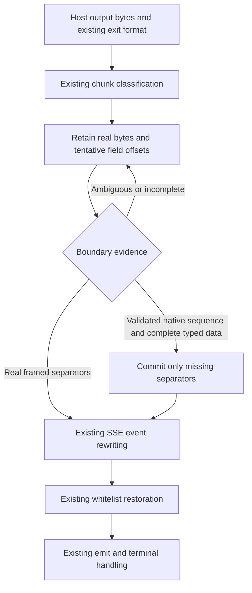

# Native Responses SSE Field Boundaries - Plan

## Goal Capsule

- **Objective:** Mapped Responses clients receive valid, complete terminal data with the Client-Requested Model when native SSE metadata or empty fields precede it.
- **Means:** Confirm field boundaries in the shared incremental rewriter, preserving unresolved bytes and reusing current restoration and lifecycle code (KTD1-KTD3).
- **Authority:** The [design spec](../specs/2026-10-22-native-sse-field-boundaries-design.md) owns R1-R13 and AE1-AE6. This plan defines implementation and verification without changing that scope.
- **Execution:** One coding owner completes TDD, minimal implementation, tests, specification/quality review, corrections, re-review, and commit in one independent worktree. The coordinator merges only completed, reviewed work after checking conflicts.
- **Start gate:** The coordinator must receive all twelve audit scopes and independent verification, resolve all candidates, incorporate any other confirmed plugin-owned defect into both documents, and complete document review before production or test edits. This documentation task leaves that gate unasserted.
- **Stop conditions:** A same-input protocol conflict, failed producer control, required CPA/ABI change, or overlapping writer returns to the coordinator with evidence. Push, tag, and release require the user's actual authorization; this plan grants none.

---

## Product Contract

### Summary

Implement F-SSE-001 for the confirmed native fields, with exact framed-partition controls and real CPA producer/native/HTTP verification. Preserve the current plugin's model, protocol, resource, and error behavior.

### Problem Frame

The retained audit shows bare `id`/`retry`, extension metadata, bare `data`/`event`, empty `event:`, and Codex empty `data: ` concatenated with later native fields. The independent real-consumer replay turns direct HTTP 200 into mapped HTTP 502 for the first three shapes. Current metadata recovery also inserts LF inside split standard fields/comments. The spec's evidence table distinguishes these observations from the rebuilt-DLL acceptance still required.

### Requirements

Product Contract preserved from the origin spec. The trace below locates verification, rather than restating its protocol rules.

| Requirements | Implementation | Acceptance |
| --- | --- | --- |
| R1-R2, confirmed fields and empty-field semantics | U2, rounds S1-S4 | AE1-AE2; exact root bytes and actual producer/native/HTTP cases |
| R3-R4, complete lifecycle and dispatch | U2, rounds S1-S5 | AE1-AE2; per-Write output, single/two/nine events, mixed shapes, late delimiters |
| R5-R6, framed partitions and ambiguity | U2, rounds S1-S5 | AE3; no speculative LF, all splits/BOM/endings, opaque controls |
| R7-R8, discriminator and whitelist preservation | U2-U3 | AE3-AE4; existing error/keepalive/alias, Interactions and JSON controls |
| R9-R11, resources/raw formats/lifecycle/errors | U2, rounds S5-S6; U3 | AE4-AE5; bounds/ownership/allocations, raw/Gemini, terminal/error/shutdown suites |
| R12, unchanged public surfaces and real seams | U2-U3 | AE6; actual RPC envelopes, cgo/native loader, registration and full integration |
| R13, owner completion and patch delivery | U1-U4 | Baseline RED/current GREEN, completed owner commit, independent review, final-SHA CI and authorized release |

### Scope Boundaries

Production edits are confined to `sse_rewriter.go` and necessary boundary classification/retention changes in `stream_rewriter.go`. Tests use the files and callers in the origin's Change reach table. All ten production files remain in the same package; dependencies, configuration, exports, schema, routing, and five formats remain unchanged.

Gemini `countTokens` and host error information missing from the current ABI remain host limitations. This task adds no host patch, new parser, provider branch, mode, retry, or migration. README, `CONCEPTS.md`, historical planning documents, CI/Makefile, packaging scripts, and global/project instructions need no edits.

---

## Planning Contract

### Key Technical Decisions

- KTD1. Use tentative boundary offsets/state in the existing rewriter, with byte-preserving retention until the native sequence is validated. Widening `isResponsesMetadataField` and immediately appending LF fails the `id` + `: cursor` and `retry` + `: 100` controls. Governs R1-R2, R5-R6, R9.
- KTD2. Reuse the current incremental scanner, `encoding/json`, `drain`, model restorer, and reset paths. Keep ordinary framed parsing and existing logical dispatch distinct; no global native-mode guess from the first callback. Governs R3-R8, R10.
- KTD3. Keep `executor_stream.go`, `main.go`, and `abi_cgo.go` production callers unchanged. Verify complete chunks plus errors and lifecycle effects through their existing interfaces. Governs R9-R12.
- KTD4. Add behavioral root cases in `stream_native_fields_regression_test.go` and one new matrix in the sole CPA fixture, `.github/scripts/testdata/cpa-functional-regression_test.go`. Reuse existing helpers; add no second permanent fixture or smoke entry point. Governs R12-R13.
- KTD5. Keep one parent-lifetime canonical library and sequential enabled Hosts. Record source/build/canonical/actual-loaded identities, including the actual overlay child's Windows shadow DLL PID/path/hash; canonical-only records are incomplete native identity evidence. Governs R12-R13.
- KTD6. Keep default-version integration separate from patch-version registration/packaging. Local tags include `v0.5.14`; `0.5.15` is a candidate to recheck before injection and publication, not a reserved version. Governs R13.

### Boundary flow



### Assumptions and execution-time facts

The pinned CPA is the compatibility target; local fake upstreams isolate external model services while actual producers, translators, validator, host callbacks, loader, and HTTP/WS consumers run. The exact minimal state changes are determined by the vertical tests. Gate completion, the eventual implementation commit, benchmark results, final patch version, CI run, and release identity are facts to record when they occur.

The current partial-metadata characterization has one incompatible expected byte sequence, identified explicitly in the spec. Correct that oracle only with its focused framed RED/GREEN proof. Preserve every other baseline case, assertion, size, and internal timeout; add Responses to partition tables that currently cover metadata only through `claude`.

---

## Implementation Units

### U1. Close the audit and planning gate

**Goal:** Establish the complete reviewed implementation scope before a coding owner starts.

**Requirements:** R13; Start gate.

**Dependencies:** All twelve audit returns and independent verification, delivered to the coordinator by completion notifications.

**Files:** The origin spec and this plan; retained audit artifacts are read-only inputs.

**Approach:**

1. Match all twelve named audit scopes to complete results and resolve each candidate. Investigate missing coverage without replacing it with sampling.
2. Confirm F-SSE-001 evidence and any additional confirmed plugin-owned issue; update spec first and plan second if scope changes.
3. Review both documents against current callers, fixtures, commands, R/AE/KTD references, and the ambiguity constraints. Correct and re-review blocking issues.
4. Give one owner the reviewed document commit and an independent worktree whose production baseline is the specified SHA or a coordinator-verified descendant with equivalent relevant code.

**Test expectation:** Documentation checks only. No product tests, builds, production edits, or test edits during this document-only unit.

**Verification:** The coordinator has a coverage-complete audit and review record. The present document task's commit contains only the two requested Markdown files.

### U2. Complete the shared boundary fix through vertical TDD

**Goal:** Satisfy R1-R12 across unit, RPC, C ABI/native, and real HTTP seams.

**Dependencies:** U1. One owner holds the overlapping scanner, classification, root-test, and CPA-fixture scope.

**Files:** `sse_rewriter.go`, necessary portions of `stream_rewriter.go`, `stream_native_fields_regression_test.go`, and the sole CPA fixture. Necessary partition-table extensions may touch `main_test.go` or `stream_protocol_regression_test.go`. Existing performance/lifecycle files are verification targets; add only a focused boundary case if needed, without altering thresholds or unrelated assertions.

**Patterns:** `gNativeParts`, `gNativeSequence`, `gNativeCompleted`, `gNativeCompletedWant`; existing forwarder callbacks and `runExecutorStreamTestWithHostContentTypeAndForwarded`; `handleMethod`/`setHostCallbackForTest` for real RPC envelopes; the origin's listed CPA helpers for native and HTTP/WS.

**Execution note:** Finish one vertical slice before adding the next. For each newly failing behavior, add its smallest permanent test, run it on frozen baseline production to obtain a target RED, make the smallest shared change, and rerun the same test to GREEN with its controls. Advance the corresponding native fixture case through baseline DLL RED and rebuilt DLL GREEN in that slice. A shared fix may already make a later case pass: retain its baseline RED/current GREEN record without undoing the fix or manufacturing another failure. Existing-correct controls remain GREEN throughout.

| Round | Add first, then obtain baseline RED | Minimal GREEN and required controls |
| --- | --- | --- |
| S1, bare metadata and standard continuations | `TestFunctionalNativeSSEBoundaryMetadata/bare-id`, then `bare-retry`; add each corresponding producer/native/HTTP case. Add `TestFunctionalNativeSSEBoundaryWirePartitions` for `id` + `: cursor`, `retry` + `: 100`, split `id:`/`retry:`, and split comments before broadening recognition. | Retain candidate bytes and confirm boundaries at the shared source. Run every split, bytewise, BOM and line-ending controls with Responses active. Correct the one documented characterization oracle after its target RED; keep all other assertions. |
| S2, opaque extensions | `TestFunctionalNativeSSEBoundaryMetadata/extension`; real `x-request-id: trace-123` before event, in event, and between events for both producers. | Preserve extension bytes and recover the later data. Split extension names/values and metadata containing canonical field text must remain opaque. |
| S3, colonless empty fields | Add `TestFunctionalNativeSSEBoundaryEmptyFields/bare-data`, then `bare-event`, with real producer/native/HTTP cases. | Preserve empty fields without adding non-empty data or disabling the next completion. Include repeated empty fields, standalone empty-field groups, and split field names. |
| S4, colon-form empty fields | Add `TestFunctionalNativeSSEBoundaryEmptyFields/empty-event`, then `codex-empty-data`; capture actual `event:` and Codex `data: ` units. | Recover standalone empty event, repeated/empty event headers, and empty data followed by valid JSON. XAI filtered empty `data:` stays an actual producer control. Partial `event:`/`data:` values retain ordinary framed bytes. |
| S5, sequence and dispatch | `TestFunctionalNativeSSEBoundaryDispatch` and `TestFunctionalNativeSSEBoundaryAmbiguity`; extend the CPA matrix to every confirmed field at applicable positions and single/created-completed/nine-event, pair/data-only/alternating shapes. | Verify exact cumulative output after every Write, natural EOF, repeated Flush/Finish, late delimiters, existing complete-comment flush, and no duplicate data. Preserve mismatches, markerless and opaque canonical-text controls. |
| S6, failures and resources | `TestFunctionalNativeSSEBoundaryForwarder`, `TestFunctionalNativeSSEBoundaryRPC`, and `TestFunctionalNativeSSEBoundaryResources`; use a representative newly failing field for target RED and all remaining fields as regression cases. | Preserve complete-prefix-plus-error, terminal payloads, callback/decode/in-band/rewrite/emit/cleanup errors, close order/counts, no extra reads, no replay, bounds, ownership and allocations. Run real native controlled error/close cases as well as happy-path HTTP. |

The names above and `TestModelMapperFunctionalNativeSSEBoundaries` are proposed permanent additions, not baseline tests. Give metadata/empty-field subtests the exact slugs in this table so focused commands select real cases. The CPA test uses `provider/field/position/shape/lifecycle/transport/consumer` subtest components, with `provider` equal to `xai` or `codex` and the same field slugs as the root tests.

**Test scenarios and assertions:**

1. Covers AE1-AE2. Capture core and host non-empty units from both actual providers before asserting what the plugin receives. For every confirmed field, exercise before-event, event/data, between-events, and standalone-empty positions where applicable; test whole and bytewise upstream writes, which must pass through the real Scanner.
2. Covers AE1. Run native mapped execution and real `/v1/responses` streaming plus non-streaming completion where supported by the existing fixture. Require valid JSON, exact data count/order, completed status, full output, model restoration, Content-Type, EOF, and original request/call/header/URI checks. HTTP 200 or a model substring alone is insufficient.
3. Covers AE1-AE2. Run direct, enabled-unmapped, and disabled controls for both actual model names. Build each custom wire with the appropriate model; `setFixture` does not clear `p.wire`, so explicitly set or clear `wire` and `records` under `p.mu` before each request.
4. Covers AE3-AE4. Standard framed controls cover LF/CRLF/CR/mixed endings, BOM, every split, bytewise and irregular partitions, multi-data JSON, escaped keys, unknown/colonless fields, metadata after complete JSON, embedded canonical strings, and raw-looking continuations. Keep exact output bytes, not merely decoded equality.
5. Covers AE2-AE5. Root tests assert known exact wire. Use existing JSON assertions only on real data frames; `requireValidResponsesSSE` assumes every frame carries JSON and is unsuitable for metadata-only/empty frames. The CPA fixture uses its existing `sse.Decode` plus JSON validation of non-empty data, retaining metadata/empty-frame bytes for separate exact assertions. Add no parser or root dependency.
6. Covers AE5. RPC coverage calls `handleMethod(executor.execute_stream)` with actual encoded envelopes and host callbacks, checks the outbound Upstream Model and supported headers, waits for worker closure, and validates emitted terminal bytes/errors. Keep forwarder tests for precise cleanup/emit ordering. In-process callbacks isolate the host boundary; they do not replace DLL loading.
7. Covers AE4-AE6. Real C ABI coverage loads the rebuilt library through existing `Host`/native loader, exercises registration, execution, reconfigure, unload and reload, and observes the actual producer/validator/HTTP consumer. Preserve WS completion controls and fixed CPA's existing error-only WS limitation.
8. Covers AE5. Bound incomplete JSON, incomplete fields, ambiguous candidate chains, and incomplete suffixes at and above 16 MiB. Preserve complete units/batches above the limit, completed metadata before a near-limit JSON unit, valid prefixes on failure, and clearing after overflow. Mutate input buffers and issue later writes to prove output ownership.

**Verification:** All slices have genuine assertion-level RED/GREEN evidence, exact framed controls, and real native/HTTP results. The owner completes full checks below, specification/quality self-review, corrections, affected retests, re-review, and a normal path-limited commit before handoff. No incomplete implementation or owner checks pass to the coordinator.

### U3. Review and verify the final integrated change

**Goal:** Verify the complete baseline-to-final diff and current binaries against the spec.

**Requirements:** R7-R13, AE3-AE6.

**Dependencies:** Completed U2 commit and owner evidence. The coordinator confirms no conflicting edits before integration.

**Files:** Final production/test/fixture diff; existing ABI, registration, full suites, scripts, build and integration entry points remain unchanged.

**Approach:**

1. Review the entire baseline-to-final change for protocol correctness, scope, duplicate logic, bounded state, input/output ownership, and incremental scan/copy costs. Independent reviewers return findings; the coding owner fixes and re-reviews them in its worktree.
2. Verify that the one corrected oracle follows R5 and no unrelated test, table case, expected key, limit, or deadline was removed, skipped, weakened, or replaced.
3. Rebuild and rerun the full command matrix on the final integrated source. Run the new focused native matrix at least twice. Preserve all four baseline capture key sets and all expanded legacy cases, with new cases listed separately.
4. Compare affected benchmark runs against frozen baseline on the same toolchain/host/policy. Investigate repeatable regressions; retain existing allocation limits and incremental behavior. A one-iteration preflight establishes runnable cases only.
5. Verify default registration and a separate patch-injected artifact through actual init/register, then package and inspect its bytes using the existing tooling.

**Verification:** Every required command has its real exit status and source/artifact identities. Blocking review findings are corrected and re-reviewed; final-source checks pass with limits reported by execution layer.

### U4. Validate CI and the authorized patch release

**Goal:** Deliver the reviewed patch with matching source, version, and package assets.

**Requirements:** R13, AE6; KTD6.

**Dependencies:** U3, final branch review, and actual authorization for each outward action.

**Files:** Existing Git refs, `.github/workflows/build.yml` output, and release assets; no workflow or packaging implementation change.

**Approach:**

1. Check local/remote tags and GitHub Release occupancy before version injection and again before publication. Select an unused patch; a changed version requires a new injected build/registration/package check.
2. Integrate the completed commit into the authorized target branch without losing existing work. Push/tag only within authorization; never move an occupied tag or force-push.
3. Verify the final SHA's Ubuntu test job actually runs `make integration`. Verify all seven platform builds/packages and the tag release job.
4. Download all seven ZIPs and `checksums.txt` into a new owner-controlled directory. Verify SHA256, names, root dynamic library and `LICENSE`, version identity, Linux GLIBC <=2.17 and macOS deployment target 12.0 using the existing compatibility path.
5. Return actual main/tag/release SHA, version, CI and Release URLs, package validation, and runtime limits. After successful integration, clean only this task's unused, clean, fully merged worktrees/branches through Git.

**Verification:** Final SHA, tag, injected registration version, CI and validated assets agree. Build coverage and actual runtime coverage are reported separately.

---

## Verification Contract

### Evidence and frozen baseline

Run commands from the owner's worktree root, with the current host Go/cgo compiler. On Windows Git Bash, use a Windows-valued `TMPDIR` if required by Go. Use fresh owner-controlled ignored `dist/native-sse-field-boundaries/` evidence directories and OS temporary files for disposable inputs. Preserve failures and separate each attempt's logs; diagnostic Go snapshots belong in an isolated module so they cannot change `go test ./...` package discovery.

Before source edits, freeze all ten production files from the exact baseline Git objects, baseline tests/benchmarks/table cases, the permanent fixture and capture key definitions. A baseline Go overlay maps only production paths to these frozen files while leaving the new tests active. This proves new tests against baseline production without resetting the worktree or deleting edits. Use standard JSON tools to generate/check overlay maps.

Record baseline/current source hashes, tests/fixture/overlay hashes, command/cwd/toolchain/time/exit, CPA revision/module Sum/binary hash, built/canonical library hashes, and actual loaded native library identity. Build-directory HEAD and filenames alone do not prove which source was compiled. The original audit logs are diagnostic evidence, not formal RED/GREEN for the new implementation.

### Focused commands for each slice

The uppercase path variables below are absolute paths resolved and recorded by the owner: `BASELINE_OVERLAY` maps to frozen baseline production; `CPA_COPY` and `FIXTURE_OVERLAY` come from the existing `prepareFunctionalCPAOverlay` mechanism; `BASELINE_PLUGIN` and `GREEN_PLUGIN` are separate persistent canonical paths shaped as `plugins/<host-goos>/<host-goarch>/model-mapper.<ext>`. Both libraries stay alive until their test process exits. Set `ROOT_CASE` and `NATIVE_CASE` to the new case being added, using the S1-S6 slugs.

```bash
export CGO_ENABLED=1
# Example S1 selection; change to the actual next slice, never to a non-existent test.
ROOT_CASE='^TestFunctionalNativeSSEBoundaryMetadata$/^bare-id$'
NATIVE_CASE='^TestModelMapperFunctionalNativeSSEBoundaries$/^xai$/^bare-id$'
go test -overlay "$BASELINE_OVERLAY" . -run "$ROOT_CASE" -count=1 -v
go build -trimpath -buildmode=c-shared -overlay "$BASELINE_OVERLAY" -o "$BASELINE_PLUGIN" .
CPA_SMOKE_PLUGIN="$BASELINE_PLUGIN" go -C "$CPA_COPY" test -mod=readonly -overlay "$FIXTURE_OVERLAY" -count=1 -v ./internal/pluginhost -run "$NATIVE_CASE" -timeout=600s
# After the smallest shared production change, repeat the identical assertions.
go test . -run "$ROOT_CASE" -count=1 -v
go build -trimpath -buildmode=c-shared -o "$GREEN_PLUGIN" .
CPA_SMOKE_PLUGIN="$GREEN_PLUGIN" go -C "$CPA_COPY" test -mod=readonly -overlay "$FIXTURE_OVERLAY" -count=1 -v ./internal/pluginhost -run "$NATIVE_CASE" -timeout=600s
go test . -run '^TestFunctionalNativeSSEBoundary|^TestFunctionalNativeSSEField|^TestStreamChunkRewriterDoesNotTreatReadBoundaryAsLineEnding$' -count=1 -v
```

Verify each selected test actually RUNs. Compilation/setup failure, missing DLL, zero selected tests, or a skip is not target RED. Native failure must be the completion/JSON/model assertion while direct controls succeed. The same test/fixture assertions and compiler policy apply to RED and GREEN. Also select `codex` and each new field; keep XAI's filtered-data control GREEN. For framed controls already broken at baseline, record their own assertion-level RED before changing the boundary logic.

Bootstrap the existing CPA copy/overlay and baseline integration controls with `make integration VERSION=` before adding cases, retaining the generated paths through `CPA_FUNCTIONAL_EVIDENCE`. The focused matrix runs only the new native fixture, so it needs no unrelated binary-capture client state. Full integration uses the original parent entry point below.

### Full local and integration checks

```bash
export CGO_ENABLED=1
go test -json -count=1 ./...
go vet ./...
go test -json -race -count=1 -timeout=30m ./...
go test -json -count=1 .github/scripts/package-release.go .github/scripts/package-release_test.go
go test -json -count=1 .github/scripts/check-release-compatibility.go .github/scripts/check-release-compatibility_test.go
go test -json -count=1 .github/scripts/smoke-local.go .github/scripts/smoke-local_test.go
go test . -run '^TestPluginRegistrationMetadataAndConfigFields$|^TestPluginRegisterKeepsSchemaOneForNewerHost$|^TestCIntLengthBounds$|^TestPluginResponseLengthBounds$|^TestCopyPluginRequestRejectsNullWithLength$|^TestPluginCallClearsResponseWhenMethodNil$' -count=1 -v
go test . -run '^TestFunctionalIssue8TerminalPayload$|^TestFunctionalNativeSSEField|^TestFunctionalNativeSSEBoundary|^TestFunctionalShutdown|^TestFunctionalInteractionsLogicalEvents$|^TestFunctionalLogicalEventFormatIsolation$' -count=1 -v
go test . -run '^$' -bench . -benchtime=1x -count=1 -benchmem
go test . -run '^$' -bench 'Benchmark(SSERewriter|StreamChunkRewriter)' -benchtime=500ms -count=5 -benchmem
make build-windows-amd64 VERSION=
CPA_FUNCTIONAL_EVIDENCE="$EVIDENCE_DIR" make integration VERSION=
```

`EVIDENCE_DIR` is a fresh absolute owner directory for each full integration attempt. Repeat the focused native command with `-count=2` after all slices, and run full default integration on final source. Run the corresponding actual Linux native integration locally when available and require final-SHA Ubuntu CI in U4. The Windows build command verifies that target; actual integration builds the current host target. The explicit root cgo cases must RUN with `CGO_ENABLED=1`.

Keep all legacy suites, fixture tests and expanded cases, plus the new matrix. Preserve the four exact capture key sets in the spec, the full 16,842,937-byte translator unit, existing 2 MiB/200-allocation ceilings, native unload/backpressure/error controls, and canonical-library lifetime checks. Raw JSON/Gemini/OpenAI framing, Interactions, escaped/multidata SSE, routing/DSL/config/headers, and ownership are covered by the full suites, not substituted by the focused command.

Do not run `go test ./.github/scripts`: its independent `package main` scripts collide. Ordinary script tests may skip `TestCPAPluginIntegration` without its environment; only the actual non-skipped integration run counts as native acceptance. Preserve internal request/close timeouts and data sizes. Full race's 30-minute limit applies to the complete instrumented suite.

### Version, package, and remote checks

Use an unused candidate verified twice per U4. The following commands show `0.5.15`; absence and transport/authentication failures must be distinguished.

```bash
PATCH=0.5.15
git show-ref --verify "refs/tags/v$PATCH"
git ls-remote --exit-code --tags origin "refs/tags/v$PATCH" "refs/tags/v$PATCH^{}"
gh release view "v$PATCH" --repo DoingDog/cpa-plugin-model-mapper
make package VERSION="$PATCH" GOOS=windows GOARCH=amd64 DIST_DIR=dist/native-sse-field-boundaries/versioned
```

Default `pluginVersion = "0.0.0-dev"` stays unchanged. `TestModelMapperFunctionalReconfigureReload` requires exactly that value; keep the patch library separate from default integration. For injected-version acceptance, a verification-only overlay test named `TestModelMapperPatchRegistration` reuses the existing native Host loader and asserts actual `record.meta.Version` against the chosen patch literal, schema, formats and configuration fields. Generate it in the owner's evidence directory, overlay it into the same CPA test package, and run it against the separate versioned canonical library; it is neither a second permanent fixture nor a new product option.

```bash
CPA_SMOKE_PLUGIN="$VERSIONED_PLUGIN" go -C "$CPA_COPY" test -mod=readonly -overlay "$VERSION_OVERLAY" -count=1 -v ./internal/pluginhost -run '^TestModelMapperPatchRegistration$' -timeout=600s
git diff --check
git diff --cached --check
# After authorized publication, inspect the actual final-SHA run and assets.
gh run view "$RUN_ID" --repo DoingDog/cpa-plugin-model-mapper --json headSha,status,conclusion,jobs
gh release view "v$PATCH" --repo DoingDog/cpa-plugin-model-mapper --json tagName,targetCommitish,url,assets
gh release download "v$PATCH" --repo DoingDog/cpa-plugin-model-mapper --dir "$RELEASE_DIR"
```

`VERSION_OVERLAY` includes the same permanent fixture plus the verification-only registration assertion; `VERSIONED_PLUGIN` has the canonical platform path shape. Verify ZIP/checksum contents with established ZIP and SHA256 tools, including extracted-library identity. Sidecars, archive names, or source variables do not prove runtime registration Version. Keep all seven targets: linux/amd64, linux/arm64, darwin/amd64, darwin/arm64, windows/amd64, windows/arm64, freebsd/amd64. Remote checks occur only in the authorized delivery phase; this documentation task performs none.

---

## Definition of Done

- U1's full audit, independent verification, and document-review gate is recorded before production/test edits.
- Every confirmed field and required position/shape is represented by permanent tests with actual baseline RED/current GREEN or existing-correct control evidence; ambiguity and framed-partition assertions remain exact.
- The sole CPA fixture proves actual producer -> C ABI/native -> real HTTP terminal delivery, with direct/disabled/unmapped controls, actual upstream request checks, and complete output. RPC mocks and consumer replay are identified separately.
- Bounds, complete-prefix-plus-error, ownership, allocation, raw/Gemini/Interactions behavior, dispatch and error/lifecycle conditions satisfy R3-R12. The one corrected oracle and every added case are traceable; legacy assertions and capture membership are preserved.
- The same coding owner completes review, corrections, retests, re-review and the implementation commit in its worktree. The coordinator integrates only completed, conflict-checked work; final integrated checks and independent review pass.
- Default and patch-injected artifacts have actual registration evidence. Authorized CI/release checks bind final SHA, seven-platform packages, checksums, root contents and version; unexecuted runtime platforms and host limitations are explicit.
- Abandoned implementation attempts, duplicate helpers and task-created disposable files are removed without deleting user files. This document-only delivery stages and commits exactly the two requested planning documents, with no runtime or publication claim.
