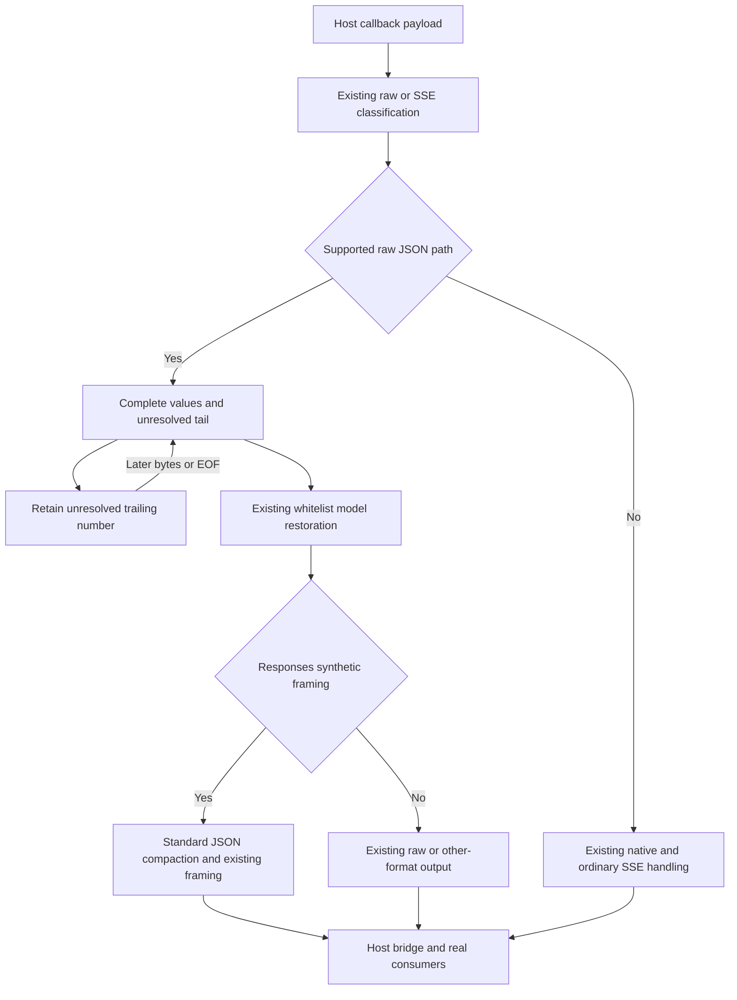
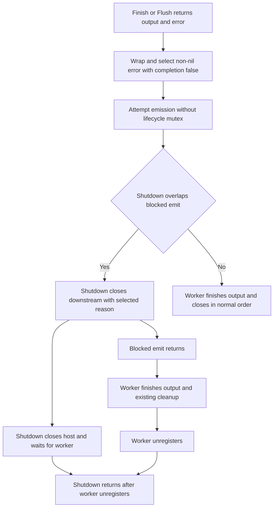
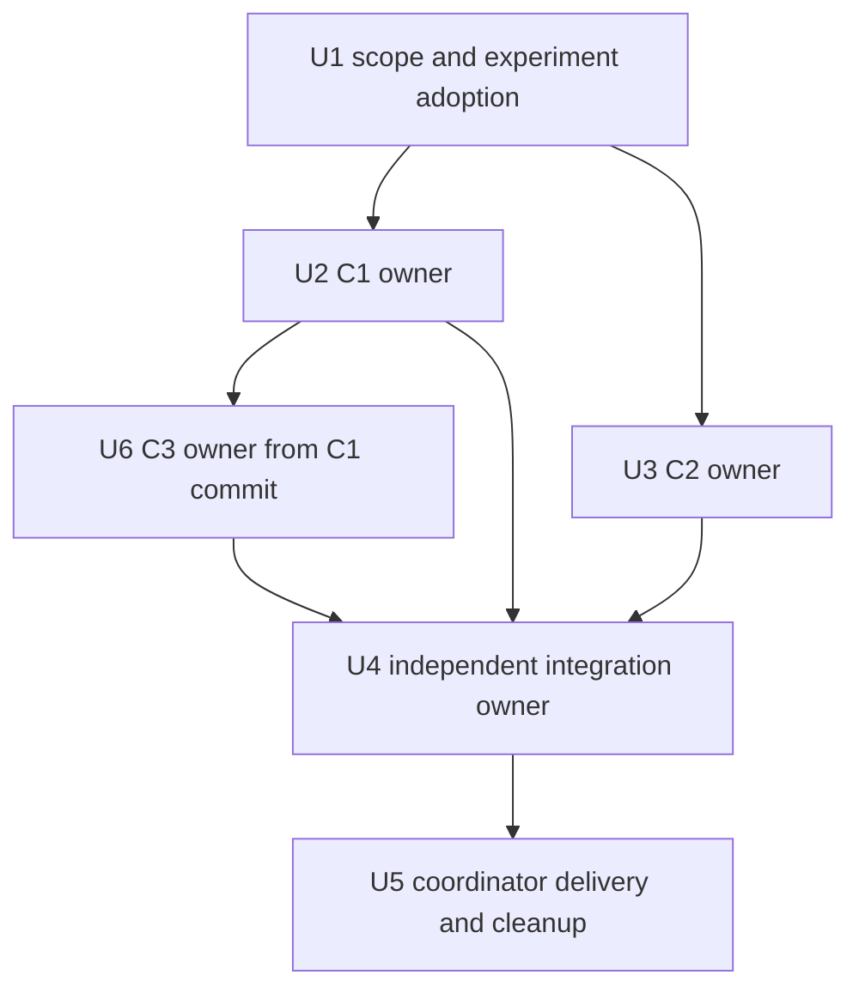

# Functional Stream Corrections - Plan

## Goal Capsule

- **Objective:** Mapped stream consumers receive supported JSON content with the Client-Requested Model and retain the known error when shutdown interrupts output.
- **Means:** Scoped synthetic framing, existing terminal selection, and deferred consumption of unresolved trailing numbers, per KTD1-KTD3.
- **Authority:** The [final specification](../specs/2026-10-23-functional-stream-corrections-design.md) owns R1-R17 and AE1-AE8. This plan defines implementation and verification without changing that Product Contract.
- **Execution:** C1 and C2 finish independently in separate worktrees. C3 starts from C1's completed commit. The integration owner accepts only completed reviewed commits; the coordinator merges validated integration into local main and performs publication only under actual user authority.
- **Stop conditions:** New evidence contradicting the spec, an unexplained changed file, an overlapping writer, a required CPA/public-interface change, or an old oracle failure requires an evidence-backed correction of scope or ownership. Return required implementation corrections to their owner; do not leave unfinished code with the coordinator.

The original thirteen audit assignments, three cross-module checks, C1/C2 verification, and C3/coverage verification have all returned. All three defects are included. The only conditional production reach is R8's `processPayload` test gate. The documentation task runs none of the tests, builds, merges, or release operations below.

---

## Product Contract

### Summary

Repair C1 at Responses synthetic raw framing, C2 before known-error output can block, and C3 where a numeric token's local Reader EOF is mistaken for its stream boundary. Use existing stream, JSON, lifecycle, native integration, and release mechanisms.

### Problem Frame

The spec's native reproductions show three observable failures: a mapped pretty completion never reaches the actual Responses WS client, shutdown replaces a known flush parse error, and a split decimal/exponent leaves a later response model unrestored. The spec distinguishes supported controlled SDK/ABI inputs from unproven stock-provider behavior and records the successful controls.

### Requirements

Product Contract unchanged from the final specification. Its R1-R17 and AE1-AE8 are incorporated by reference; the table maps every requirement to implementation and evidence.

| Spec requirement | Responsible units | Completion evidence |
| --- | --- | --- |
| R1-R2 | U2, U4 | AE1, actual WS completion/close, single-line synthetic wire, HTTP and routing controls |
| R3-R4 | U2, U4 | AE2, explicit lexical expectations and unchanged generic/native/other-format oracles |
| R5-R7 | U3, U4 | AE3-AE4, known terminal reason, accepted output order, unchanged first-terminal and close behavior |
| R8 | U3, U4 | AE5, independent payload-branch failing proof or documented non-reproduction before production reach |
| R9-R11 | U6, U4 | AE6-AE7, complete partition matrix, both parser paths, exact separators and immediate-container controls |
| R12 | U6, U4 | AE7, five helper formats and actual native `openai` unframed route |
| R13-R14 | U2, U3, U6, U4 | Old assertions, limits/deadlines, formats, ownership, headers, registration/config/ABI preserved |
| R15 | U1, U2, U3, U6, U4 | Owned worktrees, full owner review/correction/re-review, completed task-only commits |
| R16 | U4 | Full local matrix, repeated native tests, actual default/patch registration, same-library integration/captures |
| R17 | U5 | Unused patch, final-SHA CI and checked release assets, precise cleanup and stated runtime limits |

### Scope Boundaries

Production reach is limited to the private functions in the spec's Change reach table. Existing generic/native SSE interpretation, model whitelist, header handling, public configuration/registration/ABI, dependencies, and release entry points remain governed by R4, R11, R13, and R14.

No network-security work, CPA development, provider-specific production behavior, new parser, option, retry, success/error event, permanent smoke entry, duplicate native fixture, unrelated refactor, or performance campaign is included. A trailing unresolved numeric token may wait as stated in R12. Existing Responses native-unit precedence and its raw-wire ambiguity remain unchanged; C3 does not introduce an unconditional Responses arbitrary-wire-partition promise.

### Evidence and execution-time questions

The spec's Baseline and evidence section contains the reconciled source records, all three reproductions, initial recursive-discovery failures, first integration timeout, later successes, Windows skips, and busy remainder. These are inputs, not a baseline suite to repeat during planning.

R8 is decided by a real focused test during U3, with both outcomes already specified. Patch availability, actual loaded-library paths, CI results, and final cleanup state are delivery-time facts to check in U4/U5. No unresolved user choice blocks implementation.

---

## Planning Contract

### Key Technical Decisions

- KTD1. Use `encoding/json.Compact` only in `frameRawJSON` for the actual Responses synthetic path. Keep `frameSSEEvent` intact and propagate a checked private framing error at both callers. The existing multidata compaction pattern supports token preservation. Governs R1-R4, R13.
- KTD2. Use `selectTerminal(..., false)` immediately after wrapping a non-nil local flush error, before host emission. Keep the local return/error ordering and existing lifecycle state; apply this ordering to the payload branch only under R8. Governs R5-R8.
- KTD3. Retain unresolved trailing numbers through existing pending storage in both `tryRawJSONChunks` and `splitJSONValues`, using `encoding/json` validation/decoding and offsets. A fresh Decoder also sees local EOF, so bypassing only the fast path cannot repair C3. Governs R9-R12.
- KTD4. Give each repair one permanent root regression location and one disjoint insertion in the sole native fixture. C1 owns any fixture import edit; C2/C3 need no additional imports for their retained experiments. Governs R14-R15.
- KTD5. Reuse the pinned CPA overlay, native loader, real bridge/validator/HTTP/WS consumers, and mature SSE/JSON decoders. Record the actual loaded Windows shadow identity in addition to canonical/built hashes. Governs R13-R16.
- KTD6. Compare identical permanent assertions against frozen baseline production and repaired production. Convert C1's new baseline-wire characterization to the target oracle while preserving every pre-existing expectation. Governs R4, R13, R15-R16.
- KTD7. Keep default `0.0.0-dev` integration separate from an injected unused patch artifact. The recorded `v0.5.15` makes `0.5.16` a candidate, not a reserved version; recheck before injection and publication. Governs R14, R16-R17.

The mechanisms are established private-boundary changes with separate causal evidence. No competing architecture needs a prototype or additional parser. The existing [release automation solution](../../solutions/workflow-issues/model-mapper-release-automation-alignment.md) supports KTD7's version and package boundaries; current Makefile/workflow source defines the actual commands and platform matrix.

### High-Level Technical Design

#### JSON data flow

#### Known-error lifecycle

An earlier selected primary or shutdown outcome stays selected under R6. Nil completion waits until output finishes. R8 uses the same ordering only after its separate failing proof.

#### Framing and numeric-boundary decisions

| Input context | Planned action | Unchanged check |
| --- | --- | --- |
| Actual `openai-response`, complete raw JSON, synthetic framing | KTD1 compaction | Event type and full completion content |
| Generic format-empty framing | Existing multiline framing | Exact pretty JSON payload |
| Native or ordinary SSE | Existing scanner/restorer | Metadata, empty fields, aliases, mismatch and dispatch |
| Unframed or `application/json` raw sequence | KTD3 retains unresolved trailing number | Exact final bytes, separators and later model restoration |
| Complete object/array or established raw prefix | Existing immediate output | Per-Write container/prefix assertions and batching |
| Framed scalar or established unknown-SSE/native-type context | Existing interpretation | EOF/framing/native precedence controls |
| `openai`, `gemini`, `claude`, `interactions` synthetic/framing decisions | No C1 compaction | Existing exit-format and DONE behavior |

#### Dependencies

### Worktree and fixture ownership

| Unit | Worktree/base | Exclusive code/test reach |
| --- | --- | --- |
| U2 / C1 | Reuse `.claude/worktrees/wf_5426b494-7fa-1` after ownership checks; baseline production plus documentation commit | `frameRawJSON` and two framing call sites; new `stream_responses_raw_framing_regression_test.go`; native block immediately before `TestModelMapperFunctionalResponsesWS`; sole fixture import owner |
| U3 / C2 | Reuse `.claude/worktrees/wf_5426b494-7fa-4` after ownership checks; baseline production plus documentation commit | `flushAndEmit`, conditional `processPayload`; `stream_lifecycle_regression_test.go`; native block after NativeUnload and immediately before `TestModelMapperFunctionalNativeRequestDuplicates`; no fixture import edits |
| U6 / C3 | New independent worktree from U2's completed commit; read-only migration source `.claude/worktrees/wf_bd8c1abf-58d-1` | Numeric-tail ranges in `tryRawJSONChunks`/`splitJSONValues`; `stream_raw_number_regression_test.go`; native block immediately before `TestModelMapperFunctionalMetadataBuiltin`; no fixture import edits |
| U4 / integration | New independent worktree; combine completed U2/U3/U6 commits by ancestry | Whole-diff verification/review and a committed final verification record; no unfinished repair implementation |
| U5 / coordinator | Original checkout after U4 completes | Local main integration, authorized main/tag publication, artifact verification, task-owned cleanup |

C1 and C2 have disjoint source ranges and fixture anchors and can proceed concurrently. C3's base includes C1's framing/call-site changes, so no concurrent writer touches those parser ranges. Preserve branch ancestry when combining C3; do not independently duplicate C1's commit. Compare fixture hunks and imports before merging, even when Git reports no conflict.

All baseline fixture imports needed by the retained experiments already exist. If an additional shared import/helper becomes necessary, C1 supplies a small reviewed prerequisite and the dependent owner consumes it before editing; no concurrent shared-helper rewrite is permitted. An actual overlapping change returns to its owner for correction and re-review.

### Assumptions

- The requested repairs can stay within the named private functions. Unexpected broader reach requires evidence and review before changing the plan.
- Existing fixture helpers remain sufficient after experiment consolidation. Their present imports and callable seams were inspected; additional helper needs are resolved under the ownership rule above.
- No performance improvement is claimed. Existing allocation, size, and benchmark correctness checks remain the acceptance boundary.

---

## Implementation Units

### U1. Freeze scope and adopt the retained experiments

**Goal:** Give the repair owners a single reconciled specification and a preserved, attributable starting state.

**Requirements:** R15; all R/AE mappings in this plan.

**Dependencies:** Completed records listed in the spec. No pending audit notification remains.

**Files:** The two canonical documents; existing audit inputs; the three reproducer trees as read-only/adoption inputs; baseline test/fixture manifests in owned ignored evidence storage.

**Approach:**

1. Read current branch/HEAD, tracked/untracked changes, file identities, and experiment ownership in each tree before reuse. Confirm no other live writer owns the same range. Preserve any unexplained change and resolve its origin without resetting it.
2. Incorporate the documentation-only commit into C1/C2 trees without altering production or discarding experiments. Read the C3 tree's three test files and identify its exact added fixture function for later migration.
3. Freeze baseline production and existing test/benchmark declarations, expanded cases, old expected values, and capture-key membership. Keep diagnostic Go snapshots outside recursive package discovery, using an isolated module or OS temporary directory.
4. Record exact branch/base, changed-file ownership, fixture insertion anchors, and import ownership for each unit. Use already completed audit/baseline evidence; do not repeat full baseline checks as a bootstrap.

**Test expectation:** None. This unit verifies documents, provenance, ownership, and manifests without executing production behavior.

**Verification:** C1/C2 adoption preserves their experiments, C3's migration ranges are identified, all requirements map to a unit, and no unknown change or competing writer is accepted silently.

### U2. Deliver C1 through the actual Responses consumer

**Goal:** Deliver a complete mapped pretty raw Responses completion without changing the other framing paths.

**Requirements:** R1-R4, R13-R16; AE1-AE2; KTD1, KTD4-KTD6.

**Dependencies:** U1. Independent of U3 within the assigned ranges.

**Files:** `stream_rewriter.go`; new `stream_responses_raw_framing_regression_test.go`; the assigned block/imports in `.github/scripts/testdata/cpa-functional-regression_test.go`. Existing generic, protocol, native-field, and performance tests remain unchanged checks.

**Approach:**

1. Adapt `pretty_json_verification_test.go` into permanent target-behavior root/callback tests. Move the useful separate CPA experiment into the sole fixture at the assigned anchor, retaining only its necessary empty-header provider adapter.
2. Apply KTD1 at the private framing boundary and both direct call sites. Check unexpected compaction failure through the existing error path without a new fallback or global framing change.
3. Complete the owner verification/review contract below, remove only its superseded experiment files/temporary driver after evidence is retained, and commit its complete repair.

**Execution note:** Obtain assertion-level baseline failure from the target framing/WS oracle before the first production edit. The retained callback experiment currently asserts baseline multiline wire and must not be mistaken for a target regression.

**Patterns to follow:** Existing `sseRewriter.rewriteMultiDataEvent`, `runExecutorStreamTestWithHostContentTypeAndForwarded`, `prepareFunctionalCPAOverlay`, `eControlledProvider`, `eNativeHost`, `eNativeDrain`, `eResponsesServer`, `eWS`, and `eHTTP`.

**Test scenarios:**

1. Covers AE1. Use the original three-LF completion and empty host headers. Assert outbound request model/body, one complete single-line synthetic data value, event name, full id/status/output/opaque content, and restored model.
2. Covers AE1. Actual native WS receives exactly one valid completion and finishes/closes normally. Keep direct, disabled, enabled-unmapped, compact mapped, and mapped pretty HTTP semantic controls healthy.
3. Covers AE2. Exercise LF/CRLF/CR, blank lines/tabs, escaped strings/member names, duplicate members/order, Unicode, `1.00`, `1e+09`, and `9007199254740993`. Use explicit expected bytes, not expectations computed by the implementation's compaction routine.
4. Covers AE2. Whole input, every two-way split, and bytewise input of the small supported raw witness retain event/value order. A raw sequence and raw-plus-real-SSE suffix preserve complete prefixes and the actual SSE suffix.
5. Covers AE2. Leave the format-empty pretty oracle unchanged. Check native multiline SSE, unframed/application-json, and other formats for exact old bytes, metadata, aliases, dispatch, framing and DONE behavior.
6. Exercise the checked framing error directly at its private boundary with invalid input, without introducing failure into valid production input. Retained/emitted buffers must remain independent of input mutation and later writes.

**Verification:** Permanent root/native target assertions fail for the intended baseline symptom and pass unchanged after repair. Existing controls, owner checks, specification/quality review, corrections, re-review, and the task-only commit are complete before U6 or U4 consumes it.

### U3. Deliver C2 and resolve its payload subcase

**Goal:** Preserve the already known local error when emission blocks and shutdown closes downstream.

**Requirements:** R5-R8, R13-R16; AE3-AE5; KTD2, KTD4-KTD6.

**Dependencies:** U1. Can run concurrently with U2.

**Files:** `executor_stream.go`; `stream_lifecycle_regression_test.go`; the assigned native block in `.github/scripts/testdata/cpa-functional-regression_test.go`. Existing protocol/lifecycle tests are unchanged regression targets.

**Approach:**

1. Retain `TestFunctionalShutdownPreservesFlushErrorAtBackpressure` and `TestModelMapperFunctionalNativeFlushErrorAtBackpressure` as permanent tests with natural, in-band, and shutdown modes.
2. Establish a real focused `processPayload` complete-output-plus-rewrite-error witness using existing rewriter behavior, then coordinate blocked emission and shutdown. Apply R8's specified outcome before editing that production branch; no static analogy or injected fake parser error establishes this proof.
3. Apply KTD2 after the respective failing proofs. Preserve local error ordering and avoid duplicating selected errors in joins. Do not mark completion early or move close/cleanup responsibilities.
4. Complete owner checks and reviews, remove its temporary `smoke-terminal-experiment_test.go` driver after retaining evidence, and commit the completed unit.

**Execution note:** Failure must be the wrong consumer-visible terminal reason after observed blocked emission, not setup failure or timeout. Use channels/actual bridge observation, and join the first shutdown/unload before resetting shared test state.

**Patterns to follow:** The retained tests, existing `TestFunctionalPayloadRewriteAndEmitErrors`, terminal-order/error-join controls, and `waitFunctionalNativeEmitBlocked`. Reuse the actual native bridge's established capacity/handoff observation.

**Test scenarios:**

1. Covers AE3. After seventeen accepted native indexed raw units and `1 2 [` plus terminal read, observe final-flush emit blocked, then unload. Assert ordered restored accepted units and one terminal reason with the known flush prefix, without generic interruption replacing it.
2. Covers AE4. Natural completion emits scalar units `1` and `2` before the parse error and never emits incomplete `[`. In-band primary remains `primary upstream error`; forced close does not promise the unaccepted flush payload.
3. Covers AE5. Test the payload branch independently with shutdown, natural drain, and earlier-primary controls. If reproduced, the same baseline failing assertion passes after its narrow ordering fix; otherwise record the non-reproduction and leave `processPayload` unchanged.
4. Covers AE4. Preserve shutdown-first, natural-success-first during cleanup, blocked read/preparation, concurrent shutdown, host-close-once, successful plugin-close-once, and the existing failed-close remedy, with old deadlines unchanged.
5. Covers AE4. Preserve normal emit -> host-close -> plugin-close and forced downstream-close -> host-close -> worker-wait ordering. Preserve outputFinished timing, emit-failure non-replay, callback/decode/cleanup joins, and final empty lifecycle state.

**Verification:** C2 root/native shutdown reason assertions change from baseline failure to fixed success with healthy natural/in-band controls. R8 has its own result, any production extension has its own failing proof, and owner checks/reviews/corrections/re-review/commit finish in this tree.

### U6. Deliver C3 on top of the completed C1 repair

**Goal:** Restore later response models regardless of where a supported raw numeric sequence is split.

**Requirements:** R9-R16; AE6-AE7; KTD3-KTD6.

**Dependencies:** Completed reviewed U2 commit, U1's preserved C3 source/ownership record. No dependency on U3's code.

**Files:** `stream_rewriter.go`; `stream_raw_number_regression_test.go`; the assigned native block in `.github/scripts/testdata/cpa-functional-regression_test.go`. Read all three retained C3 files, including `.github/scripts/raw-number-native_test.go`, as migration/evidence inputs.

**Approach:**

1. Create a new independent tree from U2's completed commit. Precisely migrate the root regression file and only `TestModelMapperFunctionalRawNumberContinuation` from the source fixture; preserve all already integrated C1 tests/helpers/imports. Use the temporary C3 driver only for focused verification, then remove the task-owned copy.
2. Repair both single-value and multi-value trailing-number consumption under KTD3. Keep completed prefixes available and retain only the unresolved tail through existing pending behavior.
3. Check all `splitJSONValues` callers, including `retainPending`, framed scalar-prefix accounting in `Write`, the raw decoder path, and existing root test helpers. Preserve C1's checked framing changes.
4. Complete owner checks/reviews/corrections/re-review and commit the whole unit. Preserve the original reproducer tree until its owned experiments have been safely retained or migrated.

**Execution note:** Baseline production plus the migrated tests must still show C3's intended failures. Also demonstrate C3 failure on the completed C1 base before changing C3 production; do not use a test rewritten to accept altered output timing as a substitute for restoration correctness.

**Patterns to follow:** `TestRawNumberContinuationPartitions`, `TestRawNumberContinuationPreservesSeparators`, `TestRawNumberContinuationKeepsImmediateContainers`, `TestRawNumberContinuationForwarder`, the minimal trace assertion, existing RawMessage/Decoder/InputOffset use, and the actual `openai` native witness.

**Test scenarios:**

1. Covers AE6. Run whole input, all two-way splits including empty parts, and bytewise input for `1.5`, `1e+3`, `1E-3`, `-1.5`, `-1e+3`, `12.5`, `1`, and `-1`, with and without a preceding completed model-bearing object. All final bytes match explicit expectations.
2. Covers AE6. Preserve exact leading space/tab, numeric-to-object tab/CRLF, trailing CRLF, duplicate/escaped model fields where applicable, opaque nested model/text, and numeric lexemes.
3. Covers AE7. Distinguish valid prefixes that can continue from incomplete forms such as `1.`, `1e`, and `1e+`. Check a following separator, next supported value, clean EOF, and error-flush boundary; consume neither duplicate nor truncated numeric bytes.
4. Covers AE7. Complete objects/arrays and already completed prefixes still emit immediately during Write, even when a later number remains pending. Keep the old immediate-container, separator, batching, pending-limit, large-complete-unit, and ownership assertions unchanged.
5. Covers AE7. All five formats pass the existing `application/json` executor helper with correct upstream request/body, returned Content-Type, final bytes, and host/plugin close results.
6. Covers AE7. Actual native `openai` passes whole/split decimal, exponent, and negative cases with direct/enabled-unmapped controls and complete response/opaque content. Record that this path is unframed despite its native returned event-stream header.
7. Covers AE7. Framed scalar, established unknown-SSE scalar, native type/metadata, mixed raw/SSE, EOF, generic fast-path equivalence, and Gemini/OpenAI core controls retain their old meanings. Run C1's new root/native regression again on this source.

**Verification:** Every retained C3 failing partition/helper/native assertion passes without old-oracle changes. Both parser paths and all five helper formats are exercised, numeric latency is bounded by an actual boundary/EOF, and the completed owner commit preserves C1.

### U4. Integrate completed repairs and validate one source/library

**Goal:** Prove all three repairs and the unchanged behavior on the combined source and actual rebuilt artifacts.

**Requirements:** R1-R16; AE1-AE8; KTD4-KTD7.

**Dependencies:** Complete U2/U3/U6 commits, owner evidence and review receipts, U1's baseline/capture manifests.

**Files:** Entire baseline-to-final diff; root/script suites; sole native fixture and integration entry; owned ignored evidence; final verification record `docs/superpowers/verification/2026-10-23-functional-stream-corrections.md`.

**Approach:**

1. In an independent tree, inspect every incoming commit's paths, source ranges, fixture anchors, imports, and ancestry before merging. Integrate only completed reviewed work. Send any required code/test correction back to its owner for correction, retest, re-review, and a new commit.
2. Run the full matrix below sequentially where required. Repeat each of the three new native tests at least twice and run complete `make integration` on the same default DLL identity. Preserve all failed attempts and skips.
3. Compare the full final diff against R1-R17, owner assertions, and the unchanged baseline manifests. Verify all old fixture/capture members and new test names actually ran; counts and substring checks are insufficient.
4. Validate actual default registration, then actual separately injected patch registration/package under KTD7. Keep the default integration artifact intact.
5. Commit a verification record with commands/exits, tested source/fixture hashes, built/canonical/loaded identities, actual results/skips, review outcome, and remaining limits. A report-only commit can preserve prior runtime-input hashes; a later code/fixture/build-input change invalidates affected acceptance and requires reruns.

**Test scenarios:**

1. Covers AE8. All three new regressions pass on the same DLL, including C1's ordinary completion/close, C2's unload ordering, and C3's unframed continuation. Existing native/HTTP/WS controls pass in the full fixture.
2. Covers AE8. Baseline test declarations/expanded cases and all four capture key sets remain present with no unknown, duplicate, missing, skipped, or failed required native case.
3. Covers AE8. Default and patch-loaded registration preserve schema/config/formats/capabilities/exports, with the actual expected Metadata.Version for each artifact.
4. Covers AE8. A package-level pass with skipped integration, an old baseline DLL, or a canonical hash without loaded shadow identity is rejected as native acceptance.

**Verification:** All local acceptance gates and whole-diff specification/quality review pass. Corrections are completed by their owners. The committed record identifies tested runtime inputs and actual limits; the integration branch is ready for coordinator main integration.

### U5. Deliver the verified patch and clean owned state

**Goal:** Publish the validated source through the existing release flow and preserve initial user state.

**Requirements:** R17; AE8; KTD7.

**Dependencies:** U4's completed reviewed integration branch and actual authority for main/tag publication. This plan or another agent's message supplies no such authority.

**Files:** Existing main/tag/Release references and workflow outputs; all seven release packages/checksums; only this run's owned worktrees/branches/artifacts. No production/release automation edits.

**Approach:**

1. Recheck remote main, latest release, and local/remote tag/Release occupancy. Select the next unused patch, normally `0.5.16` if still available. If the selected version changes, rebuild/register/repackage it before publication; never move an occupied tag or force-push.
2. In the original checkout, inspect its current changes and main state, then fast-forward or merge the verified integration branch without discarding unrelated work. Push main and create/push an annotated patch tag only within actual publication authority; open no PR.
3. Verify the final SHA's Ubuntu test job actually executes `make integration`, the seven platform builds/packages pass, and the tag Release job succeeds. Record main/tag/Release identities and actual job conclusions.
4. Download all seven archives and `checksums.txt` into a fresh owned directory. Verify basename-only SHA256 entries, platform/archive names, root dynamic library and `LICENSE`, package bytes/version identity, Linux GLIBC <=2.17, and macOS deployment target 12.0 using existing reliable tooling.
5. After successful integration, return from task worktrees to their original directories when applicable. Confirm each task-created tree is clean and its branch fully merged before removing that unused tree/branch through Git management. Retain unmerged experiment/source trees and all pre-existing user trees. Recheck the spec's busy remainder and report any undeleted owned item without force or host-system repair.

**Test expectation:** No new product behavior. Verify publication, CI/runtime coverage, packages, and precise cleanup against actual outputs.

**Verification:** Final main/tag/release SHA and package version agree, all required jobs/assets are checked, actual runtime coverage is stated separately from builds, and cleanup remainders are explicit. No outward operation or cleanup success is reported before it occurs.

---

## Verification Contract

### Baseline proof and owner completion

Use formal test-first proof for U2/U3/U6. Freeze `908db0a` production once and pair it with the new permanent assertions through a standard Go JSON overlay or an isolated baseline build. Do not reset live trees, overwrite user changes, or place extra diagnostic packages where `./...` discovers them. U6 also checks its failure on U2's completed base.

For each failing proof, retain command/cwd, exact source/test/fixture identities, toolchain, attempt time, selected test names, numeric exit, and intended assertion. A compilation/setup failure, skip, timeout, or zero-match selector is not functional RED. Run the same assertions on repaired source/DLL. Keep already correct controls GREEN; manufacture no failures.

Each coding owner completes focused root tests, its actual native regression, full root unit/vet checks, focused repeated race tests for the changed path, the three script suites, and existing relevant performance/assertion checks. It then completes specification review and quality review, resolves findings, reruns affected checks, re-reviews the complete task diff, removes owned superseded diagnostics, and commits only that finished unit. A read-only reviewer reports findings; the owner performs the corrections. The integration owner additionally runs the complete final-source race and integration gates.

### Permanent regression selectors and fixture consolidation

| Repair | Root regression names | Sole-fixture native name |
| --- | --- | --- |
| C1 | `TestFunctionalResponsesRawJSONFraming`, `TestFunctionalResponsesRawJSONForwarder` | `TestModelMapperFunctionalResponsesRawPrettyJSON` |
| C2 | `TestFunctionalShutdownPreservesFlushErrorAtBackpressure`; new `TestFunctionalShutdownPreservesPayloadErrorAtBackpressure` for R8 | `TestModelMapperFunctionalNativeFlushErrorAtBackpressure` |
| C3 | `TestRawNumberContinuationPartitions`, `TestRawNumberContinuationPreservesSeparators`, `TestRawNumberContinuationTrace`, `TestRawNumberContinuationKeepsImmediateContainers`, `TestRawNumberContinuationForwarder` | `TestModelMapperFunctionalRawNumberContinuation` |

C1 names are planned permanent additions. C2/C3 names identify retained tests to consolidate; verify the actual selected names and expanded cases. The existing overlay already selects `TestModelMapperFunctional*` and the two bridge controls. Keep its sole `TestCPAPluginIntegration` entry unchanged.

Read and consolidate C1's `pretty_json_verification_test.go`, `.github/scripts/pretty-json-verification_test.go`, and separate `.github/scripts/testdata/cpa-pretty-json-verification_test.go`; C2's temporary driver; and C3's `.github/scripts/raw-number-native_test.go`. Temporary focused drivers may reuse `prepareFunctionalCPAOverlay` without becoming permanent entries. Remove only the current owner's superseded files after their evidence/assertions have been retained.

### Full repaired-source checks

Run from clean owned worktree roots with cgo enabled and `GOWORK=off`. Keep logs/evidence outside recursive Go package discovery. A Windows temporary-path environment adjustment is permitted when needed; do not repair the host system. Preserve every existing internal test deadline, data size, and limit.

| Gate | Existing command or required check | Acceptance |
| --- | --- | --- |
| Full unit | `go test -json -count=1 ./...` | All controlled production/root tests execute and pass |
| Vet | `go vet ./...` | No diagnostics on the final source |
| Full race | `go test -json -race -count=1 -timeout=30m ./...` | All root cases pass without a race report |
| Release packager | `go test -json -count=1 .github/scripts/package-release.go .github/scripts/package-release_test.go` | Existing script suite passes; actual platform skips recorded |
| Compatibility checker | `go test -json -count=1 .github/scripts/check-release-compatibility.go .github/scripts/check-release-compatibility_test.go` | Existing script suite passes |
| Smoke helper | `go test -json -count=1 .github/scripts/smoke-local.go .github/scripts/smoke-local_test.go` | Helper suite passes; an ordinary integration skip is not native acceptance |
| Registration/C ABI | `TestPluginRegistrationMetadataAndConfigFields`, `TestPluginRegisterKeepsSchemaOneForNewerHost`, `TestCIntLengthBounds`, `TestPluginResponseLengthBounds`, `TestCopyPluginRequestRejectsNullWithLength`, `TestPluginCallClearsResponseWhenMethodNil` | Every named case executes, then actual library loading verifies registration |
| Changed-path repetition | C1/C3 permanent root selectors; C2 flush/payload selectors with repeated race, including existing natural/primary/close controls | All selected cases execute; retain at least the retained C2 five-repetition race proof |
| Existing performance checks | `go test . -run '^$' -bench . -benchtime=1x -count=1 -benchmem` and existing allocation/size tests in the full suite | Existing correctness prechecks and ceilings remain; no speed-equivalence claim from one sample |
| New actual native regressions | All three native names above, each at least two executions on final combined source | No skipped or zero-match native case; exact actual loaded identity recorded |
| Full actual integration | `make integration VERSION=` with a fresh owned `DIST_DIR` and `CPA_FUNCTIONAL_EVIDENCE` | Enabled/disabled registration, full permanent fixture, bridge controls and four capture sets actually pass on the final default library |

Never run `go test ./.github/scripts`, whose independent main packages collide. Full race and full `make integration` must not overlap, including across owner jobs. Reserve enough outer process time for their existing limits; do not lengthen internal deadlines to mask the baseline timeout. Retain failed attempts and rerun the unchanged entry in an available execution window when appropriate.

For same-library acceptance, use one final build policy and source/fixture identity for focused native runs and full integration. `make integration` rebuilds the canonical plugin: compare its resulting hash with the focused artifact. If it differs, rerun focused acceptance against that actual artifact and reconcile the build identity before claiming the same-library gate. Keep default and patch artifacts in separate owned directories.

### Native evidence and compatibility

Use the existing canonical deployment shape `plugins/<host-goos>/<host-goarch>/model-mapper.<ext>`, parent-lifetime library storage, sequential enabled Hosts, and fresh init/reconfigure/unload/reload. Preserve module-cache/CPA source. The helper copies pinned CPA into an owned writable directory and overlays only the repository's sole native fixture.

Record CPA revision/module Sum, binary identity, fixture/overlay hashes, source identity, built/canonical library hashes, and the actual loaded Windows shadow path/PID/hash. Record failures as well as successes. Fake providers control output only; assertions must still exercise real callback, ABI, bridge, validator and applicable consumer paths.

Use `github.com/gin-contrib/sse` and `encoding/json` for event-name/type/status/model/full-output assertions. Normalize known line endings only for decoder input, retaining original bytes for lexical comparisons. Do not add a parser or root dependency. HTTP 200, `json.Valid`, and model substrings alone do not establish full completion delivery.

### Preserved membership and actual registration

Compare final test/benchmark declarations, expanded cases, fixture tests and capture keys with U1's baseline manifest. Preserve all old assertions and add the new cases separately. Keep `native-binary-captures.json` 1536, `mixed-native-captures.json` 1800, `mixed-binary-captures.json` 1440, and `mixed-shape-controls.json` 1680 with their exact key sets; unknown, duplicate and missing keys fail. Retain the full 16,842,937-byte translator unit, allocation ceilings, and native unload/backpressure controls.

Actual default init/register must report `0.0.0-dev`, schema 1, current capabilities, input/output formats `openai`, `openai-response`, `claude`, `gemini`, `interactions`, and fields `global_rules`, `claude_messages_rules`, `codex_responses_rules`, `openai_completions_rules`, `rules_stack_mode`. CPA keeps ownership of enabled/priority. Preserve `cliproxy_plugin_init`, `cliproxyPluginCall`, `cliproxyPluginFree`, `cliproxyPluginShutdown` and their ownership/lifetime behavior.

For a separate unused patch artifact, reuse VERSION or `-X main.pluginVersion` and existing package/compatibility tooling. Use a verification-only overlay of the existing registration assertion to check actual loaded Metadata.Version; filenames, source constants and sidecars alone are insufficient. Do not alter the default fixture or add a permanent version option.

### Final-SHA release and limits

U5 rechecks version occupancy immediately before publication. The seven required targets are linux/amd64, linux/arm64, darwin/amd64, darwin/arm64, windows/amd64, windows/arm64, and freebsd/amd64. Verify Ubuntu's actual `make integration` execution and each required build/package/release job at the final SHA. Earlier baseline CI cannot substitute.

Each downloaded `model-mapper_<version>_<goos>_<goarch>.zip` must match its basename-only SHA256 entry and contain the expected root library and `LICENSE`. Use existing compatibility inspection for GLIBC <=2.17 and macOS deployment target 12.0. Report which platforms actually loaded/exercised the library separately from seven-platform build results.

The final record preserves the original `./...` discovery failures, first integration timeout and later successes, Windows permission/symlink skips, unproven stock-provider inputs, R8's actual result, and the final state of the known busy remainder. These limits do not reopen completed audit coverage or authorize host-system repairs.

---

## Definition of Done

- The canonical spec and plan agree on R1-R17, AE1-AE8, all three repairs, R8's conditional reach, supported input boundaries, ownership and dependencies.
- U2/U3/U6 convert all reproduced assertion failures to success, preserve healthy controls and old oracles, and finish their own implementation, checks, reviews, corrections, re-review, cleanup and commits.
- U4 integrates only completed conflict-checked commits, verifies both numeric parser paths and the payload gate, passes the complete local matrix and same-library native acceptance, and commits the evidence/review record.
- Actual default and patch-version registration pass without configuration, dependency, schema, capability, ABI, CPA, or release-entry changes.
- Under actual publication authority, U5 integrates local main, verifies final-SHA Ubuntu integration and all seven build/release assets, and checks the downloaded packages against checksums and compatibility requirements.
- Only clean, fully merged, unused task worktrees/branches are removed. User state, unmerged experiments and unrelated artifacts remain intact; undeleted owned items and runtime limits are reported accurately.
