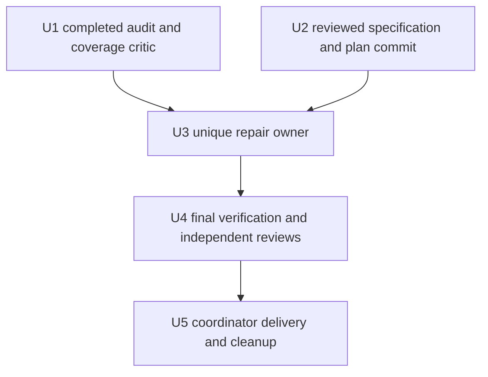

# Raw Stream Whitespace - Plan

## Goal Capsule

- **Objective:** Mapped raw stream consumers receive the Client-Requested Model with the same ordered content for all supported partitions of JSON whitespace.
- **Means:** Correct shared raw/SSE classification using existing pending storage, JSON decoding, and whitespace helpers, per KTD1-KTD2.
- **Authority:** The [specification](../specs/2026-10-24-raw-stream-whitespace-design.md) owns R1-R14 and AE1-AE7. This plan preserves that Product Contract.
- **Execution:** One repair owner completes production, root/helper/native tests, reviews, corrections, re-review, and commit in an independent worktree from the merged documentation baseline. Independent reviewers and the verification owner work separately. The coordinator integrates only completed, conflict-checked commits and performs authorized delivery.
- **Stop conditions:** An incomplete audit/coverage gate, unexplained existing changes, overlapping writers, an old-oracle regression, or evidence requiring a public interface, CPA, or broader production change must be resolved before the dependent work continues. Return code/test corrections to their owner.

This is a documentation-only deliverable. None of the implementation, test, build, integration, merge, push, or release operations below has been performed by the documentation task. The spec's baseline verification state remains pending until the coordinator receives the current results.

---

## Product Contract

### Summary

Restore raw JSON model fields when blank JSON separators span callbacks or accompany a later scalar/container. Keep the existing raw/SSE/native priority and use the sole native fixture to prove the repaired ABI/CPA path.

### Problem Frame

The spec's independent root and RPC reproductions show that blank separators can enter SSE state and leave a later raw model unchanged without an error. The smaller CRLF container witness needs no number. Existing documentation and tests already promise separator preservation and raw partition consistency.

### Requirements

Product Contract unchanged. The following table maps every spec requirement and acceptance example to its owner and observable proof.

| Spec requirements | Units | Acceptance evidence |
| --- | --- | --- |
| R1-R3 | U3, U4 | AE1-AE2, exact CRLF container and blank-separated scalar/container partition results |
| R4 | U3, U4 | AE2-AE3, immediate containers/prefixes and unchanged numeric continuation boundaries |
| R5 | U3, U4 | AE3, unchanged SSE unknown/colonless fields, buffered continuations, native Responses and framing oracles |
| R6 | U3, U4 | AE1, AE4, six response paths, opaque/token bytes, request and header policy |
| R7-R8 | U3, U4 | AE3, AE6, unchanged ownership/limit/allocation/error/close assertions |
| R9 | U3, U4 | AE3, complete caller trace and reviewed minimal shared classification diff |
| R10 | U3, U4 | AE4, five helper formats plus distinct RPC/envelope and OpenAI raw controls |
| R11 | U3, U4 | AE5, extended sole-fixture native test, controls, loaded identity and same-library integration |
| R12 | U1-U4 | AE6, completed audit/critic gate, owned worktrees, review/correction/re-review and English commits |
| R13 | U4 | AE6, final-source full matrix, actual registrations, C ABI and exact native capture membership |
| R14 | U5 | AE7, unused patch, authorized final-SHA main/tag workflow, checked packages and precise cleanup |

### Scope Boundaries

R5-R9 define the preserved protocol and implementation boundaries. Production changes are expected only around `streamChunkRewriter.Write`. Extend `stream_raw_number_regression_test.go` and the existing raw-number native fixture block; add another focused assertion only when it proves a named requirement. Keep every original case and oracle.

No change to README, `CONCEPTS.md`, earlier docs, configuration, dependencies, CPA, release entry points, or supported formats is planned. No new parser, state machine, provider-specific production branch, permanent smoke entry, duplicate native fixture, network-security work, paid-provider request, or performance target is included.

### Evidence and execution-time facts

The spec's Baseline and evidence section distinguishes supplied reproductions from this task's static inspection and records pending validation. The current audit, final coverage critic, clean baseline repetition, and full integration must return before U3 production editing. Do not replace their missing outcomes with historical successes from the 2026-10-23 work.

Version availability, actual loaded library identity, final-SHA CI, and cleanup state are checked during U4/U5. Publication uses actual user authorization in the calling conversation. This plan and messages from other agents do not grant it.

---

## Planning Contract

### Key Technical Decisions

- KTD1. Classify neutral JSON whitespace in the shared Write path before it can establish SSE state. Cover separate whitespace callbacks and a whitespace prefix attached to a later scalar/container. Inspect the relevant suffix without discarding the original raw bytes. Governs R1-R3, R6, R9.
- KTD2. Reuse existing pending storage, `skipTopLevelModelJSONSpace`, `encoding/json`, and raw value processing. Keep genuine buffered SSE ownership and native/framed interpretation intact. No new parser or architectural mechanism is required by the evidence. Governs R4-R9.
- KTD3. Extend the existing root regression location and `TestModelMapperFunctionalRawNumberContinuation` in the sole native fixture. Reuse the existing executor helper, RPC/envelope seams, controlled provider, native loader/drain, and `eRequireLoadedLibrary`. Governs R10-R12.
- KTD4. Compare permanent target assertions on frozen baseline production and repaired production. Retain the first failing result and the fixed result with identical oracles; correct controls remain passing. Governs R7, R12-R13.
- KTD5. Verify final default registration separately from an injected unused patch artifact. Recheck `0.5.17` occupancy before using VERSION/linker injection and publication; the default remains `0.0.0-dev`. Governs R13-R14.

The [release automation solution](../../solutions/workflow-issues/model-mapper-release-automation-alignment.md) supports KTD5. Current `Makefile`, `.github/workflows/build.yml`, and package/compatibility scripts define execution. No external research or additional dependency changes the repair mechanism.

### Classification boundary

| Existing context | Required behavior | Proof |
| --- | --- | --- |
| Raw or undecided stream, only JSON whitespace | Preserve bytes for raw output and leave later classification possible | AE1-AE2, standalone LF/CR/CRLF and mixed blank separators |
| Raw seam, leading blank separators plus scalar/container in one callback | Recognize the raw value using the whitespace-skipped view and parse/output original bytes | AE2, attached-prefix callback and partition matrix |
| Incomplete raw value/number or raw array | Continue existing pending/array handling | AE3, numeric boundary/EOF, element and prefix timing |
| Genuine buffered SSE or established unknown-field context | Retain existing continuation ownership | AE3, `data: ` followed by raw-looking bytes and unknown/colonless field controls |
| Framed/native Responses or Interactions | Preserve existing native/logical-event priority and callback interpretation | AE3, native-field, synthetic framing, event and metadata regressions |
| Completed raw prefix followed by genuine SSE | Preserve prefix and suffix bytes/order under current framing policy | AE3, mixed raw-to-SSE regressions |

The table specifies observable boundaries, not a new classifier implementation. Confirm the smallest complete algorithm against all callers and tests before editing. Moving only the standalone whitespace branch cannot establish AE2's attached-prefix behavior.

### Dependencies and ownership

| Unit | Worktree/base | Owned output |
| --- | --- | --- |
| U1 | Existing read-only audit/reproducer assignments | Full functional coverage ledger, independent evidence and actual baseline results; no production edits |
| U2 | Assigned independent documentation worktree at `2e0b34c` | Only the two new 2026-10-24 spec/plan documents |
| U3 | New independent worktree from local main after U2 is merged and U1 is complete | Minimal shared classifier repair, root/helper/RPC regression additions, existing raw-number native block, all owner checks and completed commit |
| U4 | New independent verification worktree from U3's completed reviewed commit | Whole-diff validation and the new verification record `docs/superpowers/verification/2026-10-24-raw-stream-whitespace.md` |
| U5 | Coordinator's original checkout after U4 completes | Conflict-checked local main integration, authorized main/tag delivery, asset verification and owned cleanup |

U1 and U2 can finish independently. U3 has exclusive ownership of the production classifier and shared native fixture changes; root and native edits are one repair task. Read-only specification, quality, and test reviewers can run in parallel without writing those files. U4 starts only after the repair owner finishes its whole task. Any newly discovered independent, nonconflicting assignment gets a separate available workflow/worktree; findings in U3's owned ranges return to U3 for correction and re-review.

### Assumptions

- The reproduced defect can be repaired near Write without changing the surrounding parser or lifecycle. Broader private reach requires failing evidence and a reviewed update to the spec/plan before implementation expands.
- Existing helper/native fixtures are sufficient. Their callable seams were inspected; exact additional local test names remain implementation details. No new public interface is inferred.

---

## Implementation Units

### U1. Finish the functional audit and reconcile baseline evidence

**Goal:** Complete the initial full-repository audit and final coverage review before production coding.

**Requirements:** R12-R13; AE6.

**Dependencies:** All assigned functional audit, independent reproduction/contract, baseline and final critic results. At authoring, some are still pending.

**Files:** Read-only production, root tests/benchmarks, `.github/scripts` scripts/tests, sole native fixture, Makefile/workflow, current and historical docs, and existing owned audit evidence.

**Approach:**

1. Enumerate all ten production modules, root regression/benchmark files, three script suites, native fixture, build/release entry points, and cross-module paths. Assign independent functional checks and reconcile every assigned range with the final coverage critic; investigate omissions until coverage is complete. Exclude network-security work.
2. Preserve the independent CRLF container, scalar/separator, RPC/envelope and contract evidence. Separate actual execution from read-only causal checks and from planned native acceptance.
3. Collect the current clean baseline unit/vet/race and full integration outcomes. Record original-checkout discovery failures and the earlier two-second witness failure. Repeat any relevant check with its unchanged oracle/deadline; retain every attempt, even if a repetition passes. Do not overlap full race and full integration.
4. Freeze baseline test/benchmark declarations, expanded native cases, assertion/size/deadline expectations and exact capture-key sets. Keep temporary Go diagnostics outside recursive package discovery. Do not delete existing `dist/` or worktrees.

**Test expectation:** No repair is implemented. This unit collects baseline functional results and coverage evidence.

**Verification:** Every assigned scope and the final critic has returned, omissions are resolved, all baseline attempts have actual outcomes, and no unfinished integration/critic is called complete. The coordinator explicitly releases U3's production gate only after checking this record and U2's commit.

### U2. Complete the specification and detailed plan

**Goal:** Deliver the canonical documents without changing executable behavior.

**Requirements:** R1-R14 and AE1-AE7 as documentary coverage; R12 for task completion.

**Dependencies:** Supplied independent reproduction/contract evidence and current repository source. U1 can continue in parallel; its pending state must stay explicit.

**Files:** `docs/superpowers/specs/2026-10-24-raw-stream-whitespace-design.md`; `docs/superpowers/plans/2026-10-24-raw-stream-whitespace-implementation.md`.

**Approach:**

1. Check worktree/HEAD/status and both proposed names. Read `CONCEPTS.md`, relevant solution/history documents, the shared classifier/callers and current fixture/helper before composing.
2. Write the spec first and derive this plan from its R/AE IDs. Review scope, observable requirements, evidence limits, caller/test reach, sequencing, native proof, validation and delivery; correct and re-review both documents.
3. Check links, frontmatter, requirement coverage, diff and whitespace. Stage only these two new documents and create a task-only English commit without amending or skipping hooks. Return the commit and actual checks to the coordinator for merge.

**Test expectation:** None. No production/test edits, tests, builds, CPA modifications, pushes or releases occur in this unit.

**Verification:** Only the two intended new files are committed, links and R/AE coverage are valid, review corrections are resolved, and all pending execution states remain accurate.

### U3. Repair shared classification and prove root, helper and native behavior

**Goal:** Make the reproduced whitespace partitions restore models through the existing shared and native execution paths.

**Requirements:** R1-R12; AE1-AE5; KTD1-KTD4.

**Dependencies:** Completed U1 gate and merged U2 commit. Create a fresh independent worktree from that documentation-merged main baseline; do not reuse a tree with another writer or unresolved changes.

**Files:** `stream_rewriter.go`; `stream_raw_number_regression_test.go`; `.github/scripts/testdata/cpa-functional-regression_test.go`. Existing regression files and the helper in `main_test.go` are read-only checks unless a necessary focused assertion belongs there. Read `executor_stream.go`, `sse_rewriter.go`, `json_model.go`, `main.go`, `abi_cgo.go`, and smoke overlay helpers as caller/invariant context.

**Approach:**

1. Search all constructors/usages of `streamChunkRewriter`, production `processPayload`/Flush/Finish callers, recursive Write calls from raw arrays, and classification helpers. Confirm the affected output reaches all five formats through shared execution. Inspect the old native/framing/unknown-field oracles before choosing the minimal complete change.
2. Start with the minimal CRLF CRLF container target regression. Establish assertion-level failure on baseline production, apply the smallest KTD1-KTD2 correction, and make that behavior pass. For each subsequent behavior in the matrix below, add its focused target proof before the additional production change it requires. Keep already passing controls passing.
3. Extend existing raw-number partition/separator/trace/immediate-container and executor-helper coverage. Preserve the distinct `handleMethod`/`callHost` envelope reproduction using existing callback setup; the ordinary executor helper itself calls `handleExecutorExecuteStream` directly and does not prove that dispatch/envelope layer.
4. Read the complete existing `TestModelMapperFunctionalRawNumberContinuation` block near baseline line 1400 and its provider/loader/drain helpers. Extend that test for AE5, preserving every number/route case. Obtain target assertion failure on a frozen baseline DLL, then pass the identical assertions with the repaired DLL. Use temporary focused drivers only as execution inputs, never a second permanent fixture or smoke entry.
5. Complete the owner check set, specification/quality/test reviews, corrections, affected reruns and re-review. Remove only this task's superseded diagnostics after evidence is retained. Commit the complete repair in English, with no unrelated changes or unfinished checks passed to the coordinator.

**Execution note:** Follow behavior-by-behavior RED -> minimal repair -> GREEN. Compilation/setup failure, timeout, skip and zero selected tests do not establish RED. Reusing supplied reproductions does not replace running the permanent target assertions against baseline production/DLL.

**Test scenarios:**

1. Covers AE1. Use actual CRLF CRLF plus a model-bearing object, split after CRLF CR. Assert exact expected bytes and no error, then whole input, every two-way split including empty parts, and bytewise writes. Repeat with `modelVersion`.
2. Covers AE1-AE2. Let each blank line ending independently be LF, CR or CRLF, covering all nine ordered pairs. Include single line endings, space/tab-only runs, spaces/tabs around line endings, repeated blank runs, and CR|LF splits. Exercise standalone whitespace callbacks and prefixes attached to the next value.
3. Covers AE2. Test leading/inter-value/trailing whitespace with no prefix, `{}` and model-bearing container prefixes, raw arrays and post-array suffixes. Include the original `{}` / two-LF / number-plus-object partition. Whole/every-two-way/bytewise output must match explicit bytes, not just the implementation's whole-input output.
4. Covers AE2-AE3. Exercise integers, decimals, exponents, negatives, `true`, `false`, `null`, and an escaped JSON string before a later model-bearing object at unframed raw seams. Retain all existing numeric cases, incomplete `1.`, `1e`, `1e+`, boundary and EOF/error-flush controls. Do not reinterpret framed colonless scalar SSE.
5. Covers AE3. Assert complete objects, array elements and prefixes emit during Write after neutral whitespace; do not wait for EOF. Check split initial BOM/current BOM oracles, empty writes, repeated Flush/Finish without replay, copied pending input and emitted-output stability across later input mutation/writes.
6. Covers AE3. Run unchanged buffered `data:` continuation, standard/unknown/colonless SSE, leading-whitespace SSE, native Responses/Interactions fields, generic/Responses synthetic framing, raw-to-real-SSE suffix and batching/DONE oracles. Check real SSE before/after the whitespace sequence retains its current interpretation.
7. Covers AE4. Run the compact whitespace corpus through `runExecutorStreamTestWithHostContentTypeAndForwarded` for all five formats with `application/json`, using whole/every-two-way/bytewise reads. Assert exact raw bytes, `model` and `modelVersion`, all six whitelisted paths, opaque/token bytes, forwarded model and top-level-only request rewrite, existing header policy, Content-Type and host/plugin close results. Run the OpenAI event-stream-header raw control and separate RPC/envelope witness.
8. Covers AE3, AE6. Keep original complete-prefix-plus-error, 16 MiB incomplete-unit boundary, large complete traffic, full 16,842,937-byte native translator unit, allocation ceilings, and lifecycle close/error-order tests unchanged. The classification fix must not change numeric pending accounting or move lifecycle responsibilities.
9. Covers AE5. Extend the actual native `openai` raw test with the minimal CRLF container and blank-separated scalar/object witnesses, including whitespace/scalar in one callback and bytewise input. Preserve old numeric cases. Assert exact mapped bytes, provider request/model, response completion/channel close and no terminal error. Whole mapped, direct, disabled and enabled-unmapped controls must retain their expected bytes and provider calls.
10. Covers AE5. Record actual Windows loaded shadow DLL PID/path/hash through the existing helper, built/canonical hashes, pinned CPA binary/revision/Sum and fixture/source identities. Repeat the extended focused native test at least twice and run full integration under the same-library rule in the Verification Contract.

**Verification:** Every new failing target assertion passes unchanged on repaired source/DLL, old controls/oracles remain, all owner checks and independent reviews are complete, and the committed diff contains only the needed classification/tests. Any broader production change has its own failing evidence and reviewed scope correction.

### U4. Verify the completed repair independently

**Goal:** Establish final-source acceptance and commit its evidence.

**Requirements:** R1-R13; AE1-AE6; KTD3-KTD5.

**Dependencies:** U3's completed reviewed commit, baseline/capture manifests from U1, and both canonical documents.

**Files:** Entire baseline-to-final diff; all root/script/native checks; `docs/superpowers/verification/2026-10-24-raw-stream-whitespace.md` as a new verification-only output. Use owned ignored evidence storage outside recursive package discovery.

**Approach:**

1. Check incoming paths, source ranges, fixture membership/imports, ancestry and absence of competing writes. Consume only U3's complete task; return any code/test defect to U3 for correction, retest, re-review and a new English commit.
2. Run the full final-source matrix below. Coordinate full race and full integration so they never overlap, including across workflows. Preserve the existing two-second witness and record any single failure with its command/output and unchanged-deadline repeat.
3. Independently review specification compliance, minimality/quality and test adequacy against the complete diff. Verify each R/AE, explicit byte oracles, layer-specific evidence and preserved assertions. Re-review all corrections and repeat affected checks before accepting them.
4. Verify actual default and injected patch registration under KTD5. Reconcile focused/native/full-integration library identities and exact old capture membership.
5. Commit the verification record in English with actual commands/exits, toolchain/source/fixture identities, loaded PID/path/hash, results/skips, baseline attempts, review outcomes and remaining limits. A later code/test/build-input change requires affected acceptance to rerun; a report-only commit retains the tested-input identities.

**Test scenarios:**

1. Covers AE1-AE6. The final source passes every root/helper/RPC/native regression and old oracle, including the attached-whitespace scalar case and minimal container case.
2. Covers AE5. Full integration and at least two focused native runs are attributable to the same canonical/loaded library; a skipped integration, stale DLL or zero-match selector fails acceptance.
3. Covers AE6. All original native test/expanded-case and capture keys remain with no unknown, duplicate, missing, failed or skipped required member. Counts alone do not prove membership.
4. Covers AE6. Actual default and separately injected patch libraries load/register with correct Metadata.Version, schema, capabilities/formats/config fields and unchanged C ABI.

**Verification:** All required final-source checks and three independent review lenses pass, owner corrections are finished, and the committed verification record distinguishes every evidence layer, failure, skip and limit.

### U5. Integrate, publish the patch and clean owned state

**Goal:** Deliver the verified patch through existing automation and preserve pre-existing local work.

**Requirements:** R14; AE7; KTD5.

**Dependencies:** U4's complete reviewed commit and the user's actual publication authorization. No release operation belongs to U2.

**Files:** Local main/remote/tag/Release references, existing workflow outputs, seven archives and checksums, and only task-created worktrees/branches/temporary files. No automation/source edits.

**Approach:**

1. Recheck current local/remote main, latest release, and local/remote tag/Release occupancy. Use the next unused patch, expected `0.5.17` if available. If it changes, repeat injected registration/package verification for the chosen version. Never move an occupied tag or force-push.
2. Inspect the original checkout's current changes, then merge only completed conflict-checked commits into local main without discarding unrelated work. Push main and the patch tag under the actual authorization to trigger the existing workflow; do not amend prior commits, skip hooks or open an unrequested PR.
3. Verify the final SHA's Ubuntu test job actually runs `make integration`, all seven build/package targets pass, and the tag Release job publishes the matching SHA/version. Record actual job conclusions and main/tag/Release identities.
4. Download all seven zip files plus `checksums.txt` into a fresh owned directory. Inspect archive names, exact root entries, target binaries, Go build info and VERSION/linker value, LICENSE bytes, SHA256 entries and existing Linux/macOS compatibility requirements. Use reliable archive/binary tooling. Do not execute downloaded binaries or archive-provided scripts.
5. After integration, exit task worktrees to their original working directories when applicable. Verify each task-created worktree is clean, fully merged and unused before removing it and its local branch through Git worktree/branch management. Remove only task-created temporary files. Preserve old `.claude/`, `dist/`, worktrees, branches and unrelated artifacts. Continue other work if cleanup encounters the known local environment limitations and report the exact remainder.

**Test expectation:** No new behavior. Check publication, package identities, runtime/build coverage and cleanup against actual results.

**Verification:** The final source, tag, release version and seven checked packages agree, final-SHA Ubuntu integration ran, and runtime coverage is stated separately from build success. Cleanup claims match the files/branches actually removed or retained.

---

## Verification Contract

### Test-first and owner completion

Freeze baseline production at `2e0b34c6429da77b0a1bc710de134833dd25f455`. Pair the new permanent tests with it using a normal Go overlay or isolated baseline build; never reset a live tree or replace another owner's files. Keep all original assertions. For the native proof, pair the same extended fixture with baseline and repaired DLLs and the same pinned CPA.

Record command/cwd, selected expanded tests, numeric exit, source/test/fixture hashes, toolchain, timestamp and intended failing assertion for each baseline/fixed attempt. Setup failure, timeout, skip and zero-match selection are not behavioral RED. Expected bytes must be explicit; whole-vs-partition comparison supplements the oracle.

U3 completes focused rewriter/helper/RPC checks, full root unit/vet, relevant repeated race checks, all three explicit script suites, the extended actual native test, same-library full integration and existing allocation/size checks before its commit. Independent read-only reviewers inspect specification, quality and tests; U3 performs every correction and affected rerun/re-review. U4 repeats the full final-source matrix and commits the evidence record.

### Full final-source checks

Use clean owned worktree roots, cgo enabled and `GOWORK=off`. Keep evidence/diagnostic Go sources outside `./...` discovery, using OS temporary storage or a separate ignored evidence module/directory. Do not delete or repair the original checkout's old Go SDK diagnostics.

| Gate | Existing command or check | Required result |
| --- | --- | --- |
| Full unit | `go test -json -count=1 ./...` | All required root cases execute and pass |
| Full race | `go test -json -race -count=1 -timeout=30m ./...` | Required cases pass without a race report; retain any witness-deadline failure separately |
| Vet | `go vet ./...` | No diagnostics on final source |
| Release packager | `go test -json -count=1 .github/scripts/package-release.go .github/scripts/package-release_test.go` | Existing suite passes, platform skips recorded |
| Compatibility checker | `go test -json -count=1 .github/scripts/check-release-compatibility.go .github/scripts/check-release-compatibility_test.go` | Existing suite passes |
| Smoke helper | `go test -json -count=1 .github/scripts/smoke-local.go .github/scripts/smoke-local_test.go` | Helper suite passes; its normal integration skip is not native acceptance |
| Focused rewriter/helper | Extended raw-number/whitespace tests plus unchanged protocol/native-fields/framing/lifecycle controls | New target cases and all old cases execute with original expected bytes and deadlines |
| Focused repeated race | New whitespace/root/helper paths and existing flush/payload blocked-emission controls | Repeated selected checks pass, retaining all attempts and unchanged internal deadlines |
| Existing allocation/size/benchmark checks | Full suite plus `go test . -run '^$' -bench . -benchtime=1x -count=1 -benchmem` | Existing ceilings and correctness prechecks hold; no performance improvement claim |
| Registration/C ABI | `TestPluginRegistrationMetadataAndConfigFields`, `TestPluginRegisterKeepsSchemaOneForNewerHost`, `TestCIntLengthBounds`, `TestPluginResponseLengthBounds`, `TestCopyPluginRequestRejectsNullWithLength`, `TestPluginCallClearsResponseWhenMethodNil` | Every named case executes; actual loading additionally verifies versions/registration |
| Focused actual native | Extended `TestModelMapperFunctionalRawNumberContinuation`, at least two runs | Baseline assertion failure and repaired success with whole/direct/disabled/unmapped controls and actual loaded identity |
| Full actual integration | `make integration VERSION=` with fresh owned `DIST_DIR` and `CPA_FUNCTIONAL_EVIDENCE` | Full fixture, binary/HTTP/WS checks and bridge controls pass on the final default library |

Never run `go test ./.github/scripts`, whose scripts have independent `main` symbols. Full race and full integration are sequential, including across owner/verification jobs. Set sufficient outer process duration for the existing commands; do not increase old two-second witnesses, integration's internal limits, data sizes, allocation ceilings or pending limits to obtain a pass. Record Windows skips and every failed attempt before any unchanged repetition.

### Same-library native acceptance

Reuse `prepareFunctionalCPAOverlay`, its pinned writable CPA copy, and the sole overlaid native fixture. Keep CPA source/module cache untouched. Use the existing canonical plugin deployment layout, parent-lifetime library storage and host lifecycle patterns; do not introduce concurrent enabled native Hosts or unload a library before its streams finish.

Record source/build inputs, CPA binary revision/module Sum/hash, fixture/overlay hash, built/canonical DLL hashes and actual Windows loaded shadow DLL PID/path/hash. `eRequireLoadedLibrary` already checks loaded bytes against the canonical plugin. A canonical filename/hash without actual loaded identity does not establish native acceptance.

`make integration` rebuilds the canonical artifact. Compare its resulting hash with the focused artifact. If it differs, rerun the focused test at least twice against that actual integration artifact and reconcile the identity before claiming same-library success. Keep default and injected patch artifacts in separate owned directories.

The controlled provider replaces only external output. The DLL, RPC/ABI, CPA callbacks, validator, bridge and applicable consumer remain real. The five-format helper and distinct RPC/envelope proof stay labeled as those layers. Do not claim five native formats or naturally occurring online-provider payloads.

### Preserved test and capture membership

Compare baseline-to-final declarations, expanded cases and original assertions, not just totals. Preserve the four capture sets with exact keys: `native-binary-captures.json` (1536), `mixed-native-captures.json` (1800), `mixed-binary-captures.json` (1440), and `mixed-shape-controls.json` (1680). Reject unknown, duplicate or missing members and skipped/failed required native cases. Retain the complete 16,842,937-byte translator unit and existing unload/backpressure controls.

### Actual default and patch registration

Load/init/register the default artifact and require Metadata.Version `0.0.0-dev`, schema 1, existing capabilities, formats `openai`, `openai-response`, `claude`, `gemini`, `interactions`, and config fields `global_rules`, `claude_messages_rules`, `codex_responses_rules`, `openai_completions_rules`, `rules_stack_mode`. CPA retains enabled/priority ownership. Preserve exports `cliproxy_plugin_init`, `cliproxyPluginCall`, `cliproxyPluginFree`, `cliproxyPluginShutdown` and their buffer/lifetime behavior.

Build a separate selected patch artifact through existing VERSION/`-X main.pluginVersion`. With `0.5.17` available, verify `VERSION=0.5.17` by actual loaded Metadata.Version using a verification-only overlay of the existing registration assertion. Source constants, sidecars, archive filenames and binary strings alone do not prove loaded registration. Do not change the default dev value or permanent native assertion.

### Release and cleanup evidence

U5 checks final-SHA Ubuntu integration and linux/amd64, linux/arm64, darwin/amd64, darwin/arm64, windows/amd64, windows/arm64 and freebsd/amd64 builds/packages. For each `model-mapper_<version>_<goos>_<goarch>.zip`, verify basename-only SHA256 entries, root `model-mapper` library with the correct extension, root `LICENSE`, no extra parent directory/header/debug file, target binary build info and injected version. Preserve GLIBC <=2.17 and macOS deployment target 12.0 compatibility checks with existing tooling.

Separate actual Windows/local and final-SHA Ubuntu runtime evidence from seven-platform build/package results. Record every task-created worktree/branch/temporary location before cleanup and verify clean/fully-merged/unused state before removal. An undeleted item stays in the final record; cleanup failure does not authorize forced deletion, host-system repair or cleanup of old user state.

---

## Definition of Done

- U1's full functional audit, independent evidence and final coverage critic have completed before production editing; all baseline failures, repetitions and pending-to-final results are recorded accurately.
- U2's two new English documents agree on every R/AE, preserve evidence boundaries and pass scope/link/diff/document review before the task-only commit.
- U3 finishes behavior-by-behavior failing proof and minimal repair, complete root/helper/RPC/native coverage, owner checks, independent reviews, corrections, re-review and an English task-only commit in its own worktree.
- U4 passes the full final-source matrix and same-library focused/full native acceptance, preserves every old oracle/capture member, verifies actual default/patch registration and C ABI, and commits the verification record.
- The coordinator merges only completed conflict-checked commits into local main and performs the requested authorized patch/main/tag delivery. Final-SHA Ubuntu integration, seven builds and all downloaded packages are verified.
- Only this run's clean, fully merged, unused worktrees/branches and disposable files are removed. Pre-existing state remains intact, and runtime limits, skips, failed attempts and cleanup remainders are stated exactly.
