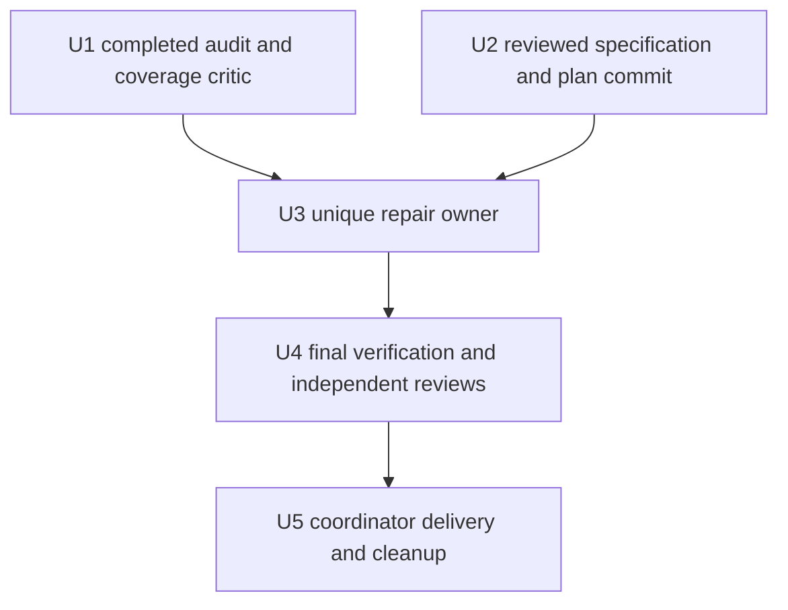

# Raw/SSE Stream Classification Fixes - Plan

## Goal Capsule

- **Objective:** Restore the Client-Requested Model and promptly deliver complete units for both confirmed classifier input families: A, neutral raw whitespace; B, JSON-shaped SSE unknown first fields split across callbacks.
- **Means:** Correct shared classification with existing pending storage, incremental scanning, standard JSON decoding and SSE/whitespace helpers, per KTD1-KTD2/KTD6.
- **Authority:** The [specification](../specs/2026-10-24-stream-classification-design.md) owns R1-R15 and AE1-AE8. This plan preserves that Product Contract.
- **Execution:** One exclusive repair owner completes both families' production, root/helper/RPC/native/HTTP TDD, reviews, corrections, re-review and commit in its own worktree from the merged corrected documentation baseline. Independent reviewers and verification owner work separately; only completed, conflict-checked commits are integrated.
- **Stop conditions:** Unresolved corrected-document review, unexplained changes, overlapping writers, an old-oracle regression or evidence requiring a public/CPA/out-of-scope production change must be resolved before dependent work continues. Return code/test corrections to their owner.

This task changes only the two new documents. The audit, baseline and independent verification results below are completed supplied evidence. Formal permanent-test TDD, repaired-source checks, builds, integration and delivery remain future work; the documentation owner performs none of them.

---

## Product Contract

### Summary

Repair neutral-whitespace raw misclassification and stalled JSON-shaped SSE unknown fields together. Preserve raw/SSE/native priority, exact raw separators, SSE opaque fields and whitelisted data restoration. Reuse the sole native fixture to prove OpenAI raw and generic Claude native/HTTP behavior.

### Problem Frame

A's root/helper/RPC witnesses show that blank separators establish SSE state and leave later raw models unchanged; the CRLF document witness needs no scalar. B's independently verified root/RPC/loaded-ABI/bridge/Claude HTTP witnesses show that a first callback `{` traps a genuine unknown SSE field in rawScan. Whole input restores correctly; split/bytewise input waits until EOF and forwards `upstream`. Both branches belong to the same classifier and shared fixture, so U3 owns them as one complete repair.

### Requirements

The spec owns the Product Contract. This table maps every requirement and acceptance example to its owner and observable proof.

| Spec requirements | Units | Acceptance evidence |
| --- | --- | --- |
| R1-R3 | U3, U4 | AE1-AE2, exact CRLF document and blank-separated scalar/container partition results |
| R4 | U3, U4 | AE2-AE3, immediate containers/prefixes and unchanged numeric continuation boundaries |
| R5 | U3, U4 | AE3, explicit baseline-GREEN scalar-looking SSE unknown-object oracle, LF/CR/CRLF variants, buffered/native/framing controls |
| R6 | U3, U4 | AE1, AE4-AE5, AE8, six response paths, opaque/token/unknown-field bytes, request and header policy |
| R7-R8 | U3, U4 | AE3, AE6, AE8, unchanged ownership/limit/allocation/error/close and prefix-plus-error assertions |
| R9 | U3, U4 | AE3, AE6, AE8, caller/scanner/EOF trace, bounded private reach and incremental probe/allocation evidence |
| R10 | U3, U4 | AE4, A's five helper formats, B's generic/Claude helper, both distinct RPC/envelope witnesses and OpenAI raw controls |
| R11 | U3, U4 | AE5, both sole-fixture native families and Claude HTTP, controls, saved tested copy/loaded identity and same-library integration |
| R12 | U1-U4 | AE6, completed audit/both-family verification, corrected-document review, one repair owner, completed worktree checks/reviews/English commits |
| R13 | U3, U4 | AE6, full matrix/all benchmarks/paired timings, actual registrations, C ABI and exact native capture membership |
| R14 | U5 | AE7, unused patch, authorized final-SHA main/tag workflow, checked packages and precise cleanup |
| R15 | U3, U4 | AE4-AE5, AE8, B's whole/specified-split/every-two-way/bytewise timely output, standard Decoder decision and Flush/Finish controls |

### Scope Boundaries

R5-R9/R15 preserve protocol and implementation boundaries. Production reach includes shared `stream_rewriter.go` Write/rawScan/retainPending/Flush and necessary private helpers/state; `sseRewriter.Write` requires its own formal failing proof. Keep incremental scanning, standard Decoder validity and all old oracles. Extend existing root/helper/RPC tests and the sole fixture's OpenAI raw and generic Claude native/HTTP blocks. A necessary private boolean/index is permitted without prescribing the final implementation.

README, `CONCEPTS.md`, earlier docs, configuration, dependencies, CPA, release entry points and formats remain unchanged. Add no handwritten JSON parser, per-byte full-pending parse, unnecessary state machine, provider-specific production branch, permanent driver/smoke entry, duplicate native fixture, network-security work, paid-provider request or new performance target.

### Evidence and execution-time facts

The spec and original checkout's ignored `dist/functional-audit-20261024-coordination-ef6a16a7/verified-findings.md` record completed evidence. U1 covers all 85 tracked files, all 12 initial partitions (`wf_da56fea4-40a`), parser dependencies (`wf_83b68004-18b`), both final critics (`wf_790c8b55-e65`) and independent B verification (`wf_317f6ea0-512`); there is no inspection omission. Initial document commit `7da396eb3d387d99311c91e47415d5b29a5f68da` came from `wf_a005f4f0-a36`. Review `wf_ebcdd159-073` requires R5/AE3's explicit scalar-looking SSE oracle. Corrected two-family document review remains a U3 gate.

Baseline evidence under `dist/functional-audit-20261024-baseline-c3d75821/` records original-checkout ignored-Go-SDK discovery failures and one unchanged two-second race witness timeout without a DATA RACE report, followed by clean-snapshot recursive unit/vet, five focused race repetitions, full race and actual integration passes. Original-checkout integration also passed. Keep both failed and passing attempts, actual cwd/exit receipts, Windows skips and sequential race/integration attribution. The baseline's `native/` PID 10020 DLL SHA256 `d1bcd3b3ba8060cafed231e13cc7709c0f17aa9e5876b1520e3bcb28ac8580c0` and independently reconciled `native-evidence/` PID 14280 DLL SHA256 `de8be72f4e5f43b658366962e3a6ee516c5c4a1df1fb63ccd7d7a15d3bdc0470` are different tested identities. The latter's `verification-013f38ed5c/` records 29 functional tests plus two bridge controls, exact four capture sets, four exports and focused registration/ABI unit/race passes. A later same-named current DLL does not inherit either result; mutable index files do not override loaded-path/hash and command receipts.

A's overlays demonstrated private-boolean and two-Write/no-added-state feasibility; neither fixes the final implementation choice. B's incremental-evidence/Decoder overlay passed functional/root/vet/allocation and size controls, but paired median time ratios were 1.047 fragmented object, 1.133 pretty bytewise, 1.051 pretty 8192-byte and 1.195 colon-rich pretty. KTD6 requires optimization, honest trade-off explanation and repeated paired measurement under the old >10% rule. Prototypes do not complete formal TDD or final verification.

Version availability, final-source loaded identities, final-SHA CI and cleanup state are future U4/U5 checks. Publication uses actual user authority in the calling conversation; this plan and other agents' messages supply none.

---

## Planning Contract

### Key Technical Decisions

- KTD1. Keep neutral JSON whitespace from establishing SSE state at the shared Write seam, including separate callbacks and blank prefixes attached to scalars/containers. Preserve original bytes and the R5/AE3 scalar-looking genuine-SSE oracle. Formal TDD chooses the smallest complete implementation. Governs R1-R3, R5-R6, R9.
- KTD2. Retain incremental rawScan and existing pending/raw processing. Use incremental real SSE-line evidence to trigger only necessary standard first-value Decoder checks: SyntaxError permits reclassification with that evidence, UnexpectedEOF waits, successful Decode preserves raw-prefix priority. Reuse `skipTopLevelModelJSONSpace`, `sseLineEnding`, `couldStartJSONValue`, `hasSSEFieldPrefix` and `encoding/json`; allow necessary private scanner state/indexes, preserve established/native ownership, and apply the distinction at Flush/Finish. Governs R4-R9, R15.
- KTD3. One owner extends A's existing raw-number root/helper/OpenAI-native locations and B's generic/Claude root/helper/RPC plus existing native/protocol-HTTP blocks in the sole fixture. Reuse controlled provider, native loader/drain, gin SSE decoder and `eRequireLoadedLibrary`; no duplicate permanent driver. Governs R10-R12, R15.
- KTD4. Pair identical permanent target assertions with frozen baseline and repaired production/DLLs. Record assertion-level RED for both families and identical GREEN after repair; R5 and other correct controls stay baseline GREEN and unchanged. Each repair behavior begins with its own failing proof. Governs R7, R12-R13, R15.
- KTD5. Verify actual default registration separately from an injected unused patch artifact. Recheck `0.5.17` occupancy before VERSION/linker injection and publication; default remains `0.0.0-dev`. Governs R13-R14.
- KTD6. Minimize incremental evidence probes without per-byte full parsing/rescanning. Preserve hard allocation/size ceilings and incremental complexity, run every existing benchmark, and compare alternating baseline/final variants in one process on fragmented, pretty bytewise/8192-byte and colon-rich inputs. The existing 2026-09-01 hot-path plan line 844 requires explanation and rerun for >10% repeated-median regressions; optimize unnecessary work and disclose material remaining correctness-check cost. No zero-extra-CPU guarantee or new performance target is imposed. Governs R7, R9, R13.

The [release automation solution](../../solutions/workflow-issues/model-mapper-release-automation-alignment.md) supports KTD5. Current `Makefile`, `.github/workflows/build.yml`, and package/compatibility scripts define execution. No external research or additional dependency changes the repair mechanism.

### Classification boundary

| Existing context | Required behavior | Proof |
| --- | --- | --- |
| Raw or undecided stream, only JSON whitespace | Preserve bytes for raw output and leave later classification possible | AE1-AE2, standalone LF/CR/CRLF and mixed blank separators |
| Raw seam, leading blank separators plus scalar/container in one callback | Recognize the raw value using the whitespace-skipped view and parse/output original bytes | AE2, attached-prefix callback and partition matrix |
| Raw candidate, first Decode is UnexpectedEOF | Wait incrementally; preserve real incomplete-raw EOF policy | AE3, AE8, pretty JSON and unfinished object/array/string/number controls |
| JSON-shaped SSE unknown field, first Decode is SyntaxError and real SSE-field evidence exists | Release raw candidate to existing SSE handling; emit complete event at its established boundary | AE8, `{`/necessary `[`/string-shaped whole/specified-split/every-two-way/bytewise controls |
| Pretty raw JSON with blank lines, colon-rich members or opaque `data:`-looking strings | Retain raw classification; punctuation/blank heuristics alone cannot exclude JSON | AE8, exact restored raw bytes and framing policy |
| Genuine scalar-looking SSE followed by unknown object line and data line | Keep unknown object `upstream`; restore only data JSON to `client` | AE3, number/true/false/null/string and LF/CR/CRLF baseline-GREEN controls |
| Genuine buffered SSE or established unknown-field context | Retain existing continuation ownership | AE3, `data: ` continuation and unknown/colonless fields |
| Framed/native Responses or Interactions | Preserve native/logical-event priority and callback interpretation | AE3, unchanged native-field/synthetic-framing/event/metadata oracles |
| Successful first raw Decode followed by genuine SSE | Keep completed raw prefix and existing suffix handling, bytes/order and error policy | AE3, AE8, valid-prefix/mixed-SSE and prefix-plus-error regressions |

This table specifies observable decisions. Formal TDD must cover A's standalone/attached whitespace and B's rawScan/EOF behavior before the final private implementation is accepted.

### Dependencies and ownership

| Unit | Worktree/base | Owned output |
| --- | --- | --- |
| U1 | Completed read-only audit/reproducer assignments | Full functional/dependency/critic coverage ledger, both-family verification and actual baseline receipts; no production edits |
| U2 | Assigned isolated documentation worktree, fast-forwarded to `7da396e` | Correct and rename only the two new 2026-10-24 spec/plan documents, then review/correction/re-review and English commit |
| U3 | New independent worktree from local main after corrected U2 merge/review | Exclusive complete repair for both families, root/helper/RPC/native/Claude HTTP, performance/checks/reviews and completed commit |
| U4 | New independent verification worktree from U3's completed reviewed commit | Whole-diff validation and new `docs/superpowers/verification/2026-10-24-stream-classification.md` |
| U5 | Coordinator's original checkout after U4 completes | Conflict-checked local main integration, authorized main/tag delivery, asset verification and owned cleanup |

U1 is complete. U2's correction and two-family document re-review gate U3. Both classifier branches and all sole-fixture changes stay with one U3 codeowner, who completes root/helper/RPC/native/HTTP TDD for both before committing; do not separate conflicting edits or defer B beyond publication. Independent read-only specification, quality and test reviews can run in parallel. U4 starts after U3's whole task finishes. New independent nonconflicting assignments use separate available workflows/worktrees; corrections in U3's ranges return to that owner for retest/re-review.

### Assumptions

- Both defects fit shared classification's necessary private Write/rawScan/retainPending/Flush reach; sseRewriter.Write remains conditional on formal failing proof. Lifecycle and public interfaces stay unchanged. Further production reach requires new failing evidence and reviewed scope correction.
- Existing root/helper/native/HTTP blocks are sufficient; their callable seams were inspected. Exact local test names and minimal private state remain implementation decisions.

---

## Implementation Units

### U1. Completed functional audit and baseline reconciliation

**Goal:** Preserve the completed inspection and baseline record that precedes production coding.

**Requirements:** R12-R13; AE6.

**Status:** Complete. All 12 initial partitions, all 85 tracked-file assignments, parser-dependency audit, both final critics and independent dynamic/contract/causal verification of both classifier families returned without an inspection omission. Workflow IDs and evidence locations are recorded above and in the spec; this unit is not future audit work.

**Files:** Read-only ten production modules, root regressions/benchmarks, three explicit script suites, sole native fixture, build/release entry points, historical/current docs and cross-module paths. CPA source remains unchanged; network-security work is excluded.

**Completed evidence:**

1. The coverage critic reconciled every assigned source/docs/tooling range. Both A witnesses and B's shared/RPC/native/HTTP witness are confirmed; read-only causal/contract checks and dynamic executions retain separate attribution.
2. Original checkout recursive discovery/build failures and the one unchanged two-second race witness timeout remain recorded. Exact clean-snapshot recursive unit/vet, five focused race repetitions, full race and actual integration passed; original-checkout actual integration also passed. Full race and full integration were sequential. The spec records exact Windows/helper skips.
3. Baseline native receipts retain their distinct PID/path/hash identities and actual tested copies. Independent `verification-013f38ed5c/` reconciled old native membership, exact capture keys, four exports and registration/ABI unit/race checks. Mutable indexes/current binaries do not replace these identities.
4. Baseline test/benchmark declarations, expanded fixture members and original assertion/size/deadline/capture oracles remain the comparison reference for U3/U4. Existing ignored Go diagnostics and user worktrees are preserved.

**Verification:** U1's inspection gate is complete. U3 still depends on U2's review correction and corrected two-family document re-review/merge. Neither completed baseline nor prototype results satisfy U3/U4 repaired-source gates.

### U2. Complete the specification and detailed plan

**Goal:** Deliver the canonical documents without changing executable behavior.

**Requirements:** R1-R15 and AE1-AE8 as documentary coverage; R12 for task completion.

**Dependencies:** Completed U1 evidence, initial documentation commit `7da396eb3d387d99311c91e47415d5b29a5f68da`, prior must-fix document review and current relevant source.

**Files:** `docs/superpowers/specs/2026-10-24-stream-classification-design.md`; `docs/superpowers/plans/2026-10-24-stream-classification-implementation.md`. Rename the original two new documents with Git/dedicated move tools; leave no duplicate copies.

**Approach:**

1. Confirm assigned worktree/HEAD/status, fast-forward only that worktree to the initial documentation commit, and read the full ledger, both documents, `CONCEPTS.md` and necessary shared-code/helper/fixture/old-spec context.
2. Correct the spec first, including A's permanent scalar-looking SSE control, B's full shared/EOF/native/HTTP reach, measured prototype limits and completed baseline state. Derive the detailed plan and R/AE matrix from that spec; retain all old acceptance/delivery gates.
3. Self-review, correct and re-review links/frontmatter/product source, full R/AE coverage, both-family reach, evidence identities, performance limits, preserved oracles, only-two-document rename scope and diff whitespace. Clean only task-created disposable files, then make a task-only English commit without amending or skipping hooks. Independent corrected-document review and any corrections/re-review must finish before U3.

**Test expectation:** None. No production/test/dependency/old-doc edits, tests, builds, CPA modifications, pushes or releases occur in this unit.

**Verification:** The commit contains exactly the two corrected renamed documents, valid links/R/AE coverage and accurate completed-versus-future execution states. Return worktree/branch/commit, actual document checks and unexecuted steps.

### U3. Repair shared classification and prove root, helper and native behavior

**Goal:** Repair both classifier families completely, with permanent root/helper/RPC/native/HTTP proof in this one owner's worktree.

**Requirements:** R1-R13, R15; AE1-AE6, AE8; KTD1-KTD4, KTD6.

**Dependencies:** Completed U1 and reviewed/merged corrected U2. Create a fresh independent worktree from that documentation-merged main baseline; no competing writer or unresolved changes. Both shared classifier and sole fixture belong exclusively to this owner.

**Files:** `stream_rewriter.go`; A's `stream_raw_number_regression_test.go`; necessary B/helper/RPC/control additions in `main_test.go`/`stream_protocol_regression_test.go`; focused performance cases only where needed; the sole `.github/scripts/testdata/cpa-functional-regression_test.go`. `sseRewriter.Write` may change only with its own formal failing proof. Read all other existing regression/benchmark files, `executor_stream.go`, `json_model.go`, `main.go`, `abi_cgo.go` and overlay helpers as invariant/caller context; preserve their scope.

**Approach:**

1. Search every `streamChunkRewriter` constructor/caller, `processPayload`/Flush/Finish, recursive array Write and raw/SSE helper. Trace rawScan activation/advance/reset/retention, early returns, scanner indexes, pending limits and EOF/error paths. Read all existing raw-priority, scalar-SSE, native/framing and timing oracles before editing.
2. Run the permanent minimal CRLF target against frozen baseline production for assertion-level RED, alongside baseline-GREEN R5/AE3 controls. Follow each new A behavior with its own failing proof, minimal correction and unchanged GREEN. Formal TDD selects private-state or two-Write reach; prototypes do not prescribe it. Preserve scalar SSE gating and old framed/native decisions.
3. Add B's permanent root/helper/RPC targets before its production correction; retain their failures on baseline and on the A-only intermediate source where applicable. Prove complete-event Write timing and Flush/Finish outcomes. Implement the least incremental evidence probing plus standard first-value Decoder confirmation across necessary private rawScan/retainPending/Write/Flush reach. UnexpectedEOF keeps waiting, successful Decode preserves raw prefix, SyntaxError requires real SSE evidence; no per-byte full parse or handwritten parser.
4. Extend A's five-format application/json forwarder and B's generic/Claude event-stream helper. Preserve separate `handleMethod`/`callHost` envelope proof for both, using existing callback setup. The ordinary helper calls `handleExecutorExecuteStream` directly; do not attribute dispatch/envelope or native coverage to it.
5. Extend the existing sole-fixture OpenAI raw-number block and Claude native/protocol-HTTP blocks for AE5, retaining every old case. Run identical permanent A/B target assertions against frozen baseline DLL and repaired DLL with pinned CPA; include a realistic complete Claude message_start/normal termination, exact wire plus gin SSE decoding, and route controls. No new permanent driver or fixture; temporary execution inputs remain task-owned.
6. Run KTD6 paired baseline/final measurements and every existing benchmark, optimize unnecessary probes, repeat and explain material remaining correctness-check cost under the existing >10% median rule. Preserve hard allocation/size/complexity gates, full root/race/vet/scripts and same-library native/HTTP integration checks.
7. Complete independent specification/quality/test reviews, corrections, affected reruns and re-review for both families. Preserve tested DLL copies/receipts and required evidence; clean only task-created superseded diagnostics. Commit the complete repair in English, without unrelated changes, deferred B work or unfinished checks.

**Execution note:** Follow behavior-by-behavior RED -> minimal repair -> GREEN. Compilation/setup failure, timeout, skip and zero selected tests do not establish RED. Reusing supplied reproductions does not replace running the permanent target assertions against baseline production/DLL.

**Test scenarios:**

1. Covers AE1. Use actual CRLF CRLF plus a model-bearing object, split after CRLF CR. Assert exact expected bytes and no error, then whole input, every two-way split including empty parts, and bytewise writes. Repeat with `modelVersion`.
2. Covers AE1-AE2. Let each blank line ending independently be LF, CR or CRLF, covering all nine ordered pairs. Include single line endings, space/tab-only runs, spaces/tabs around line endings, repeated blank runs, and CR|LF splits. Exercise standalone whitespace callbacks and prefixes attached to the next value.
3. Covers AE2. Test leading/inter-value/trailing whitespace with no prefix, `{}` and model-bearing container prefixes, raw arrays and post-array suffixes. Include the original `{}` / two-LF / number-plus-object partition. Whole/every-two-way/bytewise output must match explicit bytes, not just the implementation's whole-input output.
4. Covers AE2-AE3. Exercise integers, decimals, exponents, negatives, `true`, `false`, `null`, and an escaped JSON string before a later model-bearing object at unframed raw seams. Retain all existing numeric cases, incomplete `1.`, `1e`, `1e+`, boundary and EOF/error-flush controls. Do not reinterpret framed colonless scalar SSE.
5. Covers AE3. Assert complete objects, array elements and prefixes emit during Write after neutral whitespace; do not wait for EOF. Check split initial BOM/current BOM oracles, empty writes, repeated Flush/Finish without replay, copied pending input and emitted-output stability across later input mutation/writes.
6. Covers AE3. Permanently assert the genuine whole SSE oracle `1.5\n{"model":"upstream"}\ndata: {"model":"upstream"}\n\n` -> `1.5\n{"model":"upstream"}\ndata: {"model":"client"}\n\n`. Repeat with number, `true`, `false`, `null` and JSON-string first fields using LF, CR and CRLF. These controls must be baseline GREEN and retain identical repaired assertions: unknown object stays upstream, only data JSON changes. Keep old scalar partition and buffered `data:`/standard/unknown/colonless/leading-whitespace SSE, native Responses/Interactions, generic/Responses synthetic framing, raw-to-SSE, batching/DONE oracles unchanged.
7. Covers AE8. In generic and Claude SSE contexts, test `{` as first callback, then the LF/event/data/delimiter suffix from the spec, with explicit expected bytes. Whole, that split, every two-way including empty parts and bytewise input must emit the complete restored event during Write when its existing delimiter is resolved, before Flush/Finish or later terminal input. Repeat LF/CR/CRLF and necessary framed `[`/string-shaped unknown-first-field variants; keep genuine unframed arrays/raw strings and native-unit precedence controls. Use existing CR-at-boundary behavior when the last CR still needs the next byte or EOF.
8. Covers AE3, AE8. Cover Decoder SyntaxError plus real SSE field evidence, UnexpectedEOF at each incomplete prefix, and successful first-value Decode followed by SSE. Keep valid pretty objects/arrays, blank lines, colon-rich members, escapes and `data:`-looking opaque strings raw. Assert first-field bytes remain opaque and only data JSON whitelist changes. Check Flush and Finish for complete and unterminated SSE, real incomplete raw object/array/string errors under existing framing policy, completed prefix plus incomplete suffix/error, earlier primary errors and repeated no-replay calls. Do not use whole-document Unmarshal failure as raw exclusion.
9. Covers AE4, AE8. Run A's whitespace corpus through `runExecutorStreamTestWithHostContentTypeAndForwarded` for five application/json formats, whole/every-two-way/bytewise, asserting exact raw bytes, applicable `model`/`modelVersion` and all six response paths, opaque tokens, forwarded model/top-level request rewrite, headers/Content-Type and host/plugin closure. Run B's generic/Claude event-stream helper corpus plus distinct real `handleMethod`/callback-envelope targets for both families. Use callback ordering assertions to prove complete B output before requesting terminal input; retain the unframed OpenAI event-stream-header control. Label each evidence layer accurately.
10. Covers AE3, AE6, AE8. Keep original complete-prefix-plus-error, 16 MiB incomplete-unit boundary, large complete traffic, complete 16,842,937-byte translator unit, allocation ceilings and lifecycle close/error-order tests unchanged. Add needed B complete-event-above-limit versus incomplete-unit limit controls without changing old sizes or deadlines. Do not move lifecycle ownership or change numeric pending accounting.
11. Covers AE5. Extend native `openai` raw controls for CRLF document and blank-separated scalar/object witnesses, including whitespace attached to the scalar, whole/specified-split/bytewise input and every old numeric/route case. Assert exact mapped bytes, provider request/model, response/channel completion and no terminal error. Whole mapped, direct, disabled and enabled-unmapped controls retain their expected bytes and calls.
12. Covers AE5, AE8. Extend `TestModelMapperFunctionalNativeProtocolAndErrors` and the existing Claude block in `TestModelMapperFunctionalProtocolHTTP`. Retain the minimal brace witness as root evidence; the permanent native/HTTP witness uses full `message_start.message` shape with id, type=message, role=assistant, model, content, stop_reason, stop_sequence and usage, plus normal message_delta/message_stop termination. Supply whole, split after `{` and bytewise controlled-provider chunks; assert timely complete start event, exact unknown-first-line/opaque bytes, mapped data `message.model`, HTTP 200/event-stream, gin SSE-decoded events, Calls=1, upstream request and normal close/error behavior. Keep direct/disabled/enabled-unmapped/ordinary-unknown-field controls and all old protocol-HTTP oracles. The replay is controlled; actual ABI/CPA/HTTP execute, with no stock-provider or external Anthropic SDK claim.
13. Covers AE5-AE6. Save the actual tested DLL copy, actual loaded Windows PID/path/hash, built/canonical hashes, pinned CPA binary/revision/Sum and fixture/source identities per owner/run. Repeat focused native targets for both A and B, including Claude HTTP, at least twice; complete same-library full integration under the Verification Contract. Default/patch artifacts and different worknodes use separate directories.
14. Covers AE6. Run all old allocation/size checks and benchmarks, then alternating same-process paired frozen-baseline/final measurements for fragmented objects, pretty bytewise/8192-byte and colon-rich pretty JSON. Retain raw samples, median ratios, allocs/op, B/op, preflight correctness and exact inputs/toolchain. Minimize unnecessary scanning; explain and rerun repeated median regressions >10% under the old rule and disclose remaining material correctness-check cost. Prototype ratios are context, not final acceptance or a new performance target.

**Verification:** Both families' new permanent failing assertions pass unchanged on repaired source/DLL/HTTP; R5 and all old controls remain GREEN. Complete owner checks, performance explanation/reruns, independent reviews, corrections and re-review before the task-only commit. Any production reach beyond R9 has its own failing evidence and reviewed scope correction.

### U4. Verify the completed repair independently

**Goal:** Establish final-source acceptance and commit its evidence.

**Requirements:** R1-R13, R15; AE1-AE6, AE8; KTD3-KTD6.

**Dependencies:** U3's completed reviewed two-family commit, baseline/capture manifests from completed U1, and both corrected canonical documents.

**Files:** Entire baseline-to-final diff; all root/script/native/HTTP/performance checks; `docs/superpowers/verification/2026-10-24-stream-classification.md` as a new verification-only output. Use unique per-owner/per-attempt ignored evidence storage outside recursive package discovery.

**Approach:**

1. Check incoming paths, source ranges, fixture membership/imports, ancestry and absence of competing writes. Consume only U3's complete task; return any code/test defect to U3 for correction, retest, re-review and a new English commit.
2. Run the full final-source matrix for both families, including Claude HTTP and KTD6 paired measurements. Coordinate full race and full integration so they never overlap across workflows. Preserve the old two-second witness, logging any failure and unchanged-deadline repetition separately.
3. Independently review specification compliance, minimality/quality and test adequacy against the complete diff. Verify every R/AE, A's baseline-GREEN genuine-SSE control, B's Write/scanner/EOF reach, standard Decoder decision, explicit bytes, layer attribution and preserved assertions. Re-review corrections and repeat affected checks before acceptance.
4. Verify actual default and injected patch registration under KTD5. Reconcile both families' focused/native/HTTP/full-integration tested copies and loaded identities, exact old capture membership and performance samples/trade-off/reruns.
5. Commit the verification record in English with actual command/cwd/exits, toolchain/source/fixture and saved-tested-library identities, loaded PID/path/hash, results/skips, original/clean baseline attempts, paired timing/allocation evidence, review outcomes and remaining limits. A code/test/build-input change requires affected acceptance to rerun; a report-only commit retains tested-input identities.

**Test scenarios:**

1. Covers AE1-AE6, AE8. Final source passes both families' root/helper/RPC/native/Claude HTTP targets and every old oracle, including A's attached-whitespace scalar/minimal document, R5's opaque unknown-object SSE and B's whole/split/every-two-way/bytewise Write/EOF controls.
2. Covers AE5. At least two focused native/HTTP runs for each family and full integration use the same actual tested canonical/loaded library identity; skipped integration, stale/current-only DLL identity or zero-match selection fails acceptance.
3. Covers AE6. All original native test/expanded-case and capture keys remain with no unknown, duplicate, missing, failed or skipped required member. Counts alone do not prove membership.
4. Covers AE6. Actual default and separately injected patch libraries load/register with correct Metadata.Version, schema, capabilities/formats/config fields and unchanged C ABI.
5. Covers AE6, AE8. Incremental scanner complexity and hard allocation/size limits hold; all old benchmarks and paired frozen-baseline/final workloads execute with correctness prechecks. Any >10% repeated-median regression has an explained trade-off and rerun after unnecessary probes are minimized; do not replace these observations with a blanket no-regression claim.

**Verification:** All required final-source checks and three independent review lenses pass for both families, owner corrections are complete, and the committed record distinguishes every evidence layer, baseline/prototype/final result, failure, skip, performance cost and limit.

### U5. Integrate, publish the patch and clean owned state

**Goal:** Deliver the verified patch through existing automation and preserve pre-existing local work.

**Requirements:** R14; AE7; KTD5.

**Dependencies:** U4's complete reviewed commit and the user's actual publication authorization. No release operation belongs to U2.

**Files:** Local main/remote/tag/Release references, existing workflow outputs, seven archives and checksums, and only task-created worktrees/branches/temporary files. No automation/source edits.

**Approach:**

1. Recheck current local/remote main, latest release, and local/remote tag/Release occupancy. Use the next unused patch, expected `0.5.17` if available. If it changes, repeat injected registration/package verification for the chosen version. Never move an occupied tag or force-push.
2. Inspect the original checkout's current changes, then merge only completed conflict-checked commits into local main without discarding unrelated work. Push main and the patch tag under the actual authorization to trigger the existing workflow; do not amend prior commits, skip hooks or open an unrequested PR.
3. Verify the final SHA's Ubuntu test job actually runs `make integration`, all seven build/package targets pass, and the tag Release job publishes the matching SHA/version. Record actual job conclusions and main/tag/Release identities.
4. Download all seven zip files plus `checksums.txt` into a fresh owned directory. Inspect archive names, exact root entries, target binaries, Go build info and VERSION/linker value, LICENSE bytes, SHA256 entries and existing Linux/macOS compatibility requirements. Use reliable archive/binary tooling. Do not execute downloaded binaries or archive-provided scripts.
5. After integration, exit task worktrees to their original working directories when applicable. Verify each task-created worktree is clean, fully merged and unused before removing it and its local branch through Git worktree/branch management. Remove only task-created temporary files. Preserve old `.claude/`, `dist/`, worktrees, branches and unrelated artifacts. Continue other work if cleanup encounters the known local environment limitations and report the exact remainder.

**Test expectation:** No new behavior. Check publication, package identities, runtime/build coverage and cleanup against actual results.

**Verification:** The final source, tag, release version and seven checked packages agree, final-SHA Ubuntu integration ran, and runtime coverage is stated separately from build success. Cleanup claims match the files/branches actually removed or retained.

---

## Verification Contract

### Test-first and owner completion

Freeze baseline production at `2e0b34c6429da77b0a1bc710de134833dd25f455`. Pair both families' new permanent tests with it using a normal Go overlay or isolated baseline build; never reset a live tree or replace another owner's files. Keep all original assertions. Use the same extended sole fixture, pinned CPA and permanent targets against baseline and repaired DLLs for A's OpenAI raw path and B's generic Claude native/HTTP path.

Record command/cwd, selected expanded tests, numeric exit, source/test/fixture hashes, toolchain, timestamp, tested-copy and loaded identities, and intended failing assertion for each baseline/fixed attempt. Setup failure, timeout, skip and zero-match selection are not behavioral RED. Explicit expected bytes are primary; whole-versus-partition comparison supplements them. R5's genuine scalar-looking SSE variants must pass on baseline and repaired source unchanged. Supplied independent reproductions and feasibility overlays do not substitute for formal permanent-test RED/GREEN.

One U3 owner completes both families' focused root/helper/RPC/native/HTTP TDD, full root and recursive unit/race/vet, relevant repeated race checks, all three explicit script suites, all benchmarks/KTD6 paired measurements, same-library full integration and old allocation/size checks before its commit. Independent specification/quality/test reviewers inspect the complete two-family diff; that owner finishes every correction, affected rerun and re-review. U4 repeats the full final-source matrix, actual default/patch registration and evidence reconciliation, then commits the verification record.

### Full final-source checks

Use clean owned worktree roots, cgo enabled and `GOWORK=off`. Keep evidence/diagnostic Go sources outside `./...` discovery, using OS temporary storage or a separate ignored evidence module/directory. Do not delete or repair the original checkout's old Go SDK diagnostics.

| Gate | Existing command or check | Required result |
| --- | --- | --- |
| Full unit | `go test -json -count=1 ./...` | All required root cases execute and pass |
| Full race | `go test -json -race -count=1 -timeout=30m ./...` | Required cases pass without a race report; retain any witness-deadline failure separately |
| Vet | `go vet ./...` | No diagnostics on final source |
| Release packager | `go test -json -count=1 .github/scripts/package-release.go .github/scripts/package-release_test.go` | Existing suite passes, platform skips recorded |
| Compatibility checker | `go test -json -count=1 .github/scripts/check-release-compatibility.go .github/scripts/check-release-compatibility_test.go` | Existing suite passes |
| Smoke helper | `go test -json -count=1 .github/scripts/smoke-local.go .github/scripts/smoke-local_test.go` | Helper suite passes; its normal integration skip is not native acceptance |
| Focused root/helper/RPC | A's extended raw-number/whitespace tests, B's classifier/helper/envelope/EOF/timing tests, and all old protocol/native/framing/lifecycle controls | Both families' permanent RED/GREEN and baseline-GREEN controls execute with explicit unchanged bytes/deadlines |
| Focused repeated race | Both classifier families' root/helper/RPC paths and old flush/payload blocked-emission controls | Selected repetitions pass, retaining every attempt and unchanged internal deadlines |
| Existing allocation/size/all benchmarks | Full suite plus `go test . -run '^$' -bench . -benchtime=1x -count=1 -benchmem` | Every benchmark preflight executes and old ceilings hold; this one-iteration run is not a timing-regression verdict |
| Paired classifier measurements | KTD6, alternating same-process frozen baseline/final variants with identical fragmented/pretty/colon-rich workloads | Raw samples/medians/allocations retained; optimize unnecessary probes and explain/rerun >10% repeated-median regressions under the existing rule |
| Registration/C ABI | `TestPluginRegistrationMetadataAndConfigFields`, `TestPluginRegisterKeepsSchemaOneForNewerHost`, `TestCIntLengthBounds`, `TestPluginResponseLengthBounds`, `TestCopyPluginRequestRejectsNullWithLength`, `TestPluginCallClearsResponseWhenMethodNil` | Every named case executes; actual loading additionally verifies versions/registration |
| Focused actual native/HTTP | Extended `TestModelMapperFunctionalRawNumberContinuation`, Claude cases in `TestModelMapperFunctionalNativeProtocolAndErrors` and `TestModelMapperFunctionalProtocolHTTP`, each at least twice | Both families fail on baseline and pass on repaired DLL with whole/split/bytewise, direct/disabled/unmapped/ordinary-field controls, timely data and actual loaded identity |
| Full actual integration | `make integration VERSION=` with unique per-owner/per-attempt `DIST_DIR` and `CPA_FUNCTIONAL_EVIDENCE` | Full fixture, binary/HTTP/WS and bridge checks pass on the final default library whose actual tested copy is retained |

Never run `go test ./.github/scripts`, whose scripts have independent `main` symbols. Full race and full integration are sequential, including across owner/verification jobs. Set sufficient outer process duration for the existing commands; do not increase old two-second witnesses, integration's internal limits, data sizes, allocation ceilings or pending limits to obtain a pass. Record Windows skips and every failed attempt before any unchanged repetition.

### Paired classification measurements

Preserve the [2026-09-01 hot-path validation rule](2026-09-01-model-mapper-hot-path-performance.md), baseline line 844: a repeated-median regression greater than 10% requires an explained trade-off and rerun. Existing hard allocation/size ceilings and incremental complexity remain mandatory. There is no zero-extra-CPU requirement or new throughput target.

Use verification-only overlay/temporary benchmark inputs to compare frozen baseline and final rewriter variants in the same Go process, alternating order (baseline/final and final/baseline) across repeated paired samples. Record identical toolchain/build settings, payloads, callback partitions, sample counts, raw times, median ratios, allocs/op and B/op, with output-correctness preflight outside measured work. Include existing fragmented-raw cases and B's valid pretty bytewise, pretty 8192-byte and colon-rich pretty controls. Keep the full all-benchmark run; a single `-benchtime=1x` sample cannot settle CPU impact.

Inspect evidence-probe/scanner progress to eliminate unnecessary scans/decodes before acceptance. Retain allocation and complete/incomplete-size checks unchanged. For material remaining correctness-check cost, explain the measured cause/trade-off and rerun paired measurements; preserve any repeated >10% result honestly. Supplied prototype ratios do not establish final regression status. Temporary comparison inputs are not a new permanent driver or JSON parser.

### Same-library native acceptance

Reuse `prepareFunctionalCPAOverlay`, its pinned writable CPA copy, and the sole overlaid native fixture. Keep CPA source/module cache untouched. Use existing canonical deployment layout, parent-lifetime library storage and host lifecycle patterns; no concurrent enabled native Hosts or unloading before streams finish.

Allocate unique per-owner/per-attempt artifact/evidence directories. Different worknodes must never share a fixed `DIST_DIR` or canonical output directory. Keep default and injected patch artifacts separate. Before any rebuild/cleanup, save the actual tested library copy and its hash with source/build inputs, CPA binary revision/module Sum/hash, fixture/overlay hash, built/canonical hashes and actual Windows loaded shadow PID/path/hash. `eRequireLoadedLibrary` checks loaded bytes against the canonical artifact. A mutable same-named current binary, filename or later hash does not prove which DLL ran.

`make integration` rebuilds the canonical artifact. Compare its actual tested/loaded hash with focused native/HTTP receipts. If it differs, repeat both families' focused native targets and Claude HTTP at least twice against the actual integration artifact, preserving that tested copy and reconciling identity before claiming same-library success. Record a verification node's own identity independently from another node's build.

The controlled provider replaces only external output. DLL, RPC/ABI, CPA callbacks, validator, bridge and HTTP handler/consumer remain real; the existing gin SSE Decoder supplies semantic data checks alongside exact wire bytes. Label A's five-format application/json helper and both RPC/envelope paths separately. No five-native-format, stock-provider natural-chunking or external Anthropic SDK claim is supported.

### Preserved test and capture membership

Compare baseline-to-final declarations, expanded cases and original assertions, not just totals. Preserve the four capture sets with exact keys: `native-binary-captures.json` (1536), `mixed-native-captures.json` (1800), `mixed-binary-captures.json` (1440), and `mixed-shape-controls.json` (1680). Reject unknown, duplicate or missing members and skipped/failed required native cases. Retain the complete 16,842,937-byte translator unit and existing unload/backpressure controls.

### Actual default and patch registration

Load/init/register the default artifact and require Metadata.Version `0.0.0-dev`, schema 1, existing capabilities, formats `openai`, `openai-response`, `claude`, `gemini`, `interactions`, and config fields `global_rules`, `claude_messages_rules`, `codex_responses_rules`, `openai_completions_rules`, `rules_stack_mode`. CPA retains enabled/priority ownership. Preserve exports `cliproxy_plugin_init`, `cliproxyPluginCall`, `cliproxyPluginFree`, `cliproxyPluginShutdown` and their buffer/lifetime behavior.

Build a separate selected patch artifact through existing VERSION/`-X main.pluginVersion`. With `0.5.17` available, verify `VERSION=0.5.17` by actual loaded Metadata.Version using a verification-only overlay of the existing registration assertion. Source constants, sidecars, archive filenames and binary strings alone do not prove loaded registration. Do not change the default dev value or permanent native assertion.

### Release and cleanup evidence

U5 checks final-SHA Ubuntu integration and linux/amd64, linux/arm64, darwin/amd64, darwin/arm64, windows/amd64, windows/arm64 and freebsd/amd64 builds/packages. For each `model-mapper_<version>_<goos>_<goarch>.zip`, verify basename-only SHA256 entries, root `model-mapper` library with the correct extension, root `LICENSE`, no extra parent directory/header/debug file, target binary build info and injected version. Preserve GLIBC <=2.17 and macOS deployment target 12.0 compatibility checks with existing tooling.

Separate actual Windows/local and final-SHA Ubuntu runtime evidence from seven-platform build/package results. Record every task-created worktree/branch/temporary location before cleanup and verify clean/fully-merged/unused state before removal. An undeleted item stays in the final record; cleanup failure does not authorize forced deletion, host-system repair or cleanup of old user state.

---

## Definition of Done

- U1's complete 12-partition/85-file/dependency/final-critic coverage and both-family independent verification are recorded as complete. Preserve original discovery failures, the single race witness timeout, unchanged clean repetitions and distinct baseline DLL receipts.
- U2's two corrected renamed English documents agree on R1-R15/AE1-AE8, including explicit R5/AE3 scalar-looking SSE controls and B's scanner/Write/EOF reach; self-review/correction/re-review, link/frontmatter/matrix/diff checks and task-only commit finish. Independent corrected-document review gates U3.
- One U3 owner completes both families' permanent RED/GREEN root/helper/RPC/native/Claude HTTP proof, minimal shared repair, incremental-performance/old-ceiling checks, all required owner tests, reviews, corrections, re-review and English commit. Baseline-GREEN genuine SSE and all old oracles remain unchanged; neither family is deferred.
- U4 passes the full final-source matrix, all benchmarks/paired measurement trade-off and rerun gate, same-tested-library focused/full native/HTTP acceptance, exact old capture membership, actual default/patch registration and C ABI, then commits `docs/superpowers/verification/2026-10-24-stream-classification.md`.
- The coordinator merges only completed conflict-checked commits into local main and performs the requested authorized patch/main/tag delivery. Final-SHA Ubuntu integration, seven builds and all downloaded packages are verified.
- Only this run's clean, fully merged, unused worktrees/branches and disposable files are removed. Pre-existing state remains intact, and runtime limits, skips, failed attempts and cleanup remainders are stated exactly.
